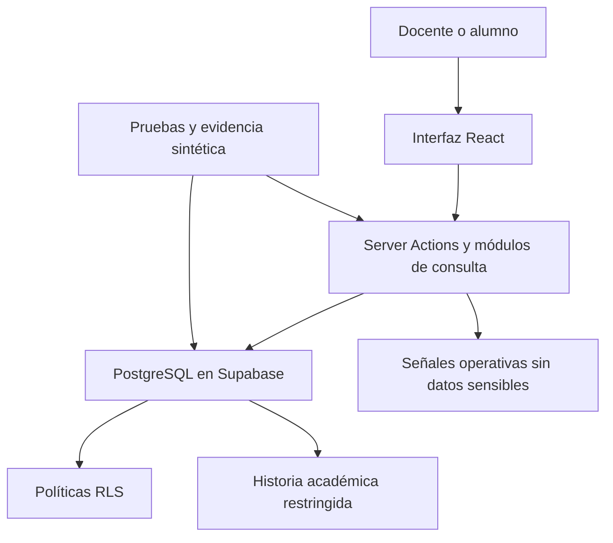

# 5. Arquitectura, modelo de datos, seguridad y controles

## 5.1 Arquitectura propuesta

Se mantiene una aplicación full-stack única. No se incorpora un backend independiente porque las fronteras existentes pueden profundizarse sin duplicar autenticación, despliegue ni contratos.

### Responsabilidades

1. **Interfaz React:** captura entradas explícitas, impide doble envío, conserva el ID de operación, muestra progreso y errores, y cumple criterios de accesibilidad.
2. **Servidor Next.js:** autentica, normaliza datos, comprueba el caso de uso, invoca operaciones confiables, traduce errores y emite señales seguras.
3. **PostgreSQL/Supabase:** aplica RLS, propiedad del curso, coherencia entre entidades, rangos, unicidad, intervalos no solapados, atomicidad e idempotencia.
4. **Pruebas/evidencia:** usa identidades sintéticas, ejecuta casos directos de RLS y recorridos de usuario, y registra entorno, versión y resultado.

## 5.2 Modelo existente y limitación

Actualmente existen perfiles, periodos, cursos, grupos, alumnos autorizados, matrículas, movimientos de puntos, evaluaciones y notas grupales. La nota admite 0–20 y la pareja grupo/evaluación es única. Sin embargo, `course_students.group_id` conserva solo el grupo actual; las evaluaciones no guardan un instante académico suficiente y el upsert de notas no preserva correcciones. Por tanto, el esquema actual no explica correctamente traslados ni correcciones históricas.

## 5.3 Extensiones propuestas

| Entidad | Propósito | Restricciones principales |
|---|---|---|
| `course_student_group_memberships` | Historia temporal de grupo por matrícula. | Intervalos `[inicio, fin)`, sin solapamientos, un máximo de uno abierto y mismo curso. |
| `course_evaluations` extendida | Instante de actividad y estado. | `occurred_at` con zona horaria; `defined`, `partial`, `conciled`; revisión para legados. |
| `group_grades` extendida | Nota vigente. | Una por grupo/evaluación, 0–20, mismo curso y escritura confiable. |
| `group_grade_corrections` | Auditoría inmutable de correcciones. | Valor anterior/nuevo, docente, operación e instante; solo anexar. |
| `academic_operations` | Idempotencia y evidencia segura. | UUID global, actor, huella, estado y resultado estable; sin nota ni datos personales. |
| `evaluation_reconciliations` | Evidencia de completitud. | Conteos coherentes; conciliada solo sin faltantes inexplicados. |
| `evaluation_exceptions` | Excepción grupal explícita. | No sustituye una nota ni implementa corrección individual. |

## 5.4 Relaciones e invariantes

- Un periodo agrupa cursos y cada curso tiene un docente responsable.
- Autorización, matrícula, grupo, evaluación y nota deben coincidir en curso.
- Una matrícula posee una línea temporal de pertenencias no solapadas.
- Una evaluación pertenece a un curso y tiene instante académico.
- Una nota vigente pertenece a una pareja grupo-evaluación y sus correcciones son inmutables.
- Los puntos son individuales y nunca intervienen en el cálculo de la nota.
- Un reintento con el mismo identificador no duplica cambios.
- Una alteración relevante invalida o reemplaza la conciliación anterior sin borrar historia.

## 5.5 Seguridad y autorización

El inicio de sesión con Google prueba identidad, no responsabilidad académica. Para modificar una nota se requieren sesión válida, rol docente, responsabilidad sobre el curso, coherencia entre grupo y evaluación y autorización tanto en servidor como en RLS. Los alumnos no deben leer notas grupales en esta entrega.

La denegación es el comportamiento predeterminado. Los secretos permanecen fuera del repositorio y el navegador. Las evidencias y señales no incluyen nombres, correos, notas ni credenciales. RLS es una capa de defensa, pero debe complementarse con privilegios, restricciones, funciones transaccionales y pruebas de acceso directo.

## 5.6 Controles propuestos para Parte II

- Supabase local o proyecto aislado para pruebas destructivas.
- Pruebas SQL de RLS, rangos, coherencia, concurrencia, historia e idempotencia.
- Pruebas TypeScript de importación, normalización y resultados.
- Pruebas de navegador de los recorridos críticos y accesibilidad.
- Señales estructuradas con ID de operación y categorías seguras.
- Conciliación entre grupos esperados, calificados, faltantes y excepciones.
- CI con lint, tipos, pruebas y build, una vez configurado.
- Verificación separada de respaldos y restauración; no se asume por usar Supabase.

Estos controles son un plan de trabajo. Salvo la prueba RLS local documentada, no representan controles ya verificados.
