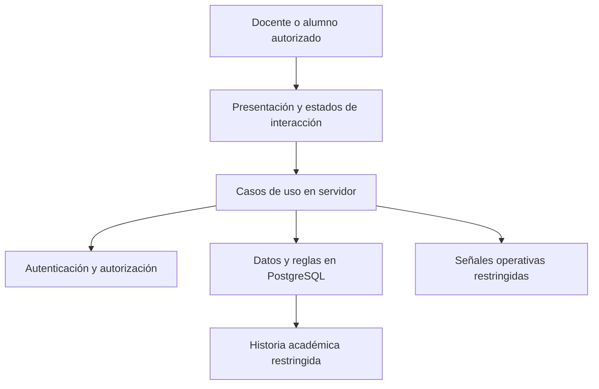

# 5. Diseño de arquitectura, información y controles

## 5.1 Alternativa arquitectónica propuesta

Se propone una aplicación web full-stack única con separación lógica entre presentación, casos de uso y persistencia. Next.js/React, Supabase y PostgreSQL se consideran una alternativa técnica compatible con las referencias examinadas, no una arquitectura ya implementada por este trabajo. La propuesta no necesita un servicio independiente: agregaría comunicación y límites de seguridad sin una necesidad identificada. La pertinencia de esta elección frente al criterio de «tendencia de arquitectura» de la guía debe confirmarse con el docente.

La presentación recogería datos, mostraría errores y permitiría reintentar. El servidor comprobaría identidad, responsabilidad y entradas y coordinaría las operaciones. La base de datos protegería coherencia, rangos, unicidad e historia. Estas responsabilidades son decisiones de diseño pendientes de construcción y prueba.

## 5.2 Modelo conceptual propuesto

| Entidad                  | Relación y función                                                           |
| ------------------------ | ---------------------------------------------------------------------------- |
| Identidad y perfil       | Identifica a la persona y su rol general; no concede acceso universal        |
| Periodo y curso          | Un periodo reúne cursos; cada curso tiene un docente responsable             |
| Autorización de alumno   | Habilitación previa para una identidad en un curso                           |
| Matrícula                | Vincula cuenta autorizada y curso; puede estar activa o inactiva             |
| Grupo                    | Pertenece a un curso y tiene capacidad y estado                              |
| Pertenencia temporal     | Vincula matrícula y grupo durante un intervalo, incluido el estado sin grupo |
| Movimiento de puntos     | Registro individual separado de las notas; contempla anulación sin borrado   |
| Evaluación grupal        | Actividad del curso con nombre y fecha/hora de realización                   |
| Nota grupal              | Valor vigente por grupo y evaluación; no se duplica como nota por alumno     |
| Corrección grupal        | Conserva transición anterior/nueva, docente e instante                       |
| Operación                | Identifica una intención de cambio y permite recuperar su resultado          |
| Conciliación y excepción | Explican grupos esperados, notas, faltantes e incidencias                    |

El modelo lógico de referencia está en `specs/001-manage-group-evaluation/data-model.md`. Sus nombres de tablas y contratos orientan el diseño; el informe no requiere un inventario de migraciones ni un plan de adaptación de código previo.

## 5.3 Pertenencia histórica e invariantes

Se proponen intervalos `[inicio, fin)`: el inicio se incluye y el fin se excluye. Un traslado cerraría el intervalo anterior y abriría el siguiente en una misma transacción. El grupo aplicable se resolvería con el instante de la actividad, nunca con la fecha de guardado ni con el grupo actual. La zona horaria y la precisión temporal son decisiones pendientes de confirmación académica.

- Autorización, matrícula, grupo, evaluación y nota deben corresponder al mismo curso.
- Una matrícula no puede tener intervalos solapados; como máximo tendría uno abierto.
- Una pareja grupo-evaluación tiene una sola nota vigente, numérica entre 0 y 20.
- La corrección conserva su historia y no cambia la pertenencia del alumno.
- No se elimina información necesaria para explicar actividades pasadas.
- Los puntos individuales no participan en el cálculo de la nota.
- Una modificación que afecte grupos, notas o fecha obliga a revisar la conciliación anterior.
- La historia desconocida se marca como incierta, sin reconstrucción ficticia.

## 5.4 Validaciones y controles diseñados

| Condición                              | Control propuesto                                             | Respuesta esperada y futura comprobación                        |
| -------------------------------------- | ------------------------------------------------------------- | --------------------------------------------------------------- |
| Sesión ausente o curso ajeno           | Comprobación en servidor y políticas por fila (RLS)           | Denegar sin revelar datos; probar acceso directo y por interfaz |
| Nota inválida o vacía                  | Validación de entrada y restricción de datos                  | Informar error o pendiente; no confirmar una nota inválida      |
| Grupo y evaluación de cursos distintos | Integridad referencial coherente y validación de dominio      | Rechazar sin cambios parciales                                  |
| Traslado o último cupo concurrente     | Operación transaccional e invariantes temporales/capacidad    | Una pertenencia coherente, sin superar cupo                     |
| Respuesta perdida                      | Identificador por intención y resultado recuperable           | Mostrar incertidumbre; reintentar sin repetir el efecto         |
| Corrección de nota                     | Actualización y anexado de corrección en una transacción      | Conservar valores, responsable e instante                       |
| Cambio de fecha de actividad           | Vista previa de atribuciones afectadas y confirmación docente | Evitar cambio silencioso; rechazar confirmación obsoleta        |
| Evaluación incompleta                  | Conteo de grupos históricos, notas y excepciones              | Mantener faltantes visibles y no cerrar sin explicación         |
| Historia insuficiente                  | Estado de revisión requerida                                  | No atribuir desde el grupo actual por defecto                   |

Para el reintento se propone conservar un identificador de operación por intención del usuario. La misma identidad, identificador y contenido devolverían el resultado previo; reutilizar el identificador con contenido diferente se rechazaría. La retención del registro y el tratamiento de operaciones pendientes se concretarían antes de implementar. También se deberá definir el control de versiones ante dos correcciones simultáneas para no perder cambios.

## 5.5 Estados, eventos y tratamiento de errores

La evaluación se representa como definida, con registro parcial o conciliada. Una conciliación pierde vigencia si cambian datos relevantes. La operación se comunica como pendiente, exitosa, rechazada, fallida o de resultado incierto. «Incierto» describe que el cliente no conoce la confirmación; no significa que la base de datos haya guardado un estado inválido.

Los eventos principales son definición de actividad, selección/traslado, guardado, corrección, rechazo, fallo, reintento y conciliación. Frente a un rechazo se mostraría una razón accionable; frente a un fallo se preservaría la entrada y se ofrecería recuperación segura; frente a una historia ambigua se solicitaría revisión docente. No se aceptaría un fallo como éxito ni se ocultarían faltantes mediante una excepción genérica.

## 5.6 Seguridad, privacidad y monitoreo previstos

Se propone denegación predeterminada, mínimo privilegio y controles de servidor más RLS; la interfaz no sería la frontera de seguridad. El alumno solo accedería a sus cursos, grupo vigente y puntos propios, sin notas grupales. Las correcciones con valores académicos permanecerían en almacenamiento restringido al docente del curso.

Las señales operativas usarían identificadores opacos, tipo de evento, instante, resultado y categoría de error; no incluirían nombres, correos, notas o secretos y también tendrían acceso y retención restringidos. Los identificadores correlacionables no se consideran automáticamente anónimos. Proveedor, retención, responsable y umbrales de alerta quedan pendientes. Respaldos y restauración no se presuponen por elegir Supabase.

El prototipo documental P-01 representa interacciones; no ejecuta estos controles. Las pruebas SQL, de lógica, de navegador, accesibilidad, fallos y recuperación corresponden a la Parte II descrita en 06.
