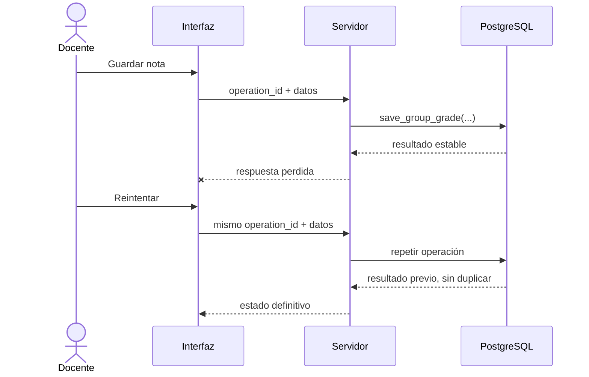

# 9. Propuesta de anexos

## Anexo A. Matriz de trazabilidad

Incluir una tabla que relacione historias, FR/NFR, casos de aceptación, tareas y evidencia futura. La fuente es `specs/001-manage-group-evaluation/spec.md`; no es necesario copiar los 39 FR completos en el cuerpo.

## Anexo B. Priorización MoSCoW

Reproducir la clasificación completa de la especificación, destacando que correcciones individuales, exportación oficial, notificaciones y LMS general están fuera de alcance.

## Anexo C. Diagramas

1. Flujo del proceso manual y flujo propuesto.
2. Arquitectura de interfaz, servidor, PostgreSQL/RLS y evidencia.
3. Modelo entidad-relación propuesto.
4. Secuencia de guardado/reintento idempotente.
5. Dependencias del backlog.

Ejemplo de secuencia para reintentos:

## Anexo D. Resumen del backlog

Incluir las ocho fases y enlazar `specs/001-manage-group-evaluation/tasks.md`. Las 74 tareas pueden adjuntarse o enlazarse, pero no conviene copiarlas al cuerpo del informe.

## Anexo E. Estado inicial

Adjuntar el inventario de `docs/automatizaciones/gestion-evaluacion-grupal/evaluacion.md` con un encabezado explícito: **línea de partida previa a implementación y evaluación; no contiene resultados finales**.

## Anexo F. Evidencia local existente

Referenciar:

- migraciones `0001`–`0029` aplicadas localmente;
- prueba `supabase/tests/group_grades_rls.sql`;
- fecha, entorno y alcance exacto del resultado documentado;
- limitación: no prueba producción ni el flujo completo.

No incorporar capturas con nombres, correos, identificadores reales, secretos o notas académicas.

## Anexo G. Instrumentos para Parte II

- protocolo comparativo;
- matriz de casos válidos, inválidos y excepcionales;
- ficha de ejecución;
- tabla de indicadores;
- lista de revisión WCAG;
- checklist de privacidad y entorno aislado.

## Anexo H. Ficha bibliográfica

Adjuntar o enlazar `08-bibliografia-y-fichas.md`, conservando DOI/URL, afirmación respaldada y página o sección.
