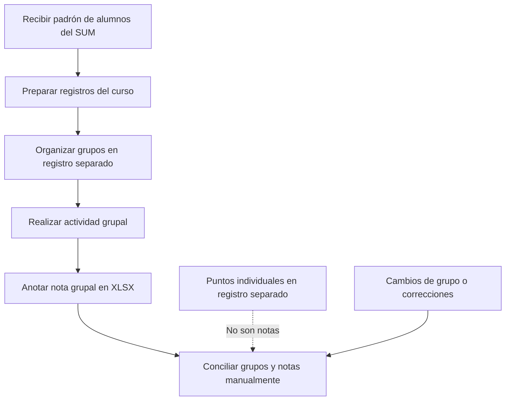
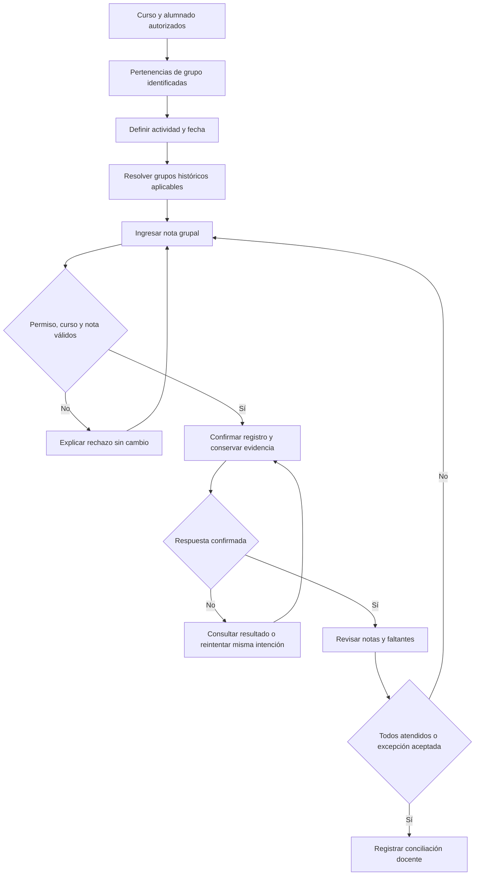
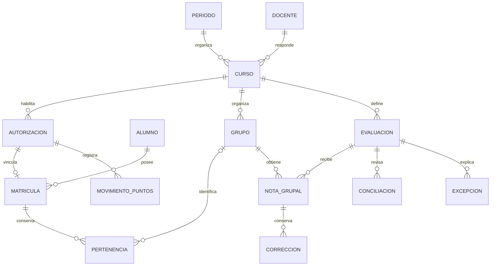
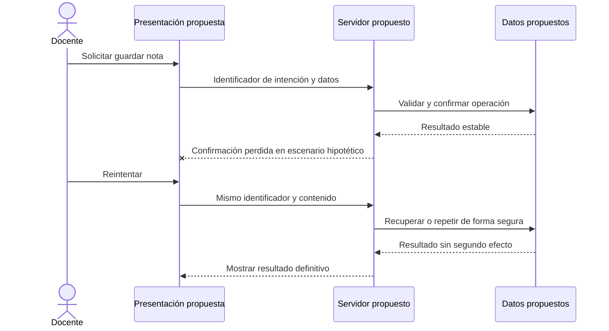

# 9. Anexos de análisis, diseño y prototipo

Estos anexos contienen artefactos documentales de semana 8 e instrumentos previstos para semana 16. Ningún ejemplo sintético corresponde a un alumno, nota real, ejecución o validación con usuarios.

## Anexo A. Modelos del proceso

### Proceso reportado — reconstrucción documental



El orden es una reconstrucción de análisis que debe confirmarse con el docente; no se observó una ejecución de campo.

### Flujo propuesto



## Anexo B. Trazabilidad de la propuesta

| Necesidad                         | Requisito de 04 | Diseño                                            | Caso futuro | Objetivo |
| --------------------------------- | --------------- | ------------------------------------------------- | ----------- | -------- |
| Acceso solo a curso autorizado    | R1–R2           | Responsabilidad docente, autorización y matrícula | C01–C02     | OE2–OE4  |
| Atribución correcta ante traslado | R3–R4           | Intervalos e instante de actividad                | C05–C07     | OE3–OE4  |
| Registro y corrección coherentes  | R5, R7          | Nota única e historia de cambios                  | C03–C05     | OE3–OE4  |
| Recuperación sin duplicar         | R6              | Identificador de intención y estados              | C08–C09     | OE4      |
| Revisión completa                 | R8              | Conteos y excepciones explícitas                  | C10         | OE3–OE4  |
| Puntos distintos de notas         | R9              | Entidades y consultas separadas                   | C02, C11    | OE2–OE3  |
| Evaluación reproducible posterior | R10             | Protocolo y ficha futura                          | C01–C12     | OE5      |

El diagnóstico y modelo manual sustentan OE1; esta matriz conecta sus necesidades con los demás entregables. Los FR de `specs/` sirven de referencia técnica más amplia, no de listado de logros.

## Anexo C. Modelo conceptual y secuencia de reintento



El diagrama expresa relaciones propuestas, no tablas construidas; las restricciones adicionales están en 05.



## Anexo D. P-01 — Prototipo documental de baja fidelidad

**Artefacto identificable:** este anexo, pantallas textuales P1–P4 y recorrido guiado. **Formato:** representación estática, no clicable. **Finalidad:** comunicar distribución de información, decisiones y estados del recorrido docente. No se ejecuta código, no se conecta a datos, no implementa permisos ni se ha validado con usuarios. Su suficiencia como prototipo de semana 8 debe confirmarse con el docente.

### P1. Contexto y definición de actividad

```text
EVALUACIONES GRUPALES — REPRESENTACIÓN, NO APLICACIÓN
Periodo: [periodo de ejemplo]   Curso: [curso de ejemplo]
Actividad: [Actividad A]       Realización: [fecha, hora y zona]
[Revisar grupos históricos]    [Continuar a registro]
Aviso: una fecha modificada requiere revisar atribuciones afectadas.
```

### P2. Matriz docente de registro

```text
Actividad A | Instante académico: [por definir]
Grupo histórico | Participantes en esa actividad | Nota | Estado
Grupo A         | [conteo]                       | [ ]  | Pendiente
Grupo B         | [conteo]                       | [ ]  | Pendiente
[Guardar intención]  [Consultar correcciones]  [Revisar faltantes]
Ayuda: valor de 0 a 20; vacío no es cero. Los puntos no se muestran aquí.
```

### P3. Error, incertidumbre y corrección

```text
Rechazo: «La nota debe ser un número entre 0 y 20». [Volver al campo]
Incertidumbre: «No se recibió confirmación». [Consultar] [Reintentar]
Corrección: valor anterior [ ] → valor propuesto [ ]
Participantes: los del grupo en la actividad, no los miembros actuales.
[Confirmar corrección]  [Cancelar]
```

Los mensajes representan estados alternativos, no una pantalla que los mostraría simultáneamente. El reintento conservaría la intención; la corrección sería una intención nueva.

### P4. Conciliación

```text
Grupos esperados [ ] | Con nota [ ] | Faltantes [ ] | Excepciones [ ]
Detalle de faltantes: [grupo y motivo pendiente]
Excepción: [categoría y justificación con acceso restringido]
[Volver a registrar] [Solicitar conciliación]
Aviso: no se declara conciliada con faltantes inexplicados.
```

### Recorrido ilustrativo, no ejecutado

Con identidades ficticias, se plantea un alumno en Grupo A durante Actividad A y trasladado después al Grupo B. P1 fija el instante de la actividad; P2 representa su participación histórica en A; P3 muestra cómo se explicaría una corrección tardía de A; P4 representa la revisión final. También se recorre conceptualmente un rechazo de rango y una confirmación perdida. No se asignan resultados observados a estos escenarios.

El prototipo no representa toda la plataforma, la importación, el panel estudiantil, exportaciones ni excepciones individuales. No prueba usabilidad, accesibilidad, seguridad o rendimiento; permite discutir el diseño y detectar preguntas antes de construir.

## Anexo E. Matriz de pruebas futuras — sin ejecutar

| Caso | Condición que se probaría en Parte II                                | Resultado esperado, no observado                                        |
| ---- | -------------------------------------------------------------------- | ----------------------------------------------------------------------- |
| C01  | Docente ajeno o sesión ausente                                       | Denegación sin datos del curso                                          |
| C02  | Alumno autorizado consulta sus datos e intenta leer notas            | Solo curso, grupo y puntos propios; sin notas                           |
| C03  | Nota 0, 20, vacía, negativa, mayor que 20 o no numérica              | Aceptar límites; no confirmar inválidas ni vacío como nota              |
| C04  | Grupo y actividad de cursos distintos                                | Rechazo sin cambios                                                     |
| C05  | Traslado posterior y corrección tardía                               | Mantener participantes históricos y conservar corrección                |
| C06  | Actividad y traslado del mismo día                                   | Aplicar regla temporal acordada                                         |
| C07  | Fecha modificada o historia insuficiente                             | Revisar impacto o solicitar revisión, sin inferencias silenciosas       |
| C08  | Respuesta perdida y mismo reintento                                  | Un solo efecto y resultado recuperable                                  |
| C09  | Identificador repetido con otro contenido o correcciones simultáneas | Rechazo de reutilización y conflicto controlado sin pérdida de historia |
| C10  | Faltantes y excepciones en conciliación                              | Conteos explicables; no cierre con faltantes inexplicados               |
| C11  | Puntos asignados o anulados                                          | No alterar notas ni borrar movimiento original                          |
| C12  | Selección fuera de ventana o concurrencia por último cupo            | Rechazo controlado sin exceder capacidad                                |

Añadir en Parte II resultados observados, pasos, datos sintéticos y referencias de evidencia, no rellenar esas columnas en semana 8.

## Anexo F. Instrumentos previstos

**Ficha futura por ejecución:** caso; fecha; versión; entorno aislado; datos sintéticos; zona horaria; pasos; esperado; observado; tiempos; discrepancias; operación correlacionada; señales restringidas; limitaciones; responsable. Todos los campos de observación están por recoger.

**Ficha comparativa:** método manual/plataforma; actividad; grupos esperados; orden y repetición; inicio/fin de registro; inicio/fin de conciliación; notas válidas; faltantes; excepciones; errores de registro; correcciones académicas; duplicados; casos de reintento; limitaciones. Fórmulas en 06.

**Revisión futura transversal:** teclado, foco, etiquetas y errores; separación de puntos/notas; ausencia de información personal o secretos en evidencia compartida; aislamiento del entorno; alcance de señales y recuperación. No es un checklist aprobado.

## Anexo G. Fuentes y preparación de entrega

Bibliografía, fuentes internas y estado de comprobación: 08. Asuntos por validar: 07. Material integrado: 10. Guion para elaborar PowerPoint: 06. Los inventarios técnicos y pruebas del repositorio no se adjuntan como resultados académicos de Parte I.
