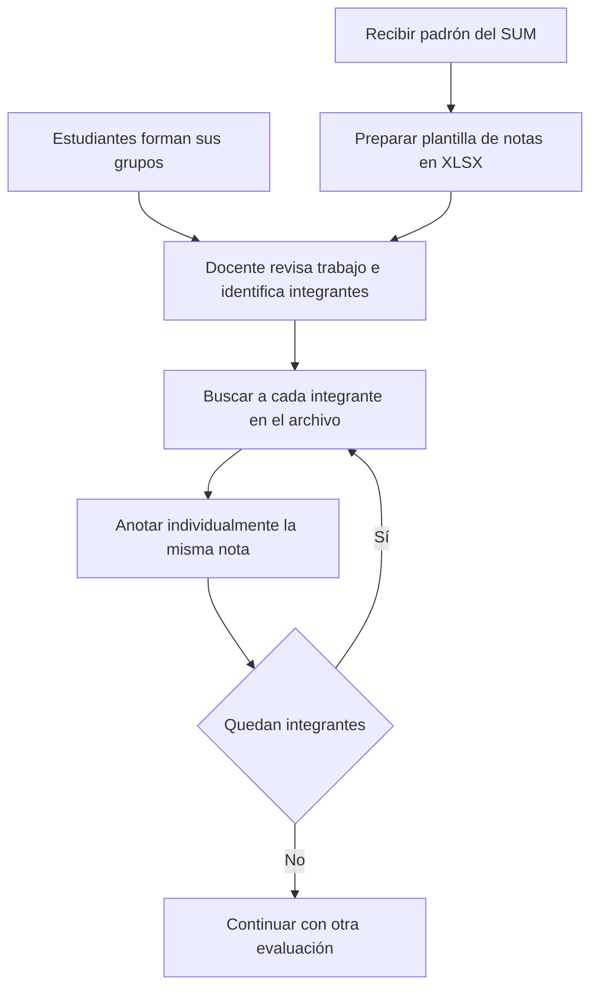
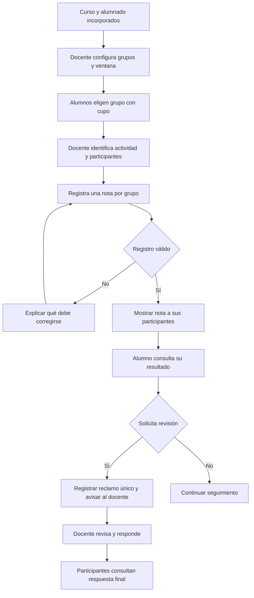

# 9. Anexos: procesos, prototipo e instrumentos

## Anexo A. Proceso actual descrito en el caso



El diagrama sintetiza el relato transmitido por el responsable del proyecto. La información de puntos permanecía en el registro docente, sin un medio individual de consulta durante el ciclo. No se dispone de una medición del tiempo de este recorrido.

## Anexo B. Registro y seguimiento propuestos



Los puntos individuales siguen un recorrido de registro, consulta y reclamo privado. El docente puede exportar el curso sin que la descarga modifique los registros originales.

## Anexo C. Prototipo documental P-01

**Formato:** representación textual estática de baja fidelidad. **Propósito:** mostrar los recorridos de registro, consulta, reclamo y exportación. Las pantallas siguientes son el artefacto disponible, no capturas de una plataforma operativa ni evidencia de validación con usuarios.

### P1. Registro docente

```text
CURSO: [curso de ejemplo]      PERIODO: [periodo]
Evaluación: [Trabajo 1]        Realización: [fecha de actividad]
Grupo de la actividad | Participantes | Nota base | Estado
Grupo A               | [lista]       | [18]      | Registrada
Grupo B               | [lista]       | [  ]      | Pendiente
[Guardar nota] [Revisar correcciones]
Una nota guardada queda visible para sus participantes.
Una celda vacía no equivale a cero.
```

### P2. Consulta del alumno

```text
MIS RESULTADOS — [curso]
Actividad | Grupo en la actividad | Nota base | Revisión
Trabajo 1 | Grupo A               | 18        | [Presentar reclamo]
Trabajo 2 | Grupo B               | Pendiente | —
MIS PUNTOS
Movimiento | Puntos | Descripción | Revisión
[registro] | 2      | [motivo]    | [Presentar reclamo]
Solo se muestran resultados que corresponden a este alumno.
```

### P3. Presentación y seguimiento del reclamo

```text
SOLICITAR REVISIÓN
Registro: [Trabajo 1, Grupo A / movimiento propio de puntos]
Descripción del desacuerdo: [texto del alumno]
[Enviar reclamo]

SEGUIMIENTO
Presentado por: [alumno]     Estado: Pendiente / En revisión / Respondido
Respuesta del docente: [decisión y motivo]
```

Los estados representan momentos distintos del recorrido. Un reclamo grupal es compartido por los participantes de aquella actividad; uno de puntos es privado entre el alumno y el docente. El caso existente se consulta en lugar de abrir otro. Tras la respuesta final no hay réplica ni reapertura.

### P4. Bandeja docente

```text
RECLAMOS DEL CURSO
Registro cuestionado | Tipo   | Presentado por | Estado
Trabajo 1, Grupo A   | Grupal | [alumno]       | Pendiente
[Movimiento]         | Puntos | [alumno]       | En revisión
[Revisar]
Decisión y fundamento: [respuesta docente]
[Marcar en revisión] [Responder]
La corrección del registro, si corresponde, se realiza expresamente.
```

### P5. Preparación de la exportación

```text
EXPORTAR CURSO — [curso]
Alumno | T1 base | T2 base | T3 base | Promedio base | Puntos
[alumno] | 20    | 18      | 17      | 18,33         | 2
Puntos aplicados: 2 | Excedente: 0 | Promedio ajustado: 19,00
[Descargar XLSX]
Las notas pendientes permanecen vacías.
Descargar no consume puntos ni cambia las notas base.
```

Las columnas son una propuesta de presentación, no un formato definitivo. El cálculo usa la regla de puntos adoptada como supuesto del equipo; no muestra una nota final del curso. El ejemplo es ficticio y sus operaciones son ilustrativas.

### Recorrido ilustrativo

El docente registra 18 para el grupo A en Trabajo 1. Un participante consulta la nota y presenta un reclamo en nombre de ese grupo. El docente recibe el aviso, revisa el caso y responde. Si el alumno se trasladó después al grupo B, mantiene la consulta del Trabajo 1 y del reclamo con los participantes originales de A. La exportación reúne las notas correspondientes a cada actividad, no las del grupo vigente para todos los trabajos.

## Anexo D. Trazabilidad de necesidades y objetivos

| Necesidad                                   | Requisitos de 4 | Representación o instrumento         | Objetivos relacionados |
| ------------------------------------------- | --------------- | ------------------------------------ | ---------------------- |
| Evitar búsqueda y anotación repetitiva      | R05–R06         | Proceso actual, flujo propuesto y P1 | OE1, OE2, OE3, OE4     |
| Incorporar alumnos y organizar grupos       | R01–R04         | Descripción de preparación en 5      | OE1, OE2, OE3          |
| Consultar resultados propios                | R07–R08         | P2 y casos C02–C03                   | OE2, OE3, OE4          |
| Atender desacuerdos con privacidad y estado | R09–R13         | P3–P4 y casos C04–C08                | OE2, OE3, OE4          |
| Obtener información del curso               | R14             | P5 y casos C09–C12                   | OE2, OE3, OE4          |

## Anexo E. Casos de comprobación previstos

| Caso | Situación                                              | Resultado esperado                                                           |
| ---- | ------------------------------------------------------ | ---------------------------------------------------------------------------- |
| C01  | Registro de una nota válida y de valores fuera de 0–20 | Confirmar solo valores válidos y explicar rechazos                           |
| C02  | Nota o puntos recién registrados                       | Consulta inmediata solo por sus destinatarios                                |
| C03  | Nota vacía frente a nota cero                          | Distinguir pendiente de calificación cero                                    |
| C04  | Reclamo grupal después de un cambio de grupo           | Acceso de participantes de la actividad, no de nuevos integrantes            |
| C05  | Reclamo sobre movimiento de puntos                     | Privacidad entre alumno titular y docente                                    |
| C06  | Segundo reclamo por el mismo registro                  | Mostrar el caso existente, incluso si ya fue respondido                      |
| C07  | Revisión y respuesta docente                           | Recorrido acordado, sin réplica ni corrección automática                     |
| C08  | Nuevo reclamo y aviso por correo                       | Aviso al docente con enlace y sin información académica ni texto del reclamo |
| C09  | Notas 20, 18 y 17; dos puntos                          | Promedio ajustado 19,00; notas base y saldo sin cambios                      |
| C10  | Notas 20, 20 y 20; dos puntos                          | Promedio 20,00; dos puntos excedentes sin efecto                             |
| C11  | Alguna nota pendiente y exportación repetida           | Campo vacío, promedio de cierre pendiente y ausencia de consumo de puntos    |
| C12  | Notas 18, 16 y 17; un punto                            | Promedio ajustado 17,33, sin redondeos intermedios                           |
| C13  | Cambio de grupo con ventana abierta y cupo             | Cambio permitido; resultados anteriores conservados                          |
| C14  | Grupo lleno o ventana cerrada                          | Cambio impedido con explicación; reapertura aplicable a todo el curso        |
| C15  | Archivo de alumnos con datos incompletos o repetidos   | Identificar lo que requiere revisión y evitar duplicados                     |

Esta matriz describe resultados esperados para la evaluación; no contiene resultados observados.

## Anexo F. Instrumentos para la evaluación

**Ficha de registro:** caso; fecha; escenario; actor; pasos; resultado esperado; resultado observado; discrepancias; evidencia sin información personal; responsable.

**Ficha de tiempo de registro:** procedimiento manual simulado o plataforma; conjunto de grupos e integrantes; notas de entrada; preparación previa; inicio; fin; duración; errores detectados; repetición; limitaciones. No se compararán tiempos de recepción o evaluación del contenido de trabajos.

**Ficha de seguimiento:** resultado consultado; destinatarios permitidos; reclamo presentado; estados; respuesta; aviso al docente; comprobación de privacidad y duplicados. La ausencia de un medio anterior equivalente no se convertirá en una tasa histórica inventada.

**Lista de revisión de claridad:** etiquetas comprensibles, estados con texto, navegación por teclado, diferencia entre pendiente y cero y acceso restringido a los resultados y reclamos correspondientes.
