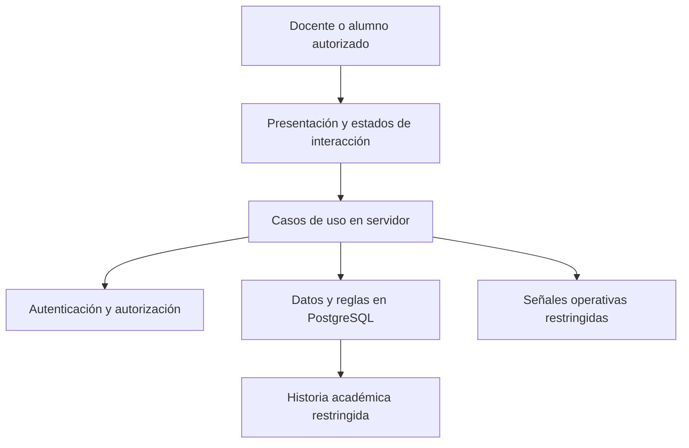
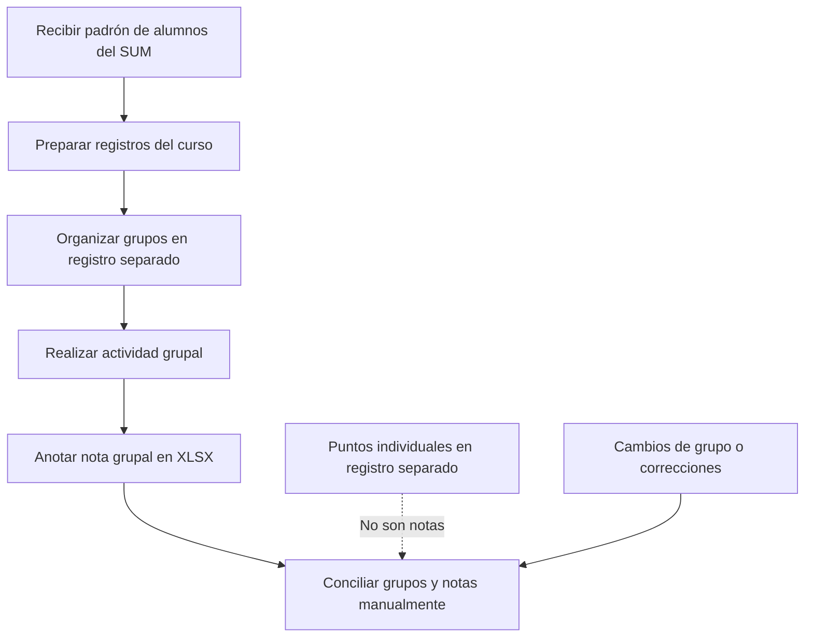
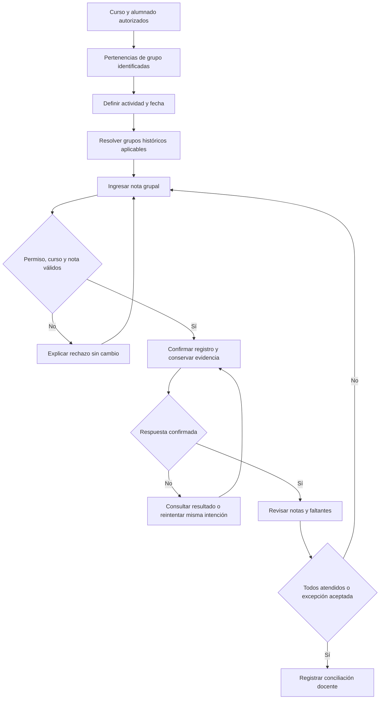
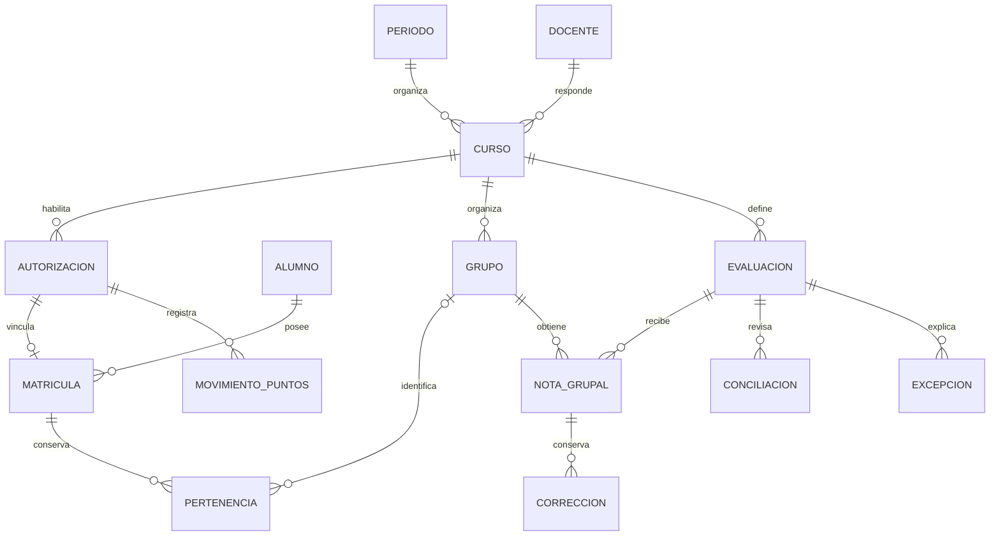
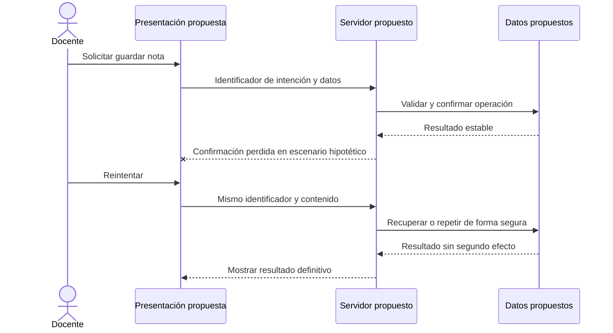

# Automatización y control de la gestión de evaluaciones grupales

## Borrador integrado — Parte I, semana 8

**Perspectiva:** propuesta de análisis, diseño y prototipo documental de baja fidelidad, todavía no implementada como solución académica. La implementación, las pruebas y la evaluación se prevén para semana 16. El material técnico examinado es referencia de dominio, no resultado de este trabajo.

## Carátula de trabajo — completar antes de maquetar

- Universidad: Universidad Nacional Mayor de San Marcos (contexto del caso; confirmar datos de carátula)
- Curso: Automatización y Control de Software 2026-2
- Título: Automatización y control de la gestión de evaluaciones grupales
- Docente: pendiente de completar
- Integrantes: pendientes de completar
- Fecha de entrega: pendiente de confirmar

## Índice de contenido

1. Introducción y planteamiento del problema
2. Objetivos del trabajo académico
3. Marco teórico
4. Caso de aplicación, alcance, actores y requisitos
5. Diseño de arquitectura, información y controles
6. Plan futuro de implementación, pruebas y evaluación
7. Productos de Parte I, asuntos abiertos y conclusiones
8. Bibliografía y fichas de investigación
9. Anexos de análisis, diseño y prototipo

La sección 7 presenta productos documentales disponibles, no resultados operativos. P-01 está en el anexo D de la sección 9. El PowerPoint y el PDF final maquetado están por elaborar. Esta compilación reproduce íntegramente las secciones 01–09 para evitar versiones distintas de los objetivos y del alcance; las fichas bibliográficas candidatas son material de trabajo, no bibliografía utilizada comprobada.

# 1. Introducción y planteamiento del problema

## 1.1 Introducción y perspectiva de la entrega

La gestión académica relaciona identidad, acceso autorizado, periodos, cursos, incorporación de alumnos, matrículas, grupos, puntos individuales y evaluaciones grupales. Dentro de esa visión, este trabajo selecciona un solo proceso principal: la gestión y control de evaluaciones grupales para el docente responsable del curso. Los demás módulos aportan contexto, entradas o dependencias; no se propone construir ni evaluar un LMS completo.

Esta Parte I se sitúa en la semana 8 del curso Automatización y Control de Software 2026-2. La guía distingue la entrega de diseño y prototipo, orientada a analizar el problema y diseñar la solución, de la Parte II de semana 16, destinada a implementar, probar y evaluar. Aquí se presentan diagnóstico documental, requisitos, diseño y una representación de baja fidelidad; no una solución operativa.

Se examinó documentación, especificaciones, aplicación y modelo de datos del repositorio para comprender el caso y formular la propuesta. Ese material técnico no se atribuye como implementación o evaluación de este trabajo. Tampoco se afirma que el repositorio carezca de código. No se realizaron entrevistas, observaciones de campo, pruebas de la solución académica ni mediciones para esta entrega.

## 1.2 Situación problemática reportada

Según el caso registrado en `docs/01-definicion/caso-evaluacion-grupal.md`, un docente de la UNMSM llevaba notas en una hoja XLSX y registraba por separado grupos y puntos individuales. Durante las primeras semanas recibe del SUM una relación de alumnos en XLSX para su incorporación inicial. Este archivo no contiene notas para importar. La descripción es una fuente interna del caso, no un estudio empírico independiente.

La separación de registros plantea necesidades de conciliación: relacionar curso, actividad, grupos y notas; reconocer faltantes; y explicar qué calificación corresponde a un alumno cuando cambia de grupo. Se identifican riesgos de omisiones, duplicados, valores inválidos y atribuciones equivocadas. No se conoce su frecuencia ni su costo real: esos aspectos requieren levantamiento y medición posteriores.

## 1.3 Problema central y diagnóstico

El problema consiste en gestionar y explicar las notas grupales con información relacionada que se registra por separado, especialmente ante traslados y correcciones. La regla documentada establece que cuenta el grupo al que pertenecía el alumno al realizarse la actividad, no el grupo vigente al guardar o corregir la nota. Una lista del grupo actual no basta como representación de esa historia.

| Aspecto reportado o requerido                 | Riesgo o necesidad inferida                       | Respuesta que se propone diseñar                       |
| --------------------------------------------- | ------------------------------------------------- | ------------------------------------------------------ |
| Notas, grupos y puntos en registros separados | Conciliación manual y posible confusión semántica | Información relacionada, sin convertir puntos en notas |
| Cambios de grupo durante el curso             | Atribución retrospectiva incorrecta               | Pertenencias temporales y fecha de actividad           |
| Registro y corrección docente                 | Valores inválidos o cambios inexplicables         | Validaciones y conservación de correcciones            |
| Posibles fallos de guardado                   | Incertidumbre y repetición de cambios             | Estados explícitos y reintento seguro                  |
| Cierre de una evaluación                      | Faltantes que podrían pasar inadvertidos          | Conciliación de grupos, notas y excepciones            |

Los riesgos son hipótesis de análisis, no incidentes observados o cuantificados por el equipo.

## 1.4 Pregunta orientadora

¿Cómo diseñar una solución de automatización y control para la gestión de evaluaciones grupales que articule las entradas académicas del curso, preserve la pertenencia histórica de sus alumnos y permita registrar, corregir y conciliar notas con reglas, permisos y excepciones explícitos?

## 1.5 Frontera del trabajo

La entrada del proceso principal es un curso bajo responsabilidad docente con alumnado autorizado, matrículas y grupos identificados. Se diseña la definición de actividades, el registro y la corrección de notas grupales y la conciliación de sus resultados. La preparación del padrón y la selección de grupos se describen como dependencias, no como procesos adicionales de evaluación de eficacia.

La salida esperada es una evaluación revisada por el docente, con grupos calificados o excepciones identificadas y sin faltantes inexplicados. La validez de cerrar con excepciones debe acordarse antes de implementar. La exportación oficial, la corrección individual excepcional, los nuevos tipos de notas y las funciones generales de LMS quedan fuera de la propuesta.

## 1.6 Fuentes y límites del diagnóstico

Se contrastaron `README.md`, `docs/`, `specs/001-manage-group-evaluation/` y las fuentes pertinentes de `portfolio-coursse/`. Su alcance técnico no se traslada automáticamente al compromiso académico. Las diferencias y decisiones por confirmar se registran en 07; las fuentes externas y su grado de verificación figuran en 08.

---

# 2. Objetivos del trabajo académico — Parte I

## Objetivo general

Analizar el proceso de gestión de evaluaciones grupales en el caso académico documentado y proponer una solución de automatización y control, mediante la delimitación de sus requisitos, el diseño del proceso y del sistema y una representación de baja fidelidad, que sirva de base para su posterior implementación y evaluación.

## Objetivos específicos

1. Caracterizar el proceso reportado de registro de notas y organización de grupos, identificando actores, entradas, actividades repetitivas, dificultades y necesidades de control mediante un diagnóstico y un modelo del proceso.
2. Delimitar el alcance de la propuesta dentro de la plataforma académica, especificando requisitos, reglas de negocio, permisos y excepciones, y distinguiendo las dependencias de las funciones excluidas.
3. Diseñar el flujo propuesto, el modelo de información y la arquitectura de la solución, con especial atención a la pertenencia histórica a grupos, el registro y la corrección de notas y la conciliación docente.
4. Definir las validaciones, los controles y el tratamiento de errores y reintentos, y representarlos en un prototipo documental de baja fidelidad del recorrido docente, sin atribuirle funcionamiento ni validación con usuarios.
5. Formular un plan de implementación, pruebas y evaluación para la Parte II, con casos de aceptación, instrumentos de registro e indicadores cuya medición permita contrastar posteriormente la propuesta con el proceso manual.

## Correspondencia con entregables de semana 8

| Objetivo | Producto verificable en el informe                             | Sección o artefacto                   |
| -------- | -------------------------------------------------------------- | ------------------------------------- |
| OE1      | Diagnóstico documental y modelo del proceso reportado          | 01 y anexo A de 09                    |
| OE2      | Frontera, actores, requisitos y asuntos por validar            | 04 y anexo B de 09                    |
| OE3      | Flujo, arquitectura, entidades e invariantes propuestas        | 04, 05 y anexos A–C de 09             |
| OE4      | Matriz de controles, estados, errores y recorrido representado | 05 y prototipo P-01 del anexo D de 09 |
| OE5      | Cronograma, protocolo, indicadores y casos futuros             | 06 y anexos E–F de 09                 |

Los objetivos describen productos de análisis y diseño de la Parte I. Autenticar usuarios, registrar notas o conciliar evaluaciones son funciones esperadas del sistema; RLS, transacciones e identificadores de operación son decisiones de diseño; implementarlos, ejecutar pruebas y medir mejoras son actividades futuras de Parte II. Ninguno de estos últimos constituye un logro operativo de semana 8.

---

# 3. Marco teórico

> **Alcance de la Parte I (semana 8):** este capítulo fundamenta una propuesta no implementada mediante análisis, diseño y prototipo. La implementación, las pruebas y la evaluación se reservan para la semana 16. Los beneficios se presentan como expectativas, no como resultados.

La estructura responde a las indicaciones de la guía PDF del curso 2026-2, leída para esta revisión (p. 2): definir el componente, explicar los problemas que aborda, sus ventajas y desventajas, cuándo recomendarlo y los conceptos relacionados. La referencia de la guía y el estado de comprobación de las fuentes se registran en el capítulo 8. Las decisiones del caso no se atribuyen a literatura pendiente de consulta.

## 3.1 Automatización y control de procesos

Para esta propuesta, la automatización consiste en trasladar tareas recurrentes y reglas explícitas de un proceso a un sistema, manteniendo la intervención humana ante excepciones. Sus componentes conceptuales son entradas, actividades, responsables, reglas, estados y salidas. El problema que se busca abordar es la dispersión de registros y la dificultad para conciliar notas y cambios de grupo.

Se espera reducir tareas repetitivas y aplicar validaciones consistentes. Como desventajas, existen costos de preparación y mantenimiento, y el riesgo de reproducir reglas incompletas o datos erróneos. Se recomienda cuando las actividades son recurrentes y sus reglas pueden acordarse; no cuando se pretende reconstruir hechos históricos sin información confiable. El libro de Dumas et al. se conserva como candidato para ampliar el fundamento de gestión por procesos, pendiente de consulta.

## 3.2 Digitalización de la gestión académica

En este caso, digitalizar significa representar y organizar información académica en medios digitales. La transformación del proceso sería un cambio más amplio en prácticas, responsabilidades y uso de esa información; disponer de una interfaz no demuestra por sí solo ese cambio. Se proponen como componentes el registro académico, los flujos docentes y las reglas de acceso.

La centralización podría facilitar consultas y conciliación, pero también genera dependencia de la disponibilidad del sistema, necesidades de capacitación y riesgos de concentración de datos. Se recomienda cuando existen registros dispersos y responsables dispuestos a acordar su gestión. Benavides et al. y OECD permanecen como fuentes candidatas para profundizar este contexto; no se presentan aquí conclusiones atribuidas a textos no comprobados.

## 3.3 Evaluación grupal y pertenencia histórica

La nota grupal representa la calificación de una actividad colectiva; los puntos individuales constituyen un registro distinto según las reglas del caso. La pertenencia histórica indica qué estudiantes integraban un grupo en el momento de una actividad, en lugar de usar únicamente su composición actual. Estos conceptos provienen del dominio del proyecto, no de una validación pedagógica de la solución.

El problema aparece cuando un cambio posterior de grupo altera la interpretación de una nota pasada. Se propone relacionar la fecha de realización de la evaluación con los periodos de pertenencia. La ventaja esperada es una atribución explicable; sus límites son la necesidad de fechas confiables y la complejidad de corregir información histórica. Se recomienda cuando los grupos pueden cambiar durante el curso. No permite inferir contribuciones individuales ni resolver la equidad de la evaluación. La corrección individual queda fuera del alcance propuesto; las fuentes sobre evaluación por pares se mantienen pendientes en el capítulo 8.

## 3.4 Integridad, transacciones e idempotencia

La integridad de datos consiste, para el diseño, en conservar registros compatibles con las reglas de rango, unicidad y relación entre entidades. Una transacción agrupa varios cambios en una operación de todo o nada, según la documentación de PostgreSQL (PostgreSQL Global Development Group, s. f.-b, sec. 3.4). Se propone usar este concepto para que un cambio de pertenencia o una corrección de nota no deje registros parciales.

La idempotencia significa que repetir una solicitud idéntica conserva el efecto pretendido de una sola solicitud (Fielding et al., 2022, sec. 9.2.2). Es útil ante reintentos por fallos de comunicación. La propuesta de evitar guardados duplicados es una adaptación al negocio, no un mecanismo exigido por el RFC ni una garantía ya implementada.

La ventaja esperada de estos controles es evitar inconsistencias y duplicados; sus costos son el diseño de reglas, el tratamiento de conflictos y la verificación posterior. Se recomiendan cuando una acción modifica registros relacionados o puede repetirse. No garantizan que una calificación sea académicamente correcta: esa responsabilidad requiere revisión docente.

## 3.5 Autenticación, autorización y mínimo privilegio

Autenticar consiste en comprobar una identidad; autorizar, en determinar qué acciones puede realizar sobre un recurso. El mínimo privilegio se adopta como principio de diseño: conceder solo el acceso necesario para una responsabilidad. En el caso propuesto, el rol de docente se combinaría con su responsabilidad sobre el curso; una sesión válida no bastaría para modificar cualquier registro.

La seguridad por filas (RLS) permite restringir qué registros pueden consultarse o modificarse mediante políticas. PostgreSQL advierte que hay roles privilegiados que pueden eludirlas (PostgreSQL Global Development Group, s. f.-a, sec. 5.9). Se propone como complemento de los controles de servidor, no como sustituto de las reglas académicas. El catálogo NIST SP 800-53 ofrece un marco general de controles adaptables al riesgo (Joint Task Force, 2020); la lectura de controles específicos sigue pendiente.

La ventaja esperada es limitar accesos indebidos. La desventaja es la complejidad de mantener permisos y políticas coherentes. Se recomienda cuando distintos responsables acceden a información de cursos diferentes; los permisos deben comprobarse en la implementación futura, no inferirse de botones ocultos en el prototipo.

## 3.6 Trazabilidad, auditoría y observabilidad

La trazabilidad es la posibilidad de reconstruir un cambio; la auditoría utiliza registros para revisar actuaciones, y la observabilidad aporta señales sobre el funcionamiento del sistema. Kent y Souppaya (2006), en el resumen oficial consultado, presentan la gestión de registros como una práctica que requiere infraestructura y procesos organizacionales, no solo una tecnología de emisión de mensajes.

Se propone distinguir el historial académico —valor anterior, nuevo valor, responsable e instante— de las señales operativas de intentos y errores. El problema abordado es la falta de explicación de una corrección o de un fallo. La ventaja esperada es facilitar revisión y diagnóstico; los costos son almacenamiento, protección, conservación y posible exposición de información personal. Se recomienda cuando las modificaciones necesitan justificación, con acceso restringido y sin divulgar notas o identidades en registros públicos.

## 3.7 Calidad, prototipo y evaluación futura

En esta propuesta, la calidad se expresa mediante criterios de aceptación relacionados con las reglas académicas, la seguridad y la facilidad de uso. Un prototipo representa pantallas y recorridos para discutir el diseño; no demuestra que la solución funcione ni que produzca mejoras. Las pruebas contrastarán posteriormente comportamientos con resultados esperados, y la evaluación analizará si la solución responde al problema planteado.

Para la semana 8 se propone describir escenarios válidos, inválidos y excepcionales. Para la semana 16 se prevé implementar, probar reglas y permisos, recorrer flujos críticos y evaluar los indicadores definidos. La ventaja de planificar estos criterios es hacer revisable la propuesta; sus límites son el tiempo de preparación y que los escenarios elegidos pueden omitir fallos. Se recomienda priorizar los recorridos con mayor impacto académico. Las referencias sobre pruebas, integración continua y revisión de código quedan como candidatas, sin atribuirles beneficios no comprobados.

## 3.8 Accesibilidad, rendimiento y privacidad

La accesibilidad busca que las personas puedan percibir, operar y comprender una interfaz, con contenido interpretable por tecnologías de asistencia. WCAG 2.2 organiza sus criterios en cuatro principios: perceptible, operable, comprensible y robusto (World Wide Web Consortium, 2024). Para la futura interfaz se proponen navegación por teclado, foco visible, etiquetas claras, errores identificables y estados que no dependan solo del color. P-01 solo representa contenido y recorrido de forma estática, por lo que no permite comprobar teclado o foco. Son criterios de diseño; no se declara conformidad WCAG sin evaluar páginas y procesos completos.

Estas medidas pueden reducir barreras de interacción, aunque requieren revisión manual y no cubren todas las necesidades de todas las personas. Se recomiendan desde el diseño de cualquier flujo académico. El rendimiento alude al tiempo de respuesta y los recursos utilizados: la respuesta visible en dos segundos para el 95 % de las acciones interactivas es una meta candidata por validar para la evaluación futura, no un estándar universal ni un resultado actual.

La privacidad se aborda como limitación del acceso y de la divulgación de información personal. Se propone trabajar con datos sintéticos y excluir secretos, correos reales y calificaciones reales de repositorios y anexos públicos. RFC 9110 advierte de riesgos de divulgación y reidentificación en registros y direcciones web (Fielding et al., 2022, secs. 17.7–17.9). Esta precaución puede limitar el realismo de las pruebas, pero se recomienda antes de utilizar datos reales. La Ley peruana N.º 29733 y el Decreto Supremo N.º 016-2024-JUS permanecen pendientes de comprobación del texto oficial y de su aplicabilidad; no se afirma cumplimiento legal.

## 3.9 Síntesis conceptual aplicada

La propuesta reúne cinco principios: acceso limitado por responsabilidad, coherencia de datos, historia explicable, reintentos sin duplicación y evidencia proporcional. Se plantea una sola aplicación como decisión de alcance, sujeta a revisión del diseño; no como arquitectura implementada ni superioridad demostrada.

Las fuentes internas de requisitos y diseño sirven para describir el dominio y rastrear decisiones (véase el capítulo 8). No son bibliografía académica independiente ni evidencia de implementación, pruebas o resultados de la Parte I.

---

# 4. Caso de aplicación, alcance, actores y requisitos

## 4.1 Visión de plataforma y frontera de automatización

| Elemento                      | Relación con el caso                                                              | Frontera académica                                              |
| ----------------------------- | --------------------------------------------------------------------------------- | --------------------------------------------------------------- |
| Acceso docente y estudiantil  | Identifica a la persona                                                           | Dependencia; autenticación no equivale a autorización           |
| Autorización                  | Determina rol y acceso al curso                                                   | Regla transversal del diseño                                    |
| Periodos y cursos             | Un periodo organiza cursos; cada curso tiene un responsable                       | Contexto organizativo, no gestión institucional completa        |
| Incorporación y matrícula     | El XLSX del SUM prepara autorizaciones; la cuenta coincidente se vincula al curso | Entrada; no importa notas ni supone matrícula oficial en el SUM |
| Grupos y selección            | Organización por curso, cupo y ventana; traslado por docente                      | Dependencia temporal indispensable para atribuir notas          |
| Puntos individuales           | Movimientos asociados al alumno autorizado                                        | Contexto separado; no son notas ni intervienen en su cálculo    |
| Evaluaciones y notas grupales | Actividad fechada y nota por grupo                                                | Núcleo del proceso a automatizar y evaluar                      |
| Conciliación                  | Revisión docente de grupos esperados, notas y excepciones                         | Cierre controlado propuesto                                     |

Los cursos pueden organizarse sin grupos dentro de la visión general, pero el experimento propuesto se limita a un curso con evaluación grupal. La ruta pública de portafolio no pertenece al caso.

## 4.2 Actores y permisos previstos

- **Docente responsable:** prepara las entradas de sus cursos, organiza grupos, autoriza traslados, define actividades, registra y corrige notas grupales y revisa la conciliación. No opera sobre cursos ajenos.
- **Alumno autorizado:** accede a sus cursos y matrícula, consulta grupo vigente y puntos propios y selecciona grupo dentro de la ventana y cupo. No consulta ni modifica notas grupales en el alcance propuesto.
- **Servicios de identidad y datos:** apoyan autenticación, persistencia y controles; no sustituyen la responsabilidad académica del docente.
- **Equipo del trabajo:** analiza y diseña en Parte I; implementaría y evaluaría en Parte II. No es un rol de usuario de la plataforma.

## 4.3 Flujo propuesto

**Preparación dependiente:** seleccionar periodo y curso → incorporar alumnos desde el padrón → vincular cuentas autorizadas y matrículas → organizar grupos y registrar sus pertenencias.

**Proceso central:** docente identifica curso y actividad → define fecha de realización → consulta grupos aplicables históricamente → introduce nota → se comprueban permisos, curso y rango → se propone confirmar el registro y conservar evidencia → si procede, corrige sin borrar el historial → revisa grupos calificados, faltantes y excepciones → concilia o mantiene pendiente la evaluación.

El flujo describe el comportamiento esperado. No representa una ejecución. Los diagramas y el recorrido de baja fidelidad están en 09.

## 4.4 Requisitos de la propuesta

Los identificadores R se usan en esta carpeta para distinguir los requisitos del núcleo de las especificaciones técnicas más amplias. No sustituyen ni modifican los FR externos.

| ID  | Requisito esperado                                                                         | Relación con fuentes técnicas        |
| --- | ------------------------------------------------------------------------------------------ | ------------------------------------ |
| R1  | Restringir acceso por identidad, rol y responsabilidad sobre el curso                      | FR-001–005                           |
| R2  | Recibir autorizaciones, matrículas y grupos coherentes del curso, sin importar notas       | FR-006–013, como dependencias        |
| R3  | Determinar pertenencia por fecha de actividad y conservar traslados sin solapamientos      | FR-014–017                           |
| R4  | Definir una actividad identificable y fechada; revisar el impacto de cambiar su fecha      | FR-018–019                           |
| R5  | Registrar una nota vigente de 0 a 20 por grupo y evaluación del mismo curso                | FR-020–022                           |
| R6  | Distinguir éxito, rechazo, fallo e incertidumbre; permitir reintentos sin duplicar efectos | FR-023–024                           |
| R7  | Conservar valores anterior/nuevo, responsable e instante de una corrección grupal          | FR-025–026, FR-036                   |
| R8  | Conciliar grupos esperados, calificados, faltantes y excepciones, sin ocultar pendientes   | FR-033–037                           |
| R9  | Separar puntos y notas; limitar la vista estudiantil a datos propios permitidos            | FR-028–032                           |
| R10 | Diseñar evidencias e indicadores seguros y reproducibles para la evaluación futura         | FR-038–039 y protocolo de evaluación |

Se priorizan como obligatorios del **diseño** R1–R10. Los filtros avanzados y resúmenes visuales son mejoras opcionales. Esta prioridad no significa que esas funciones se implementen en semana 8. En Parte II, las dependencias deberán estar disponibles y verificadas para ensayar el núcleo, sin convertir cada módulo en un experimento independiente.

## 4.5 Reglas y excepciones

1. Un curso tiene un docente responsable para este caso; no se diseña codocencia.
2. El archivo institucional incorpora alumnos, nunca calificaciones.
3. Autorización previa y matrícula de una cuenta autenticada son conceptos distintos; el dominio institucional por sí solo no otorga acceso al curso.
4. La nota es grupal, de 0 a 20. La precisión decimal debe confirmarse; un campo vacío será pendiente, no cero ni nota válida.
5. Una corrección de nota grupal alcanza a la población histórica de la actividad, aunque después existan traslados.
6. La selección estudiantil requiere ventana abierta y cupo; el docente puede autorizar un traslado fuera de ella.
7. No se inventan fechas ni pertenencias desconocidas. Se identifica la incertidumbre para revisión.
8. Una excepción grupal documenta una incidencia; no crea una nota individual ni convierte puntos en calificaciones.

Casos previstos: límites 0/20; nota inválida; cruce de cursos; acceso estudiantil a notas; docente ajeno; actividad antes/después de traslado; actividad y traslado del mismo día; competencia por último cupo; corrección concurrente; respuesta perdida y reintento; cambio de fecha; historia insuficiente. Sus pruebas se planifican para Parte II.

## 4.6 Condiciones no funcionales y exclusiones

El diseño considera mínimo privilegio, privacidad, consistencia transaccional, accesibilidad de teclado, errores comprensibles, recuperación ante incertidumbre y señales correlacionables. No garantiza disponibilidad, rendimiento o recuperación productiva sin comprobación futura.

Quedan excluidos exportación oficial de actas o notas, corrección individual excepcional, importación de notas, conversión de puntos en notas, panel institucional adicional, contenidos, entregas, asistencia, foros, notificaciones y nuevos tipos de evaluación. Una descarga técnica XLSX hallada en el código de referencia no demuestra exportación oficial ni cambia este alcance (véase 07).

---

# 5. Diseño de arquitectura, información y controles

## 5.1 Alternativa arquitectónica propuesta

Se propone una aplicación web full-stack única con separación lógica entre presentación, casos de uso y persistencia. Next.js/React, Supabase y PostgreSQL se consideran una alternativa técnica compatible con las referencias examinadas, no una arquitectura ya implementada por este trabajo. La propuesta no necesita un servicio independiente: agregaría comunicación y límites de seguridad sin una necesidad identificada. La pertinencia de esta elección frente al criterio de «tendencia de arquitectura» de la guía debe confirmarse con el docente.



La presentación recogería datos, mostraría errores y permitiría reintentar. El servidor comprobaría identidad, responsabilidad y entradas y coordinaría las operaciones. La base de datos protegería coherencia, rangos, unicidad e historia. Estas responsabilidades son decisiones de diseño pendientes de construcción y prueba.

## 5.2 Modelo conceptual propuesto

| Entidad                  | Relación y función                                                           |
| ------------------------ | ---------------------------------------------------------------------------- |
| Identidad y perfil       | Identifica a la persona y su rol general; no concede acceso universal        |
| Periodo y curso          | Un periodo reúne cursos; cada curso tiene un docente responsable             |
| Autorización de alumno   | Habilitación previa para una identidad en un curso                           |
| Matrícula                | Vincula cuenta autorizada y curso; puede estar activa o inactiva             |
| Grupo                    | Pertenece a un curso y tiene capacidad y estado                              |
| Pertenencia temporal     | Vincula matrícula y grupo durante un intervalo, incluido el estado sin grupo |
| Movimiento de puntos     | Registro individual separado de las notas; contempla anulación sin borrado   |
| Evaluación grupal        | Actividad del curso con nombre y fecha/hora de realización                   |
| Nota grupal              | Valor vigente por grupo y evaluación; no se duplica como nota por alumno     |
| Corrección grupal        | Conserva transición anterior/nueva, docente e instante                       |
| Operación                | Identifica una intención de cambio y permite recuperar su resultado          |
| Conciliación y excepción | Explican grupos esperados, notas, faltantes e incidencias                    |

El modelo lógico de referencia está en `specs/001-manage-group-evaluation/data-model.md`. Sus nombres de tablas y contratos orientan el diseño; el informe no requiere un inventario de migraciones ni un plan de adaptación de código previo.

## 5.3 Pertenencia histórica e invariantes

Se proponen intervalos `[inicio, fin)`: el inicio se incluye y el fin se excluye. Un traslado cerraría el intervalo anterior y abriría el siguiente en una misma transacción. El grupo aplicable se resolvería con el instante de la actividad, nunca con la fecha de guardado ni con el grupo actual. La zona horaria y la precisión temporal son decisiones pendientes de confirmación académica.

- Autorización, matrícula, grupo, evaluación y nota deben corresponder al mismo curso.
- Una matrícula no puede tener intervalos solapados; como máximo tendría uno abierto.
- Una pareja grupo-evaluación tiene una sola nota vigente, numérica entre 0 y 20.
- La corrección conserva su historia y no cambia la pertenencia del alumno.
- No se elimina información necesaria para explicar actividades pasadas.
- Los puntos individuales no participan en el cálculo de la nota.
- Una modificación que afecte grupos, notas o fecha obliga a revisar la conciliación anterior.
- La historia desconocida se marca como incierta, sin reconstrucción ficticia.

## 5.4 Validaciones y controles diseñados

| Condición                              | Control propuesto                                             | Respuesta esperada y futura comprobación                        |
| -------------------------------------- | ------------------------------------------------------------- | --------------------------------------------------------------- |
| Sesión ausente o curso ajeno           | Comprobación en servidor y políticas por fila (RLS)           | Denegar sin revelar datos; probar acceso directo y por interfaz |
| Nota inválida o vacía                  | Validación de entrada y restricción de datos                  | Informar error o pendiente; no confirmar una nota inválida      |
| Grupo y evaluación de cursos distintos | Integridad referencial coherente y validación de dominio      | Rechazar sin cambios parciales                                  |
| Traslado o último cupo concurrente     | Operación transaccional e invariantes temporales/capacidad    | Una pertenencia coherente, sin superar cupo                     |
| Respuesta perdida                      | Identificador por intención y resultado recuperable           | Mostrar incertidumbre; reintentar sin repetir el efecto         |
| Corrección de nota                     | Actualización y anexado de corrección en una transacción      | Conservar valores, responsable e instante                       |
| Cambio de fecha de actividad           | Vista previa de atribuciones afectadas y confirmación docente | Evitar cambio silencioso; rechazar confirmación obsoleta        |
| Evaluación incompleta                  | Conteo de grupos históricos, notas y excepciones              | Mantener faltantes visibles y no cerrar sin explicación         |
| Historia insuficiente                  | Estado de revisión requerida                                  | No atribuir desde el grupo actual por defecto                   |

Para el reintento se propone conservar un identificador de operación por intención del usuario. La misma identidad, identificador y contenido devolverían el resultado previo; reutilizar el identificador con contenido diferente se rechazaría. La retención del registro y el tratamiento de operaciones pendientes se concretarían antes de implementar. También se deberá definir el control de versiones ante dos correcciones simultáneas para no perder cambios.

## 5.5 Estados, eventos y tratamiento de errores

La evaluación se representa como definida, con registro parcial o conciliada. Una conciliación pierde vigencia si cambian datos relevantes. La operación se comunica como pendiente, exitosa, rechazada, fallida o de resultado incierto. «Incierto» describe que el cliente no conoce la confirmación; no significa que la base de datos haya guardado un estado inválido.

Los eventos principales son definición de actividad, selección/traslado, guardado, corrección, rechazo, fallo, reintento y conciliación. Frente a un rechazo se mostraría una razón accionable; frente a un fallo se preservaría la entrada y se ofrecería recuperación segura; frente a una historia ambigua se solicitaría revisión docente. No se aceptaría un fallo como éxito ni se ocultarían faltantes mediante una excepción genérica.

## 5.6 Seguridad, privacidad y monitoreo previstos

Se propone denegación predeterminada, mínimo privilegio y controles de servidor más RLS; la interfaz no sería la frontera de seguridad. El alumno solo accedería a sus cursos, grupo vigente y puntos propios, sin notas grupales. Las correcciones con valores académicos permanecerían en almacenamiento restringido al docente del curso.

Las señales operativas usarían identificadores opacos, tipo de evento, instante, resultado y categoría de error; no incluirían nombres, correos, notas o secretos y también tendrían acceso y retención restringidos. Los identificadores correlacionables no se consideran automáticamente anónimos. Proveedor, retención, responsable y umbrales de alerta quedan pendientes. Respaldos y restauración no se presuponen por elegir Supabase.

El prototipo documental P-01 representa interacciones; no ejecuta estos controles. Las pruebas SQL, de lógica, de navegador, accesibilidad, fallos y recuperación corresponden a la Parte II descrita en 06.

---

# 6. Plan futuro de implementación, pruebas y evaluación

## 6.1 Separación de entregas y cronograma tentativo

La guía fija dos hitos, no el calendario intermedio. La distribución siguiente es una propuesta del equipo, pendiente de acuerdo y fechas concretas.

| Momento        | Actividad y producto previsto                                                                                       | Naturaleza                                                               |
| -------------- | ------------------------------------------------------------------------------------------------------------------- | ------------------------------------------------------------------------ |
| Hasta semana 8 | Diagnóstico documental, objetivos, alcance, requisitos, arquitectura, modelo, controles y prototipo documental P-01 | Parte I: análisis y diseño                                               |
| Semana 8       | Maquetar informe, preparar PowerPoint y presentar el avance                                                         | Entrega requerida; no se afirma que PDF final o PowerPoint estén creados |
| Semanas 9–10   | Confirmar reglas abiertas, preparar datos sintéticos y entorno aislado, concretar contratos y pruebas               | Plan de Parte II                                                         |
| Semanas 11–12  | Implementar pertenencias temporales, actividades fechadas y registro/corrección controlados                         | Plan de Parte II                                                         |
| Semanas 13–14  | Integrar conciliación y señales; probar permisos, fallos, concurrencia y accesibilidad                              | Plan de Parte II                                                         |
| Semana 15      | Ejecutar comparación manual/plataforma, analizar indicadores y limitaciones                                         | Plan de Parte II                                                         |
| Semana 16      | Consolidar resultados efectivamente obtenidos, informe y PowerPoint final                                           | Parte II: implementación, pruebas y evaluación                           |

La historia temporal precede a la atribución de notas y esta precede a la conciliación. Las entradas académicas se deben verificar antes del recorrido central. Los estados de tareas del repositorio no representan avance académico de esta propuesta.

## 6.2 Estrategia de pruebas prevista para Parte II

- **Datos y seguridad:** restricciones de rango y curso, autorización por actor, acceso directo a datos, intervalos, capacidad, atomicidad y correcciones.
- **Lógica de aplicación:** normalización de entradas, fechas y mapeo de errores y resultados.
- **Recorrido de usuario:** definición de actividad, registro, corrección, fallo, reintento y conciliación; consulta estudiantil restringida.
- **Revisión transversal:** teclado, foco, nombres accesibles, mensajes no dependientes del color, privacidad de señales y muestreo de tiempos.

Las pruebas usarían datos sintéticos y un entorno aislado. Para cada caso se registraría identificador, regla, entrada, resultado esperado, fecha, versión, entorno, observado y discrepancias. La matriz de 09 contiene casos diseñados, sin resultados de ejecución.

## 6.3 Protocolo comparativo propuesto

Se prevé comparar registro y conciliación manual frente al flujo propuesto con la misma actividad y volumen de grupos. La preparación de periodos y la importación inicial quedan fuera del cronometraje principal, para no mezclar el núcleo con sus dependencias. Se conservarían iguales las entradas, las reglas y los casos de excepción.

Antes de medir se acordarían volumen, zona horaria, participantes, condiciones y entrenamiento equivalente. Se proponen al menos tres repeticiones por método, alternando el orden para reducir el efecto de aprendizaje y documentando limitaciones. Una muestra pequeña no permite generalizar resultados a toda la institución. Los escenarios de fallo se analizarían además por separado para no confundir tiempo normal con recuperación.

## 6.4 Indicadores a medir, no resultados

| Indicador                       | Definición prevista                                                                                         | Instrumento futuro                               |
| ------------------------------- | ----------------------------------------------------------------------------------------------------------- | ------------------------------------------------ |
| Tiempo total                    | Mediana de minutos de registro y conciliación por evaluación                                                | Ficha de inicio/fin, volumen y condiciones       |
| Cobertura de notas              | Grupos con nota válida / grupos esperados                                                                   | Conteo y detalle de faltantes                    |
| Atención del proceso            | (Grupos con nota válida + grupos con excepción explícita) / grupos esperados, sin doble conteo              | Conciliación; informar excepciones separadamente |
| Correcciones y duplicados       | Conteos y tasas separados por operaciones confirmadas; distinguir corrección académica de error de registro | Historia y clasificación de causas               |
| Tiempo de conciliación          | Minutos de revisión final del curso, actividad, grupos y notas                                              | Ficha de tiempos y discrepancias                 |
| Reintento seguro                | Casos reintentados con un único estado final correcto / casos de reintento ejecutados                       | Correlación de intentos y estado persistido      |
| Detección de entradas inválidas | Casos inválidos rechazados y comunicados correctamente / casos inválidos previstos                          | Matriz esperado/observado                        |
| Respuesta interactiva           | Percentil 95 del tiempo hasta confirmación visible, con volumen acordado                                    | Muestra registrada; excluir importaciones largas |

Se informaría «no aplicable» cuando un denominador sea cero. Los grupos esperados se definirían con participación histórica y las reglas acordadas, no simplemente contando grupos actuales. Las excepciones no se presentarían como calificaciones ni como éxito automático.

Las fuentes técnicas sugieren reducir 50 % la mediana de tiempo y alcanzar 2 segundos en el 95 % de confirmaciones. Se conservan solo como **metas candidatas por validar**, no compromisos comprobados. Detectar todos los casos definidos sería un criterio sobre esa batería, no garantía universal. No hay línea base ni mediciones académicas de Parte I que permitan afirmar mejoras.

## 6.5 Organización propuesta

Las fuentes contemplan cinco integrantes; nombres y asignaciones están pendientes.

| Área                      | Parte I                                      | Parte II prevista                   |
| ------------------------- | -------------------------------------------- | ----------------------------------- |
| Dominio y coordinación    | Diagnóstico, alcance y consultas al docente  | Verificación de entradas y reglas   |
| Experiencia               | Recorrido y representación P-01              | Interacciones y accesibilidad       |
| Datos y seguridad         | Modelo e invariantes                         | Persistencia y autorización         |
| Calidad                   | Casos y criterios diseñados                  | Pruebas y registro de discrepancias |
| Evidencia y documentación | Plan, bibliografía e insumos de presentación | Señales, medición e informe final   |

Se propone revisión cruzada y cambios acotados conforme a la gobernanza del repositorio. Un check técnico o un despliegue no demostraría por sí solo eficacia del proceso académico.

## 6.6 Guion de presentación de avance

Preparar un PowerPoint con: problema y fuente del caso; objetivo y frontera; actores y reglas; proceso reportado y propuesto; arquitectura y modelo; recorrido P-01; controles y excepciones; entregables de Parte I y asuntos abiertos; plan hasta semana 16. Este guion no constituye un archivo PowerPoint ni una exposición ya realizada.

---

# 7. Productos de Parte I, asuntos abiertos y conclusiones

## 7.1 Productos documentales disponibles

| Producto de análisis y diseño          | Artefacto identificable | Límite                                                          |
| -------------------------------------- | ----------------------- | --------------------------------------------------------------- |
| Caracterización y diagnóstico          | 01 y anexo A de 09      | Basado en relato documental, no observación de campo            |
| Objetivos, alcance y requisitos        | 02 y 04                 | No equivalen a funciones construidas                            |
| Arquitectura, modelo y controles       | 05 y anexos B–C de 09   | Consistencia de diseño, no seguridad verificada                 |
| Prototipo documental de baja fidelidad | P-01, anexo D de 09     | Representación estática; no software ni validación con usuarios |
| Plan de pruebas e indicadores          | 06 y anexos E–F de 09   | Sin ejecuciones ni valores observados                           |
| Material para informe y presentación   | 10 y guion en 06        | Requiere maquetación y elaboración del PowerPoint               |

Estos son los únicos tipos de «resultados» que se atribuyen a la semana 8. No se incluyen inventarios de migraciones, CI, despliegues o pruebas locales como resultados académicos.

## 7.2 Decisiones y datos que deben confirmarse

| Asunto                                  | Fuente y situación                                                                                   | Efecto sobre diseño y evaluación                                                                                               |
| --------------------------------------- | ---------------------------------------------------------------------------------------------------- | ------------------------------------------------------------------------------------------------------------------------------ |
| Diagnóstico del proceso manual          | Caso interno reportado; sin entrevistas o mediciones del equipo                                      | Confirmar actividades, dificultades reales y línea base antes de cuantificar beneficios                                        |
| Fecha, hora y zona horaria              | Caso habla del día de actividad; especificación propone instantes                                    | Acordar precisión y desempate cuando actividad y traslado coinciden                                                            |
| Traslados retroactivos                  | Regla de traslado existe; límites de retroactividad no están cerrados                                | Definir quién revisa impactos y qué historia puede corregirse                                                                  |
| Nota vacía y precisión                  | Código de referencia admite vacío; especificación exige nota numérica válida                         | Se propone vacío como pendiente; confirmar decimales, redondeo y corrección concurrente                                        |
| Grupos esperados y excepciones          | Diseño técnico permite conciliar con excepciones                                                     | Acordar grupos vacíos, alumnos sin grupo, grupos desactivados y autoridad para aceptar una excepción; evitar ocultar faltantes |
| Identidad y padrón                      | Fuente histórica habla de acceso institucional; autorización se vincula por correo                   | Confirmar dominios admitidos, cambios de correo y campos reales del XLSX sin difundir datos personales                         |
| Incorporación inicial por periodo/curso | Material técnico incluye importación por periodo y formularios por curso                             | Definir destino y coincidencias para evitar asociaciones al curso incorrecto                                                   |
| Exportación                             | Documentación la describe como posterior; componente `group-grades-table.tsx` contiene descarga XLSX | No equiparar descarga técnica con exportación oficial ni incorporarla como obligación del trabajo                              |
| CI y pruebas del repositorio            | Documentos de operación dicen que faltan; README y configuración técnica describen comprobaciones    | Son fuentes con actualización desigual; no trasladar su estado a resultados de Parte I ni afirmar su inexistencia              |
| Excepción individual                    | Caso la prevé para después y especificación la excluye de Parte II                                   | Mantenerla fuera de esta propuesta; reconsiderar solo con cambio de alcance explícito                                          |
| Criterio arquitectónico del curso       | Guía valora aplicar una tendencia arquitectónica                                                     | Confirmar si la aplicación full-stack con separación lógica satisface la expectativa de evaluación                             |
| Fidelidad del prototipo                 | Guía titula Parte I «Diseño y prototipo» sin detallar formato                                        | Confirmar si P-01 es suficiente o se exige maqueta visual/interactiva; no afirmar cumplimiento definitivo                      |
| Metas, calendario y equipo              | Valores técnicos candidatos, cinco áreas y semanas intermedias tentativas                            | Acordar volumen, umbrales, nombres, fechas y responsables antes de comprometerlos                                              |

La especificación externa presenta requisitos como definidos y su checklist no contiene aclaraciones abiertas; eso no demuestra confirmación académica de estos puntos. Se conservan explícitamente como asuntos por validar y no se modifica la especificación.

## 7.3 Conclusiones de análisis y diseño

1. El caso documentado permite delimitar un proceso susceptible de automatización: registro, corrección y conciliación de evaluaciones grupales. La plataforma completa aporta contexto, pero no constituye el objeto íntegro del experimento.
2. La pertenencia histórica y la fecha de actividad son necesarias en el modelo para explicar la atribución de notas ante traslados; consultar solo el grupo actual sería conceptualmente insuficiente.
3. La separación de puntos, notas, autorizaciones y matrículas evita mezclar conceptos académicos con permisos e identidades. Esa separación fundamenta los requisitos, no demuestra una mejora ya conseguida.
4. La arquitectura propuesta distribuye responsabilidades entre presentación, servidor y datos sin justificar un servicio adicional. Su adecuación operativa, seguridad y rendimiento deberán comprobarse en Parte II.
5. El diseño de estados, controles, correcciones y reintentos aborda riesgos identificados y permite formular casos de prueba. No prueba que esos riesgos estén eliminados.
6. La Parte I aporta documentos y una representación estática identificable. No establece eficacia medida, aceptación de usuarios, funcionamiento productivo ni cumplimiento definitivo del formato de prototipo requerido por el docente.

## 7.4 Recomendaciones

Confirmar primero las reglas temporales, la definición de grupos esperados y el tratamiento de excepciones. Revisar el prototipo con el docente y registrar futuras observaciones sin inventar aprobaciones. Antes de implementar, precisar contratos y criterios de aceptación; antes de medir, fijar el protocolo y las entradas equivalentes. Usar datos sintéticos, entorno aislado y evidencia con fecha, versión y limitaciones. En Parte II, reportar tanto fallos como aciertos y no confundir metas, checks de calidad o despliegues con mejoras del proceso.

Completar carátula, nombres y referencias pendientes; maquetar el informe y elaborar el PowerPoint exigido por la guía. Ninguno de estos archivos de trabajo sustituye por sí solo esos entregables finales.

---

# 8. Bibliografía y fichas de investigación

## 8.1 Criterio editorial y alcance de la verificación

La Parte I (semana 8) presenta una propuesta no implementada: análisis, diseño y prototipo. La implementación, las pruebas y la evaluación se prevén para la semana 16. Una fuente bibliográfica puede fundamentar un concepto, pero no demuestra que el proyecto ya lo aplique o que haya obtenido resultados.

**Revisión web del 14 de octubre de 2026 mediante `fetch`:** se consultaron seis fuentes oficiales. En PostgreSQL, RFC 9110 y WCAG 2.2 se comprobó el contenido pertinente; en las dos publicaciones NIST se comprobaron la ficha editorial y el resumen, no los PDF completos ni cada control. El DOI de Benavides et al. devolvió HTTP 403. Las demás candidatas no se consultaron en esta revisión: no se consideran falsas, pero tampoco verificadas.

Las referencias comprobadas se presentan en APA 7 en 8.3. Las candidatas de 8.4 quedan fuera del respaldo afirmativo del marco hasta comprobar sus metadatos y el pasaje pertinente. No se asignan niveles de calidad solo por tener DOI ni se inventan páginas leídas. En APA 7, una fecha de recuperación es pertinente para contenido cambiante sin versión archivada; no es obligatoria para toda página sin fecha.

## 8.2 Fichas de fuentes comprobadas

| Fuente y tipo                                              | URL consultada                                                     | Comprobación efectiva                                                                                                                                                 | Uso permitido y límite                                                                                                                                                    |
| ---------------------------------------------------------- | ------------------------------------------------------------------ | --------------------------------------------------------------------------------------------------------------------------------------------------------------------- | ------------------------------------------------------------------------------------------------------------------------------------------------------------------------- |
| PostgreSQL, _Transactions_; documentación oficial          | https://www.postgresql.org/docs/current/tutorial-transactions.html | Contenido de la sec. 3.4: agrupación de cambios de todo o nada y reversión. La página consultada corresponde a PostgreSQL 18.                                         | Fundamenta transacciones; no prueba integridad del proyecto.                                                                                                              |
| PostgreSQL, _Row security policies_; documentación oficial | https://www.postgresql.org/docs/current/ddl-rowsecurity.html       | Contenido de la sec. 5.9: restricciones por fila, políticas y excepciones para roles privilegiados. La página consultada corresponde a PostgreSQL 18.                 | Fundamenta RLS y sus límites; no acredita permisos implementados.                                                                                                         |
| Fielding et al., RFC 9110; estándar                        | https://www.rfc-editor.org/rfc/rfc9110.html                        | Editores, título y junio de 2022; sec. 9.2.2 sobre idempotencia y secs. 17.7–17.9 sobre privacidad.                                                                   | Define el efecto pretendido de solicitudes repetidas; no prescribe el mecanismo de deduplicación de notas.                                                                |
| Joint Task Force, NIST SP 800-53 Rev. 5; catálogo oficial  | https://csrc.nist.gov/pubs/sp/800/53/r5/upd1/final                 | Autor corporativo, título, septiembre de 2020, DOI y resumen sobre controles adaptables al riesgo. La ficha informa actualizaciones posteriores.                      | Respalda el contexto general de controles; AC-5, AC-6 y controles de auditoría requieren lectura específica antes de citarlos. No es certificación ni obligación peruana. |
| Kent y Souppaya, NIST SP 800-92; guía oficial              | https://csrc.nist.gov/pubs/sp/800/92/final                         | Autores, título, septiembre de 2006, DOI y resumen sobre infraestructura y procesos de gestión de registros.                                                          | Respalda la necesidad de gestionar registros; las secs. 2–4 del PDF quedan por leer para afirmaciones detalladas.                                                         |
| World Wide Web Consortium, WCAG 2.2; recomendación oficial | https://www.w3.org/TR/WCAG22/                                      | Título, versión publicada el 12 de diciembre de 2024, cuatro principios y criterios de teclado, foco, color, etiquetas, errores y estados; requisitos de conformidad. | Fundamenta criterios de diseño, no conformidad del prototipo ni de una futura implementación.                                                                             |

## 8.3 Bibliografía comprobada en APA 7

Fielding, R., Nottingham, M., & Reschke, J. (Eds.). (2022). _HTTP semantics_ (RFC 9110; STD 97). Internet Engineering Task Force. https://doi.org/10.17487/RFC9110

Joint Task Force. (2020). _Security and privacy controls for information systems and organizations_ (NIST Special Publication 800-53 Rev. 5). National Institute of Standards and Technology. https://doi.org/10.6028/NIST.SP.800-53r5

Kent, K., & Souppaya, M. (2006). _Guide to computer security log management_ (NIST Special Publication 800-92). National Institute of Standards and Technology. https://doi.org/10.6028/NIST.SP.800-92

PostgreSQL Global Development Group. (s. f.-a). _Row security policies_. Recuperado el 14 de octubre de 2026, de https://www.postgresql.org/docs/current/ddl-rowsecurity.html

PostgreSQL Global Development Group. (s. f.-b). _Transactions_. Recuperado el 14 de octubre de 2026, de https://www.postgresql.org/docs/current/tutorial-transactions.html

World Wide Web Consortium. (2024, 12 de diciembre). _Web Content Accessibility Guidelines (WCAG) 2.2_. https://www.w3.org/TR/2024/REC-WCAG22-20241212/

## 8.4 Candidatas pendientes de comprobación

Los datos siguientes proceden del borrador previo. Su presentación sigue el formato APA 7, pero no equivale a comprobar autores, título, fecha, DOI ni correspondencia entre texto y afirmación. Deben verificarse antes de incorporarlas a la bibliografía utilizada.

| Candidata                                          | Estado y comprobación necesaria                                                                                                              |
| -------------------------------------------------- | -------------------------------------------------------------------------------------------------------------------------------------------- |
| Benavides et al. (2020)                            | Intento mediante DOI: HTTP 403; pendiente contrastar autores, metadatos y texto completo.                                                    |
| Dumas et al. (2018)                                | Sin consulta en esta revisión; comprobar edición y pasajes sobre gestión por procesos.                                                       |
| OECD (2023)                                        | Sin consulta; comprobar título completo y capítulos pertinentes.                                                                             |
| Falchikov y Goldfinch (2000); Lejk y Wyvill (2001) | Sin consulta; comprobar metadatos, método y límites de la evaluación por pares. No justifican por sí solos la regla de nota grupal del caso. |
| Sandhu et al. (1996)                               | Sin consulta; comprobar metadatos y definición del modelo RBAC.                                                                              |
| Bertolino (2007)                                   | Sin consulta; comprobar publicación y pasajes sobre pruebas.                                                                                 |
| Hilton et al. (2016); Bacchelli y Bird (2013)      | Sin consulta; comprobar resultados y límites de generalización antes de atribuir beneficios.                                                 |
| Ley N.º 29733                                      | Sin consulta; comprobar enlace, texto oficial vigente, artículos pertinentes y aplicabilidad.                                                |
| Decreto Supremo N.º 016-2024-JUS                   | No se dispone de enlace específico verificado; localizar norma y PDF oficiales. La portada de El Peruano no identifica el documento.         |

Bacchelli, A., & Bird, C. (2013). Expectations, outcomes, and challenges of modern code review. En _2013 35th International Conference on Software Engineering_ (pp. 712–721). IEEE. https://doi.org/10.1109/ICSE.2013.6606617

Benavides, L. M. C., Tamayo Arias, J. A., Arango Serna, M. D., Branch Bedoya, J. W., & Burgos, D. (2020). Digital transformation in higher education institutions: A systematic literature review. _Sensors, 20_(11), Artículo 3291. https://doi.org/10.3390/s20113291

Bertolino, A. (2007). Software testing research: Achievements, challenges, dreams. En _Future of Software Engineering (FOSE ’07)_ (pp. 85–103). IEEE. https://doi.org/10.1109/FOSE.2007.25

Congreso de la República del Perú. (2011). _Ley N.º 29733, Ley de Protección de Datos Personales_. https://www.gob.pe/institucion/congreso-de-la-republica/normas-legales/243470-29733

Dumas, M., La Rosa, M., Mendling, J., & Reijers, H. A. (2018). _Fundamentals of business process management_ (2.ª ed.). Springer. https://doi.org/10.1007/978-3-662-56509-4

Falchikov, N., & Goldfinch, J. (2000). Student peer assessment in higher education: A meta-analysis comparing peer and teacher marks. _Review of Educational Research, 70_(3), 287–322. https://doi.org/10.3102/00346543070003287

Hilton, M., Tunnell, T., Huang, K., Marinov, D., & Dig, D. (2016). Usage, costs, and benefits of continuous integration in open-source projects. En _Proceedings of the 31st IEEE/ACM International Conference on Automated Software Engineering_ (pp. 426–437). ACM. https://doi.org/10.1145/2970276.2970358

Lejk, M., & Wyvill, M. (2001). Peer assessment of contributions to a group project: A comparison of holistic and category-based approaches. _Assessment & Evaluation in Higher Education, 26_(1), 61–72. https://doi.org/10.1080/02602930020022291

Ministerio de Justicia y Derechos Humanos. (2024). _Decreto Supremo N.º 016-2024-JUS_. [Entrada candidata: título completo y URL oficial pendientes de comprobación].

OECD. (2023). _OECD digital education outlook 2023: Towards an effective digital education ecosystem_. OECD Publishing. https://doi.org/10.1787/c74f03de-en

Sandhu, R. S., Coyne, E. J., Feinstein, H. L., & Youman, C. E. (1996). Role-based access control models. _Computer, 29_(2), 38–47. https://doi.org/10.1109/2.485845

### Documentación técnica por seleccionar

Las páginas de Next.js, Supabase, restricciones de PostgreSQL y herramientas de GitHub se incorporarán solo si son necesarias para explicar el diseño. Quedan pendientes de selección y consulta. Explican mecanismos técnicos, no beneficios académicos ni implementación efectiva de la propuesta.

## 8.5 Guía del curso y referencias internas de dominio

### Guía del curso 2026-2

_Automatizacion y control de software: Guía del trabajo final del curso_. (s. f.). [Guía de curso en PDF proporcionada por el usuario; sin autor identificado].

Se leyó directamente el PDF adjunto `Trabajo Final Automatizacion y Control de Software 2026-2.pdf`, mediante extracción de sus dos páginas. La p. 1 describe el propósito y las capacidades del trabajo completo; la p. 2 distingue Parte I de semana 8 y Parte II de semana 16, establece la estructura del informe final y exige informe y PowerPoint en ambas entregas. El documento no especifica la fidelidad del prototipo. No se inventan autor, institución editora ni fecha de publicación; 2026-2 identifica el curso en el nombre del archivo, no una fecha editorial comprobada.

### Fuentes internas como referencia de dominio

| Documento del proyecto                                                                                   | Función en la propuesta                                                               | Límite                                                                      |
| -------------------------------------------------------------------------------------------------------- | ------------------------------------------------------------------------------------- | --------------------------------------------------------------------------- |
| `docs/01-definicion/caso-evaluacion-grupal.md`                                                           | Contextualizar el problema académico descrito por el proyecto.                        | No sustituye evidencia externa ni datos de evaluación.                      |
| `docs/01-definicion/glosario.md` y `specs/001-manage-group-evaluation/spec.md`                           | Rastrear actores, alcance y reglas de nota grupal, puntos individuales y pertenencia. | Es referencia de dominio; sus reglas requieren validación con responsables. |
| `docs/02-diseno/modelo-datos.md` y `specs/001-manage-group-evaluation/data-model.md`                     | Relacionar los conceptos con decisiones de diseño propuestas.                         | No acredita controles implementados, probados o eficaces.                   |
| `docs/03-calidad-y-operacion/indicadores-y-ci-cd.md` y `specs/001-manage-group-evaluation/quickstart.md` | Relacionar criterios y planificación de evaluación futura.                            | Las metas no son resultados medidos.                                        |

Estos documentos se identifican por sus rutas existentes; no se les inventan autores o fechas. Su inclusión sirve para trazabilidad interna, no para presentarlos como antecedentes académicos independientes.

## 8.6 Plantilla para nuevas fichas

| Campo                     | Contenido por registrar                                                        |
| ------------------------- | ------------------------------------------------------------------------------ |
| Tema y concepto           | Concepto concreto que se pretende fundamentar.                                 |
| Referencia APA 7          | Autores, fecha, título y publicación contrastados con la fuente.               |
| Tipo y procedencia        | Libro, artículo, estándar, norma o documentación oficial; editorial o entidad. |
| DOI/URL                   | Identificador y enlace específico consultado.                                  |
| Estado                    | Contenido comprobado, solo metadatos/resumen, acceso fallido o sin consulta.   |
| Fecha y medio de consulta | Fecha efectiva y medio utilizado; no registrar intentos fallidos como lectura. |
| Pasaje pertinente         | Página o sección realmente consultada; para cita textual, localizador exacto.  |
| Afirmación y límites      | Qué respalda y qué no permite concluir sobre el proyecto.                      |
| Aplicación al caso        | Problema, ventaja esperada, desventaja y condición de recomendación.           |
| Pendientes                | Lectura completa, actualización, metadatos o revisión de aplicabilidad.        |

---

# 9. Anexos de análisis, diseño y prototipo

Estos anexos contienen artefactos documentales de semana 8 e instrumentos previstos para semana 16. Ningún ejemplo sintético corresponde a un alumno, nota real, ejecución o validación con usuarios.

## Anexo A. Modelos del proceso

### Proceso reportado — reconstrucción documental



El orden es una reconstrucción de análisis que debe confirmarse con el docente; no se observó una ejecución de campo.

### Flujo propuesto



## Anexo B. Trazabilidad de la propuesta

| Necesidad                         | Requisito de 04 | Diseño                                            | Caso futuro | Objetivo |
| --------------------------------- | --------------- | ------------------------------------------------- | ----------- | -------- |
| Acceso solo a curso autorizado    | R1–R2           | Responsabilidad docente, autorización y matrícula | C01–C02     | OE2–OE4  |
| Atribución correcta ante traslado | R3–R4           | Intervalos e instante de actividad                | C05–C07     | OE3–OE4  |
| Registro y corrección coherentes  | R5, R7          | Nota única e historia de cambios                  | C03–C05     | OE3–OE4  |
| Recuperación sin duplicar         | R6              | Identificador de intención y estados              | C08–C09     | OE4      |
| Revisión completa                 | R8              | Conteos y excepciones explícitas                  | C10         | OE3–OE4  |
| Puntos distintos de notas         | R9              | Entidades y consultas separadas                   | C02, C11    | OE2–OE3  |
| Evaluación reproducible posterior | R10             | Protocolo y ficha futura                          | C01–C12     | OE5      |

El diagnóstico y modelo manual sustentan OE1; esta matriz conecta sus necesidades con los demás entregables. Los FR de `specs/` sirven de referencia técnica más amplia, no de listado de logros.

## Anexo C. Modelo conceptual y secuencia de reintento



El diagrama expresa relaciones propuestas, no tablas construidas; las restricciones adicionales están en 05.



## Anexo D. P-01 — Prototipo documental de baja fidelidad

**Artefacto identificable:** este anexo, pantallas textuales P1–P4 y recorrido guiado. **Formato:** representación estática, no clicable. **Finalidad:** comunicar distribución de información, decisiones y estados del recorrido docente. No se ejecuta código, no se conecta a datos, no implementa permisos ni se ha validado con usuarios. Su suficiencia como prototipo de semana 8 debe confirmarse con el docente.

### P1. Contexto y definición de actividad

```text
EVALUACIONES GRUPALES — REPRESENTACIÓN, NO APLICACIÓN
Periodo: [periodo de ejemplo]   Curso: [curso de ejemplo]
Actividad: [Actividad A]       Realización: [fecha, hora y zona]
[Revisar grupos históricos]    [Continuar a registro]
Aviso: una fecha modificada requiere revisar atribuciones afectadas.
```

### P2. Matriz docente de registro

```text
Actividad A | Instante académico: [por definir]
Grupo histórico | Participantes en esa actividad | Nota | Estado
Grupo A         | [conteo]                       | [ ]  | Pendiente
Grupo B         | [conteo]                       | [ ]  | Pendiente
[Guardar intención]  [Consultar correcciones]  [Revisar faltantes]
Ayuda: valor de 0 a 20; vacío no es cero. Los puntos no se muestran aquí.
```

### P3. Error, incertidumbre y corrección

```text
Rechazo: «La nota debe ser un número entre 0 y 20». [Volver al campo]
Incertidumbre: «No se recibió confirmación». [Consultar] [Reintentar]
Corrección: valor anterior [ ] → valor propuesto [ ]
Participantes: los del grupo en la actividad, no los miembros actuales.
[Confirmar corrección]  [Cancelar]
```

Los mensajes representan estados alternativos, no una pantalla que los mostraría simultáneamente. El reintento conservaría la intención; la corrección sería una intención nueva.

### P4. Conciliación

```text
Grupos esperados [ ] | Con nota [ ] | Faltantes [ ] | Excepciones [ ]
Detalle de faltantes: [grupo y motivo pendiente]
Excepción: [categoría y justificación con acceso restringido]
[Volver a registrar] [Solicitar conciliación]
Aviso: no se declara conciliada con faltantes inexplicados.
```

### Recorrido ilustrativo, no ejecutado

Con identidades ficticias, se plantea un alumno en Grupo A durante Actividad A y trasladado después al Grupo B. P1 fija el instante de la actividad; P2 representa su participación histórica en A; P3 muestra cómo se explicaría una corrección tardía de A; P4 representa la revisión final. También se recorre conceptualmente un rechazo de rango y una confirmación perdida. No se asignan resultados observados a estos escenarios.

El prototipo no representa toda la plataforma, la importación, el panel estudiantil, exportaciones ni excepciones individuales. No prueba usabilidad, accesibilidad, seguridad o rendimiento; permite discutir el diseño y detectar preguntas antes de construir.

## Anexo E. Matriz de pruebas futuras — sin ejecutar

| Caso | Condición que se probaría en Parte II                                | Resultado esperado, no observado                                        |
| ---- | -------------------------------------------------------------------- | ----------------------------------------------------------------------- |
| C01  | Docente ajeno o sesión ausente                                       | Denegación sin datos del curso                                          |
| C02  | Alumno autorizado consulta sus datos e intenta leer notas            | Solo curso, grupo y puntos propios; sin notas                           |
| C03  | Nota 0, 20, vacía, negativa, mayor que 20 o no numérica              | Aceptar límites; no confirmar inválidas ni vacío como nota              |
| C04  | Grupo y actividad de cursos distintos                                | Rechazo sin cambios                                                     |
| C05  | Traslado posterior y corrección tardía                               | Mantener participantes históricos y conservar corrección                |
| C06  | Actividad y traslado del mismo día                                   | Aplicar regla temporal acordada                                         |
| C07  | Fecha modificada o historia insuficiente                             | Revisar impacto o solicitar revisión, sin inferencias silenciosas       |
| C08  | Respuesta perdida y mismo reintento                                  | Un solo efecto y resultado recuperable                                  |
| C09  | Identificador repetido con otro contenido o correcciones simultáneas | Rechazo de reutilización y conflicto controlado sin pérdida de historia |
| C10  | Faltantes y excepciones en conciliación                              | Conteos explicables; no cierre con faltantes inexplicados               |
| C11  | Puntos asignados o anulados                                          | No alterar notas ni borrar movimiento original                          |
| C12  | Selección fuera de ventana o concurrencia por último cupo            | Rechazo controlado sin exceder capacidad                                |

Añadir en Parte II resultados observados, pasos, datos sintéticos y referencias de evidencia, no rellenar esas columnas en semana 8.

## Anexo F. Instrumentos previstos

**Ficha futura por ejecución:** caso; fecha; versión; entorno aislado; datos sintéticos; zona horaria; pasos; esperado; observado; tiempos; discrepancias; operación correlacionada; señales restringidas; limitaciones; responsable. Todos los campos de observación están por recoger.

**Ficha comparativa:** método manual/plataforma; actividad; grupos esperados; orden y repetición; inicio/fin de registro; inicio/fin de conciliación; notas válidas; faltantes; excepciones; errores de registro; correcciones académicas; duplicados; casos de reintento; limitaciones. Fórmulas en 06.

**Revisión futura transversal:** teclado, foco, etiquetas y errores; separación de puntos/notas; ausencia de información personal o secretos en evidencia compartida; aislamiento del entorno; alcance de señales y recuperación. No es un checklist aprobado.

## Anexo G. Fuentes y preparación de entrega

Bibliografía, fuentes internas y estado de comprobación: 08. Asuntos por validar: 07. Material integrado: 10. Guion para elaborar PowerPoint: 06. Los inventarios técnicos y pruebas del repositorio no se adjuntan como resultados académicos de Parte I.
