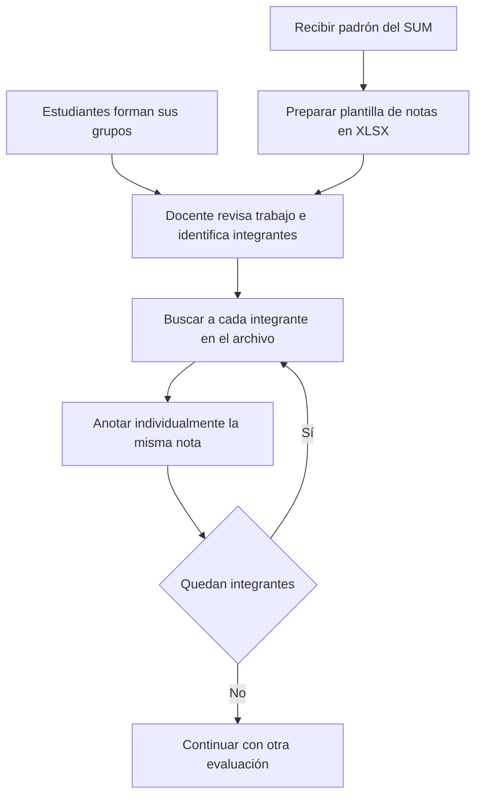
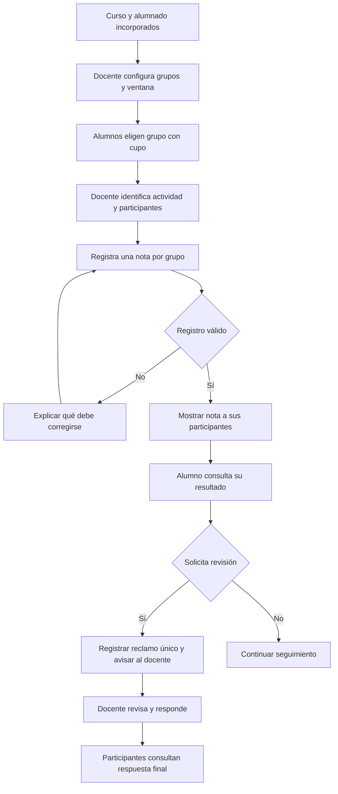

# Plataforma de gestión académica para el registro y seguimiento de evaluaciones grupales

## Carátula de trabajo

- Curso: Automatización y Control de Software 2026-2
- Entrega: avance de semana 8
- Contexto del caso: docente de la Universidad Nacional Mayor de San Marcos
- Institución de presentación: por completar
- Docente del curso: por completar
- Integrantes: por completar
- Fecha: por completar

## Presentación

El proyecto busca desarrollar una plataforma para el registro y seguimiento de evaluaciones grupales. Este documento reúne el análisis del caso, los objetivos del proyecto completo, la propuesta funcional, el prototipo documental y el plan de desarrollo. Los productos se presentan según su naturaleza: el diseño y los ejemplos ilustran el funcionamiento previsto; la evaluación se organiza en el plan de trabajo.

## Índice

1. Introducción y planteamiento del problema
2. Objetivos
3. Marco teórico
4. Caso de aplicación, alcance y requisitos
5. Propuesta de solución
6. Plan de desarrollo, indicadores y equipo
7. Conclusiones y recomendaciones
8. Bibliografía y fichas de investigación
9. Anexos: procesos, prototipo e instrumentos

La compilación reproduce las secciones fuente. Las fichas y referencias candidatas del capítulo 8 son material de investigación y se distinguen de la bibliografía utilizada. El plan interno de refinamiento no forma parte de este informe.

# 1. Introducción y planteamiento del problema

## 1.1 Introducción

La gestión de evaluaciones grupales requiere relacionar los trabajos evaluados con sus participantes, registrar calificaciones y permitir su revisión. Este proyecto plantea desarrollar una plataforma de gestión académica que reúna el registro y el seguimiento de las evaluaciones en los cursos del docente del caso de estudio, situado en la Universidad Nacional Mayor de San Marcos.

La plataforma contempla acceso docente y estudiantil, periodos, cursos, incorporación del padrón, matrícula, organización de grupos y puntos individuales. Dentro de ese contexto se seleccionan dos etapas relacionadas: el registro de evaluaciones grupales y el seguimiento mediante consulta de resultados y atención de reclamos. El docente conserva la responsabilidad de evaluar los trabajos y decidir sus calificaciones.

## 1.2 Realidad problemática

De acuerdo con el relato del responsable del proyecto sobre la situación comunicada por el profesor, este trabajaba con varios archivos XLSX. El SUM le proporcionaba la relación de alumnos, pero debía elaborar su propia plantilla para registrar notas. Los estudiantes formaban sus grupos por su cuenta.

Para registrar la calificación de un trabajo, el docente debía consultar o revisar el entregable, identificar si correspondía a un grupo y reconocer a sus integrantes. Después buscaba a cada alumno en su archivo de notas y anotaba individualmente la calificación. La evaluación de un solo trabajo grupal daba lugar, por tanto, a búsquedas y anotaciones repetidas.

Los alumnos tampoco disponían de un medio individual de consulta de sus puntos durante el ciclo, salvo sus propias anotaciones. El registro permanecía en poder del docente y su efecto se conocía al cierre del curso. Compartir el registro general planteaba una preocupación por la exposición de información de otros alumnos. La necesidad expresada incluía facilitar la revisión durante el ciclo y la comunicación oportuna de desacuerdos, en lugar de descubrir diferencias al finalizar.

El esfuerzo de búsqueda y anotación está descrito en el relato. Su incidencia sobre el tiempo es una interpretación del responsable del proyecto que deberá evaluarse; no se dispone de tiempos medidos ni de una frecuencia documentada de errores. Las aclaraciones del caso proceden de ese relato y de los acuerdos del equipo, no de entrevistas o mediciones realizadas para este informe.

## 1.3 Problema central

El registro de las evaluaciones grupales requiere identificar a los participantes de cada trabajo, buscarlos individualmente y repetir la anotación de una misma calificación en archivos separados. A esta gestión manual se suma la falta de un medio individual de consulta de puntos durante el ciclo que facilite la revisión de la información y el seguimiento de desacuerdos.

El problema no es el uso de hojas de cálculo en sí mismo, sino la separación entre la organización de los estudiantes, el registro de resultados y su revisión. Los cambios de grupo son una situación que debe contemplarse para conservar la correspondencia de cada evaluación, pero no constituyen el motivo principal del proyecto.

## 1.4 Formulación del problema

¿En qué medida el uso de una plataforma de gestión académica contribuye a mejorar el registro y seguimiento de las evaluaciones grupales en los cursos del docente del caso de estudio?

En esta pregunta, **registro** comprende la asociación de calificaciones con grupos y participantes, su revisión y corrección. **Seguimiento** comprende la consulta individual de resultados y la atención de reclamos. No se refiere al seguimiento del aprendizaje en todas sus dimensiones.

## 1.5 Justificación

El proyecto busca sustituir la búsqueda y anotación repetitiva por un registro de calificación por grupo, relacionado con los participantes de cada actividad. También propone un medio de consulta en el que cada estudiante acceda únicamente a sus puntos y notas grupales correspondientes, sin compartir el archivo general del docente.

La atención de reclamos permite complementar la consulta con un recorrido identificable de presentación, revisión y respuesta. La visibilidad de notas grupales y los reclamos dentro de la plataforma son decisiones adoptadas al delimitar la solución, no hechos que se atribuyan retrospectivamente a una petición inicial literal del profesor.

Se espera facilitar el trabajo de registro y la revisión oportuna de resultados. La magnitud de esa contribución se analizará mediante pruebas y criterios de evaluación. Su pertinencia para el curso radica en combinar actividades repetitivas, validaciones, eventos, estados, detección de situaciones excepcionales y seguimiento de solicitudes dentro de un proceso académico delimitado.

## 1.6 Delimitación general

El proyecto comprende el registro de notas grupales, consulta de resultados propios, reclamos, revisión docente y exportación XLSX por curso. La carga del padrón, el acceso autorizado y la selección de grupos son funciones de apoyo. La consulta y los reclamos de puntos individuales complementan el recorrido estudiantil; su aplicación en el cálculo de exportación se establece como supuesto de trabajo en la sección 5.

La plataforma no recibe trabajos ni administra sus plazos de entrega, no evalúa automáticamente su contenido y no se integra con el SUM para publicar calificaciones oficiales.

---

# 2. Objetivos

## 2.1 Objetivo general

Desarrollar una plataforma de gestión académica para el registro y seguimiento de las evaluaciones grupales en los cursos del docente del caso de estudio.

## 2.2 Objetivos específicos

1. Analizar el proceso actual de registro y seguimiento de las evaluaciones grupales para identificar las necesidades de los docentes y estudiantes.
2. Diseñar el funcionamiento de la plataforma a partir de los requisitos y las reglas del proceso de evaluación.
3. Implementar las funciones de registro y seguimiento de las evaluaciones grupales y las funciones de apoyo necesarias para su operación.
4. Evaluar la contribución de la plataforma al registro y seguimiento de las evaluaciones grupales mediante pruebas de funcionamiento e indicadores acordados.

## 2.3 Correspondencia con los productos del proyecto

| Objetivo         | Producto asociado                              | Apartados que lo desarrollan o planifican                |
| ---------------- | ---------------------------------------------- | -------------------------------------------------------- |
| OE1. Analizar    | Diagnóstico del proceso y requisitos           | 1 y 4; diagrama del proceso actual en 9                  |
| OE2. Diseñar     | Diseño funcional y prototipo                   | 4, 5 y prototipo P-01 en 9                               |
| OE3. Implementar | Plataforma con los recorridos acordados        | Funciones descritas en 4 y 5; actividades previstas en 6 |
| OE4. Evaluar     | Pruebas y evaluación de registro y seguimiento | Indicadores y plan de evaluación en 6; instrumentos en 9 |

Los objetivos corresponden al proyecto completo. Sus productos se desarrollan de manera progresiva conforme al plan de trabajo. La carga del padrón, la selección de grupos, la consulta de puntos, los reclamos y el aviso al docente se detallan en el alcance, sin convertirse en objetivos independientes.

---

# 3. Marco teórico

El proyecto tiene como objetivo desarrollar una plataforma de gestión académica para el registro y seguimiento de las evaluaciones grupales en los cursos del docente del caso de estudio. Este capítulo explica los conceptos que orientan su funcionamiento: automatización de tareas repetitivas, organización de la información académica, control de registros, seguimiento estudiantil, privacidad, accesibilidad y evaluación de la solución.

Se distinguen los fundamentos bibliográficos de las reglas particulares del proyecto. La descripción del proceso actual procede del relato del solicitante; las decisiones funcionales corresponden a los acuerdos registrados en el plan de refinamiento. Estas fuentes del caso no se presentan como entrevistas ni como resultados de observación directa.

## 3.1 Automatización de tareas repetitivas y gestión por procesos

La automatización consiste en ejecutar actividades recurrentes conforme a reglas definidas, sin exigir que una persona repita cada operación. La gestión por procesos permite examinar esas actividades como un conjunto relacionado de entradas, responsables, decisiones y resultados. La presentación editorial de Dumas et al. (2018) sitúa la identificación, el análisis, el rediseño, la automatización y el seguimiento dentro de un mismo ciclo de gestión.

Según el relato del solicitante, el registro anterior exige identificar a los integrantes de cada grupo y trasladar la misma nota, alumno por alumno, a Excel. La tarea repetitiva no es emitir el juicio académico, sino localizar a sus destinatarios y reproducir el resultado. La plataforma busca que el docente registre una calificación grupal y que esta se relacione con quienes participaron en la actividad, conservando su presentación individual al preparar el archivo del curso.

La ventaja esperada es reducir la repetición y las oportunidades de omisión o transcripción incorrecta. Su límite es que una regla equivocada o una composición de grupo mal registrada también puede reproducir errores. Por ello, se recomienda automatizar actividades con reglas claras y conservar la revisión docente sobre los resultados y sus correcciones. Automatizar el registro no equivale a calificar automáticamente los trabajos.

## 3.2 Gestión académica y organización de la información

En este proyecto, la gestión académica comprende la organización de cursos, grupos, evaluaciones, notas y puntos, junto con las responsabilidades de docentes y estudiantes. Digitalizar estos registros significa disponer de información ordenada para trabajar y consultar; mejorar la gestión requiere, además, definir quién registra, quién consulta y cómo se atienden las discrepancias.

UNESCO (s. f.), en la presentación del Informe GEM 2023, reconoce la gestión del sistema educativo entre los ámbitos en que puede contribuir la tecnología, pero también señala la importancia del acceso, la regulación y la preparación docente. Este enfoque permite situar la plataforma como apoyo a una necesidad académica concreta, no como una mejora educativa garantizada por el solo uso de medios digitales.

La organización común de la información puede facilitar su consulta y disminuir la necesidad de reunir registros separados. Como contrapartida, exige mantenerlos actualizados y que los usuarios comprendan el procedimiento. Se recomienda delimitar la plataforma al registro y seguimiento de evaluaciones, sin confundirla con un sistema que recibe trabajos, controla entregas o administra todos los procesos de la institución.

## 3.3 Evaluación grupal y pertenencia histórica

La evaluación grupal produce una calificación asociada a una actividad colectiva. Para el registro académico, es necesario distinguir la nota del grupo de la identificación de los estudiantes a quienes corresponde. La pertenencia histórica representa quiénes integraban el grupo cuando se realizó la actividad, aunque después se hayan trasladado a otro.

Esta distinción evita atribuir una nota anterior a los integrantes actuales que no participaron en el trabajo. También permite reconocer a quienes sí participaron cuando consultan el resultado o presentan un reclamo. Su ventaja es conservar una relación explicable entre actividad, grupo y estudiante; su dificultad reside en disponer de información confiable sobre esa participación. No permite deducir cuánto aportó cada integrante ni demostrar por sí sola la equidad de la calificación.

En el caso acordado, el docente define el número de grupos y su capacidad. Los alumnos eligen o cambian de grupo durante una ventana habilitada y sujetos a cupo. Una reapertura permite la selección a todo el curso, pero no modifica la participación registrada en actividades anteriores. Mantener esta separación es recomendable cuando los grupos pueden cambiar durante el periodo académico.

## 3.4 Registro y control académico

El registro conserva un resultado y su contexto: curso, evaluación, grupo o alumno correspondiente. El control académico comprende la revisión de que esa información sea completa, coherente y susceptible de corrección por el responsable. La trazabilidad, en este contexto, es la posibilidad de explicar a qué actividad corresponde una nota y reconocer las modificaciones pertinentes.

Un control esencial es distinguir una nota pendiente de una calificación de cero. La primera indica que todavía no se ha registrado un resultado; la segunda expresa una decisión académica del docente. Confundirlas alteraría la interpretación del avance y de los promedios. Del mismo modo, una corrección debe quedar vinculada al registro que modifica, en lugar de generar resultados contradictorios.

Los puntos individuales se conservan como un registro distinto de la nota grupal. Como supuesto de trabajo acordado con el solicitante, no como regla confirmada por el profesor, se contempla aplicarlos automáticamente al preparar la exportación del curso: cada punto aumenta una unidad de nota individual en los trabajos con margen, sin superar 20 por trabajo ni modificar las notas grupales base. Los trabajos tienen igual peso y los puntos no se repiten entre ellos; el excedente queda identificado sin aplicación.

La exportación solo calcula: no consume ni modifica los puntos. El promedio de cierre requiere las notas de los trabajos incluidos y se muestra con dos decimales, redondeando únicamente el resultado final. Estas reglas ilustran la importancia de separar los registros originales de los resultados calculados. El detalle definitivo de las columnas del archivo permanece por precisar.

El beneficio esperado del control es facilitar la revisión y evitar interpretaciones ambiguas. Su costo es la necesidad de acordar y mantener reglas comprensibles; ninguna validación sustituye la responsabilidad docente sobre la calificación.

## 3.5 Seguimiento, consulta y atención de reclamos

El seguimiento académico es la posibilidad de consultar los resultados y conocer la atención de las discrepancias a lo largo del curso. Se diferencia del registro porque considera lo que ocurre después de guardar una nota: acceso del estudiante, identificación de posibles errores y respuesta del docente.

En la plataforma, las notas grupales y los puntos quedan disponibles para sus destinatarios cuando el docente confirma su registro, sin una publicación posterior. Cada alumno consulta sus puntos y las notas de las actividades en las que participó. Esta disponibilidad puede favorecer una revisión oportuna, aunque no garantiza que el alumno consulte o comprenda el resultado.

El reclamo es una solicitud de revisión vinculada a un registro específico. Su recorrido es **Pendiente → En revisión → Respondido**. El docente emite la decisión final y explica por qué mantiene o corrige el resultado. Responder no cambia automáticamente una nota o un movimiento de puntos: la corrección, cuando corresponda, es una acción expresa del docente.

Cualquier participante de una actividad puede presentar el único reclamo del grupo sobre esa evaluación. Los participantes históricos y el docente pueden consultar su estado y respuesta. Para puntos individuales, solo el alumno titular puede reclamar sobre un movimiento propio y consultar la respuesta con el docente. No se admiten solicitudes duplicadas sobre el mismo registro ni reapertura después de la respuesta.

Al presentar un reclamo se avisa por correo al docente responsable mediante un mensaje breve y un enlace, sin incluir calificaciones, puntos o el texto del reclamo. El aviso facilita advertir una solicitud nueva, pero no reemplaza su atención dentro de la plataforma ni acredita que el mensaje haya sido leído. Este procedimiento aporta orden y un estado consultable, a cambio de requerir atención docente; no constituye una conversación ni una instancia adicional de apelación.

## 3.6 Privacidad y confidencialidad académica

La privacidad implica limitar el uso y la divulgación de información personal; la confidencialidad exige que los registros sean conocidos únicamente por sus destinatarios autorizados. En una plataforma académica, disponer de información centralizada no justifica hacerla visible a todo el curso.

Las reglas del caso aplican esta distinción: los puntos y sus reclamos son individuales; las notas y los reclamos grupales se consultan según la participación en la actividad. Un traslado de grupo no concede acceso a resultados anteriores de otros estudiantes. Los avisos por correo remiten a la plataforma sin exponer el contenido académico, y los ejemplos de demostración deben utilizar datos ficticios.

Estas medidas buscan evitar la exposición innecesaria y permitir consultas propias sin divulgar resultados ajenos. Exigen, como contrapartida, revisar cuidadosamente los destinatarios de cada información. Son criterios funcionales de protección; la normativa aplicable requiere una revisión específica antes de afirmar cumplimiento legal.

## 3.7 Accesibilidad y facilidad de uso

La accesibilidad busca que personas con diferentes capacidades puedan percibir, comprender y utilizar la información. WCAG 2.2 organiza este propósito en cuatro principios: perceptible, operable, comprensible y robusto (World Wide Web Consortium, 2024). La facilidad de uso se refiere aquí a que docentes y estudiantes puedan completar sus tareas y entender sus resultados sin confusión innecesaria.

Para el proyecto, estos conceptos orientan etiquetas claras, navegación consistente, texto legible, uso del teclado, indicación visible de la posición de navegación y mensajes que expliquen cómo corregir errores. Los estados de los reclamos deben reconocerse mediante palabras, no solo colores. También debe ser evidente la diferencia entre una nota pendiente y un cero registrado.

Estas medidas pueden reducir barreras en el registro y la consulta. Su límite es que requieren evaluación con los recorridos completos y no cubren todas las necesidades de todas las personas. Se recomienda considerarlas desde el diseño; una representación de pantallas no basta para declarar conformidad con WCAG.

## 3.8 Prototipo y evaluación de la solución

Un prototipo representa la organización de la información y los recorridos de uso para revisar si el diseño comunica lo necesario. Permite discutir cómo registrar una nota grupal, consultar resultados propios y atender un reclamo antes de cerrar las decisiones de funcionamiento. Su utilidad es detectar omisiones y ambigüedades; su límite es que mostrar una pantalla no demuestra la corrección de los registros ni la mejora del proceso.

Las pruebas de funcionamiento contrastan acciones y reglas con resultados esperados. La evaluación del proyecto examina su contribución al registro y seguimiento mediante indicadores acordados. Conviene distinguir ambas: cumplir una regla no demuestra, por sí solo, que el procedimiento sea más rápido o comprensible.

Como dimensiones candidatas se consideran el tiempo necesario para registrar notas, la correspondencia entre participantes y resultados, la posibilidad de completar una consulta propia y la comprensión del estado y respuesta de un reclamo. El método, los participantes y los valores de comparación deben acordarse antes de medir. Una comparación con el procedimiento anterior requerirá tareas equivalentes y condiciones descritas; no se atribuyen mejoras sin evidencia.

En conjunto, estos conceptos orientan una plataforma que disminuya operaciones repetitivas, conserve registros interpretables y facilite el seguimiento por sus destinatarios, manteniendo el juicio académico y la resolución de reclamos bajo responsabilidad docente.

---

# 4. Caso de aplicación, alcance y requisitos

## 4.1 Visión general de la plataforma

La plataforma organiza los cursos del docente por periodo académico. A partir del padrón institucional se habilita el acceso de los alumnos y su vinculación al curso. Estos pueden elegir grupo durante la ventana establecida y consultar sus resultados. El docente registra notas grupales y puntos individuales, revisa reclamos y descarga la información del curso en XLSX.

| Componente                          | Relación con el proyecto                                                                               |
| ----------------------------------- | ------------------------------------------------------------------------------------------------------ |
| Periodos y cursos                   | Contexto de organización y responsabilidad docente                                                     |
| Padrón, acceso y matrícula          | Incorporación y vinculación de alumnos autorizados; no equivale a matricularlos oficialmente en el SUM |
| Configuración y selección de grupos | Apoyo para identificar participantes de las evaluaciones                                               |
| Registro de notas grupales          | Primera etapa principal: una calificación por grupo y actividad                                        |
| Consulta de resultados y reclamos   | Segunda etapa principal: seguimiento de evaluaciones                                                   |
| Puntos individuales                 | Registro y consulta relacionados; reclamos privados y cálculo individual al exportar                   |
| Exportación XLSX                    | Salida por curso para uso del docente, sin integración con el SUM                                      |

## 4.2 Actores y responsabilidades

**Docente responsable:** prepara sus cursos, incorpora alumnos, define número y capacidad de grupos y habilita su selección. Evalúa los trabajos fuera de la plataforma, registra y corrige notas y puntos, atiende reclamos y exporta la información. Decide sobre la procedencia de cada reclamo.

**Alumno autorizado:** accede a sus cursos, elige o cambia de grupo cuando está permitido, consulta sus resultados y presenta reclamos sobre los registros que le corresponden. No modifica calificaciones ni consulta información académica ajena.

La plataforma relaciona registros, verifica condiciones, muestra resultados y estados y avisa al docente de nuevos reclamos. No sustituye su juicio académico.

## 4.3 Frontera del proceso

- **Entradas:** curso, alumnado autorizado, grupos y participantes identificados, actividades evaluadas y calificaciones decididas por el docente.
- **Registro:** selección de curso y actividad, ingreso de la nota grupal, asociación con participantes, revisión de pendientes y correcciones.
- **Seguimiento:** consulta de resultados propios, presentación de reclamos, revisión y respuesta final del docente.
- **Salidas:** registros consultables, reclamos con estado y respuesta y archivo XLSX del curso.

La selección de grupos y la carga del padrón habilitan el recorrido principal. La consulta y atención de reclamos de puntos se incluyen como funciones relacionadas, no como calificaciones grupales adicionales.

## 4.4 Requisitos funcionales

| ID  | Función requerida                                                                                                                           |
| --- | ------------------------------------------------------------------------------------------------------------------------------------------- |
| R01 | Organizar periodos y cursos bajo responsabilidad docente y limitar el acceso a sus usuarios autorizados                                     |
| R02 | Incorporar alumnos desde el padrón, revisar los datos y evitar duplicados o asociaciones al curso incorrecto                                |
| R03 | Permitir al docente definir número y capacidad de grupos y abrir, ampliar o reabrir la ventana para todo el curso                           |
| R04 | Permitir elegir y cambiar de grupo únicamente con ventana abierta y cupo disponible                                                         |
| R05 | Relacionar cada actividad con el grupo y sus integrantes al momento de realizarla                                                           |
| R06 | Registrar y corregir una nota de 0 a 20 por grupo y evaluación, conservando la información del cambio                                       |
| R07 | Registrar puntos individuales y permitir corregir asignaciones sin perder el registro original                                              |
| R08 | Mostrar a cada alumno sus puntos y notas grupales correspondientes al quedar registrados                                                    |
| R09 | Recibir un reclamo por grupo y evaluación de cualquier participante de aquella actividad, y compartirlo con esos participantes y el docente |
| R10 | Recibir un reclamo por movimiento de puntos, privado entre el alumno correspondiente y el docente                                           |
| R11 | Mostrar el recorrido Pendiente → En revisión → Respondido, con decisión final y respuesta motivada del docente                              |
| R12 | Avisar por correo al docente de cada nuevo reclamo mediante mensaje breve y enlace, sin resultados académicos ni texto del reclamo          |
| R13 | Evitar un segundo reclamo sobre el mismo registro, incluso después de su respuesta; no admitir réplica ni reapertura del alumno             |
| R14 | Exportar información por curso, con notas por alumno, puntos y cálculo individual según la regla de trabajo descrita en 5                   |

Estos requisitos expresan el alcance académico acordado. La validación de información y la atención de solicitudes forman parte de la solución sin desplazar el eje de registro y seguimiento de evaluaciones.

## 4.5 Reglas de funcionamiento

- Una nota o un movimiento de puntos confirmado queda visible para sus destinatarios, sin publicación adicional.
- Una nota no registrada permanece vacía o pendiente; cero es una calificación que el docente registra expresamente.
- La nota y el reclamo grupal corresponden a los participantes de la actividad, aunque después cambien de grupo.
- Los estudiantes eligen entre grupos configurados por el docente; no crean grupos ni son asignados automáticamente.
- La reapertura habilita cambios para todo el curso, sujetos a cupo; no concede una excepción individual de selección.
- Responder favorablemente un reclamo no cambia automáticamente una nota o un movimiento: el docente realiza la corrección que proceda.
- El aviso por correo no sustituye la consulta del reclamo y su respuesta en la plataforma.

## 4.6 Condiciones de calidad

La información debe ser comprensible, permitir identificar pendientes y errores y conservar la privacidad de cada actor. Los recorridos deben poder realizarse con teclado, contar con etiquetas y mensajes claros y no comunicar estados solo por color. El registro repetido de una misma acción no debe producir duplicados. Ante un fallo se debe explicar si el registro fue confirmado o necesita revisión.

## 4.7 Exclusiones

No se incluye recepción de trabajos, plazos de entrega, contenidos de clase, asistencia, foros, mensajería general, evaluación automática del contenido, integración con el SUM, actas oficiales, apelaciones, correos al alumno o recordatorios automáticos. La petición de reabrir la ventana de grupos no se incorpora como una categoría adicional de reclamo en la plataforma.

La corrección individual excepcional de una nota grupal se mantiene fuera del alcance. El ajuste individual por puntos en el archivo exportado es una regla distinta, expresamente declarada como supuesto del equipo.

---

# 5. Propuesta de solución

## 5.1 Descripción general

Se propone una plataforma en la que el docente registre una nota por grupo y evaluación y la información quede relacionada con los alumnos que participaron en la actividad. Así se busca reemplazar la búsqueda y anotación individual de una misma nota. Los alumnos consultarían sus resultados y podrían presentar reclamos con seguimiento dentro del mismo entorno.

El funcionamiento se organiza en registro y seguimiento, con apoyo de la incorporación del padrón, el acceso autorizado y la selección de grupos. La exportación permite obtener la información del curso para uso posterior del docente.

## 5.2 Preparación del curso

El docente seleccionaría periodo y curso e incorporaría el padrón de alumnos recibido del SUM. La revisión distinguiría datos aceptados, incompletos y repetidos antes de confirmar su incorporación. Esta carga habilita el acceso al curso; no importa calificaciones.

El docente definiría cuántos grupos habrá, su capacidad y la ventana de selección. Durante esa ventana, los alumnos elegirían y podrían cambiar de grupo si existe cupo. Si se necesita otra oportunidad, el docente puede ampliar o reabrir la selección para todo el curso. Esta reapertura no cambia la relación de los alumnos con actividades ya realizadas.

## 5.3 Registro de evaluaciones

1. El docente identifica curso, actividad y fecha de realización.
2. La plataforma muestra los grupos y participantes correspondientes a esa actividad.
3. El docente registra una nota grupal entre 0 y 20.
4. Se comprueban el curso, los permisos y la validez del dato.
5. Al confirmarse, la nota queda disponible para los participantes de la actividad.
6. El docente revisa las notas registradas y los campos pendientes. Si corrige un resultado, se conserva la información del cambio.

La actividad se evalúa fuera de la plataforma. Una nota pendiente no se interpreta como incumplimiento ni se sustituye por cero. Los puntos individuales se registran por separado y son visibles para el alumno correspondiente al confirmarse.

## 5.4 Consulta y reclamos

Cada alumno consultaría sus puntos y las notas grupales que le corresponden. Para una nota grupal, cualquier participante puede presentar el reclamo en nombre del grupo de aquella actividad; los demás participantes históricos y el docente pueden consultar el mismo caso. Para puntos, únicamente el alumno afectado y el docente acceden al reclamo y su respuesta.

El recorrido acordado es **Pendiente → En revisión → Respondido**. Al recibirse un reclamo se envía un correo al docente con aviso breve y enlace, sin notas, puntos ni texto del reclamo. El docente revisa, decide si corresponde mantener o corregir el registro y explica su decisión dentro de la plataforma.

Se admite un solo reclamo por grupo y evaluación y uno por movimiento de puntos. La respuesta es final: no se incluye réplica del alumno, reapertura ni una nueva solicitud sobre el mismo registro. La corrección, cuando proceda, es una actuación expresa del docente, no un efecto automático de responder.

## 5.5 Correspondencia ante cambios de grupo

Si un alumno realizó una actividad con el grupo A y después pasó al B, conserva la nota que le corresponda por aquella actividad de A. También puede reclamarla en nombre de A y consultar su respuesta. Los integrantes de B no adquieren acceso a ese reclamo por compartir ahora grupo con él.

Esta regla preserva la relación entre trabajo, nota y participantes. Es una condición de coherencia del proceso, no su problema central. Si no se conoce la participación en una actividad, se requiere revisión docente en lugar de asumirla a partir del grupo actual.

## 5.6 Exportación XLSX y aplicación de puntos

El docente podría descargar por curso las notas base de cada evaluación por alumno, sus puntos y el resultado individual calculado. Las notas se atribuyen según los participantes de cada actividad. Una nota sin registrar permanece vacía también en el archivo; mientras falten notas del conjunto de trabajos incluido, el promedio de cierre se mantiene pendiente.

**Supuesto de trabajo del equipo:** como no se pudo confirmar con el profesor una regla de aplicación de puntos, se adopta una bonificación individual automática sobre los trabajos grupales al preparar la exportación. Esta regla es revisable y no se atribuye como una instrucción del docente.

- Los trabajos tienen igual peso.
- Un punto aumenta una unidad de nota de un trabajo, sin que cada nota ajustada supere 20.
- Los puntos se aplican una sola vez dentro del cálculo, donde exista margen. No se añade el saldo completo a cada trabajo ni directamente al promedio.
- Se conservan las notas grupales originales y los resultados de los compañeros.
- Si todos los trabajos alcanzan 20, el saldo restante es excedente sin efecto sobre la calificación; no se elimina del registro ni se convierte en otro beneficio.
- Descargar solo calcula: no consume, descuenta ni modifica puntos. Con iguales datos y reglas, las exportaciones repetidas mantienen los mismos resultados académicos.
- El promedio se muestra con dos decimales, redondeando únicamente el resultado final.

Para un alumno con todas las notas del conjunto de trabajos registradas y saldo no negativo, el cálculo equivalente es:

1. **Margen disponible:** sumar cuánto le falta a cada nota base para alcanzar 20.
2. **Puntos aplicados:** tomar el menor valor entre el saldo de puntos y ese margen.
3. **Promedio ajustado:** dividir la suma de notas base más los puntos aplicados entre el número de trabajos.
4. **Excedente:** restar los puntos aplicados al saldo disponible.

Ejemplo ilustrativo: notas base 20, 18 y 17, con dos puntos. El margen total es cinco; se aplican los dos puntos y el promedio ajustado es (20 + 18 + 17 + 2) / 3 = **19,00**. No hace falta elegir manualmente a qué trabajo asignarlos para obtener ese promedio, porque todos tienen el mismo peso.

La salida propuesta distingue notas grupales base, promedio base, saldo, puntos aplicados, excedente y promedio ajustado. No se presentan notas individuales ajustadas por trabajo como definitivas hasta acordar cómo se mostraría su distribución. El archivo no constituye un acta oficial ni se envía al SUM.

## 5.7 Validaciones y tratamiento de situaciones excepcionales

| Situación                                     | Respuesta funcional esperada                                                                      |
| --------------------------------------------- | ------------------------------------------------------------------------------------------------- |
| Datos del padrón incompletos o repetidos      | Explicar los registros que requieren revisión y evitar duplicados                                 |
| Acceso a otro curso o resultado ajeno         | Denegar la consulta o modificación                                                                |
| Grupo lleno o ventana cerrada                 | Explicar por qué no se permite el cambio y mantener el grupo anterior                             |
| Nota fuera de rango o dato no numérico        | Solicitar corrección sin confirmar una nota inválida                                              |
| Nota vacía                                    | Mostrar pendiente, sin asignar cero                                                               |
| Cambio de grupo posterior a la actividad      | Conservar los participantes originales para nota y reclamo                                        |
| Segundo reclamo del mismo registro            | Mostrar el caso existente a sus destinatarios autorizados                                         |
| Respuesta favorable a un reclamo              | Permitir corrección expresa por el docente y conservar su explicación                             |
| Fallo al registrar o confirmar una acción     | Informar el estado y permitir comprobarlo sin repetir registros                                   |
| Fallo del aviso por correo                    | Mantener el reclamo registrado; definir antes del desarrollo cómo se informa y reintenta el aviso |
| Exportación con notas pendientes              | Conservar campos vacíos y no presentar el promedio como completo                                  |
| Saldo negativo o regla de puntos no aplicable | Requerir definición de la regla antes de producir un ajuste no acordado                           |

## 5.8 Beneficios esperados y límites

Se espera reducir la repetición de búsquedas y anotaciones, facilitar la consulta privada de resultados y ofrecer un recorrido visible para los reclamos. Estos beneficios dependen de que alumnado, actividades y grupos estén correctamente relacionados y de que el docente mantenga los registros actualizados.

La automatización no decide la calificación de un trabajo, no resuelve por sí sola un reclamo ni reemplaza el criterio académico. Las dimensiones para evaluar su contribución se plantean en el plan de desarrollo.

---

# 6. Plan de desarrollo, indicadores y equipo

## 6.1 Orientación del desarrollo

El proyecto tiene como objetivo desarrollar una plataforma de gestión académica para el registro y seguimiento de las evaluaciones grupales en los cursos del docente del caso de estudio. El plan articula los cuatro objetivos específicos: analizar el proceso y sus necesidades, diseñar el funcionamiento, implementar las funciones previstas y evaluar su contribución mediante pruebas e indicadores acordados.

El desarrollo se organizará en torno a los siguientes recorridos funcionales:

1. **Organización del curso y los grupos.** El docente define la cantidad de grupos, su capacidad y la ventana de selección. Los alumnos eligen y pueden cambiar de grupo mientras la ventana esté abierta y exista cupo. Una ampliación o reapertura habilita la selección para todo el curso. Se conserva la participación en cada actividad para atribuir correctamente sus notas y reclamos posteriores.
2. **Registro y consulta de resultados.** El docente registra y corrige las notas grupales y los puntos individuales. Al confirmar el registro, cada alumno puede consultar inmediatamente sus propios puntos y las notas de las actividades en las que participó, sin una publicación adicional. Las notas sin registrar permanecen vacías o pendientes, no se convierten en cero.
3. **Seguimiento de reclamos.** Cualquier participante de una actividad puede presentar el único reclamo de su grupo para esa evaluación; los participantes de esa actividad y el docente consultan el caso. Cada alumno puede reclamar sobre sus propios movimientos de puntos, de forma privada con el docente y con un único reclamo por movimiento. El recorrido es **Pendiente → En revisión → Respondido**. El docente fundamenta su decisión y realiza expresamente la corrección cuando corresponda. No se contempla réplica, reapertura ni otro reclamo sobre el mismo registro.
4. **Aviso al docente.** Un nuevo reclamo genera un correo breve al docente responsable con un enlace para revisarlo en la plataforma, sin notas, puntos ni texto del reclamo. El seguimiento y la respuesta se mantienen en la plataforma.
5. **Exportación por curso.** El docente obtiene un archivo XLSX con las notas correspondientes a cada alumno según su participación en las actividades y los datos de puntos. La descarga sirve de apoyo al docente y no supone una integración con el SUM.

Para la exportación se adopta como **supuesto de trabajo del equipo, no confirmado por el profesor**, la aplicación automática de puntos a los trabajos grupales antes de obtener el promedio individual. Los trabajos tienen igual peso; cada punto aumenta una unidad de nota individual hasta un máximo de 20 por trabajo, aprovechando el margen disponible sin repetir puntos ni alterar las notas grupales base. Los puntos que excedan ese margen se conservan como excedente no aplicado.

Exportar solo calcula: no consume ni modifica los puntos. Con los mismos datos y reglas, las descargas sucesivas deben conservar los mismos resultados académicos. Si faltan notas, permanecen vacías y no se presenta un promedio final ajustado como completo. El promedio de cierre se muestra con dos decimales y se redondea únicamente al final, conservando la precisión de los cálculos intermedios. El detalle definitivo de las columnas del archivo queda por precisar.

## 6.2 Cronograma tentativo

La guía establece un hito de análisis, diseño y prototipo en la semana 8 y otro de implementación, pruebas y evaluación en la semana 16. Ambos forman parte del mismo proyecto de desarrollo; la distribución intermedia siguiente es una propuesta de organización, sujeta a las fechas y disponibilidad del equipo.

| Periodo       | Actividades previstas                                                                                                                                          | Producto esperado                                                     |
| ------------- | -------------------------------------------------------------------------------------------------------------------------------------------------------------- | --------------------------------------------------------------------- |
| Semanas 1–4   | Analizar el proceso de evaluación grupal, identificar necesidades y delimitar objetivos, actores y alcance.                                                    | Diagnóstico y requisitos.                                             |
| Semanas 5–7   | Diseñar la organización de grupos, el registro y consulta de resultados, los reclamos y la exportación; representar los recorridos en el prototipo documental. | Diseño funcional y prototipo documental.                              |
| Semana 8      | Integrar el análisis y el diseño, revisar el prototipo y preparar el informe y la presentación de avance.                                                      | Entrega de análisis, diseño y prototipo prevista por la guía.         |
| Semanas 9–10  | Desarrollar la organización de cursos y grupos, y el registro de notas y puntos con su consulta restringida.                                                   | Recorrido de registro y consulta.                                     |
| Semanas 11–12 | Desarrollar el seguimiento de reclamos, el aviso por correo y la exportación con las reglas de cálculo acordadas.                                              | Recorridos de seguimiento y exportación.                              |
| Semanas 13–14 | Probar los recorridos completos, revisar la correspondencia de resultados y corregir las dificultades encontradas.                                             | Registro de pruebas y ajustes.                                        |
| Semana 15     | Realizar la evaluación con escenarios simulados comparables y analizar los indicadores y sus limitaciones.                                                     | Resultados de evaluación.                                             |
| Semana 16     | Consolidar la plataforma, las pruebas, la evaluación y la presentación final.                                                                                  | Entrega de implementación, pruebas y evaluación prevista por la guía. |

## 6.3 Evaluación e indicadores propuestos

La evaluación buscará determinar la contribución de la plataforma al registro y seguimiento de las evaluaciones grupales. Los indicadores siguientes son propuestas para acordar antes de la evaluación; no representan resultados obtenidos ni metas numéricas aprobadas.

| Indicador propuesto                      | Qué se observará                                                                                                                               | Criterio de revisión                                                                                                                                                                            |
| ---------------------------------------- | ---------------------------------------------------------------------------------------------------------------------------------------------- | ----------------------------------------------------------------------------------------------------------------------------------------------------------------------------------------------- |
| Tiempo de registro                       | Tiempo necesario para registrar un mismo conjunto de evaluaciones grupales mediante un procedimiento manual simulado y mediante la plataforma. | Comparar las condiciones y los tiempos observados para explorar una posible reducción. Esta es una hipótesis del equipo, no una dificultad temporal cuantificada ni confirmada por el profesor. |
| Correspondencia entre nota e integrantes | Coincidencia entre la nota de una actividad y los alumnos que participaron en ella, incluidos quienes después cambian de grupo.                | Contrastar los resultados con la relación de participantes prevista para cada actividad del escenario.                                                                                          |
| Consulta restringida e inmediata         | Disponibilidad de notas y puntos tras confirmar su registro y delimitación de lo que puede consultar cada alumno.                              | Comprobar que no se requiere otra publicación y que cada alumno accede solo a sus puntos y a las notas que le corresponden.                                                                     |
| Seguimiento de reclamos                  | Presentación, consulta, estados y respuesta de los reclamos grupales e individuales.                                                           | Revisar el recorrido Pendiente → En revisión → Respondido, la privacidad, la participación histórica, la restricción de duplicados y la decisión fundamentada del docente.                      |
| Aviso por correo al docente              | Generación del aviso ante un nuevo reclamo y contenido del mensaje.                                                                            | Verificar destinatario, enlace y ausencia de datos académicos y del texto del reclamo; distinguir el envío de la entrega o lectura del correo.                                                  |
| Exactitud de la exportación              | Correspondencia de las notas por alumno y de los resultados calculados con los casos preparados.                                               | Revisar aplicación automática de puntos, igual peso, máximo de 20 por trabajo, excedentes, ausencia de consumo, notas pendientes vacías y promedio con redondeo final a dos decimales.          |

Se prepararán escenarios simulados con grupos, actividades, cambios de integrantes, notas, puntos y reclamos. Para cada caso se definirá previamente el resultado esperado y luego se registrarán lo observado y las diferencias. Se incluirán tanto recorridos habituales como situaciones con notas pendientes, trabajos en el máximo de calificación y puntos excedentes.

La comparación del tiempo de registro utilizará las mismas entradas, cantidad de grupos y tareas en ambos procedimientos, con preparación equivalente para los participantes. Antes de realizarla se acordarán participantes, repeticiones, condiciones y forma de resumir los tiempos. No se dispone de una línea base histórica de tiempos ni de solicitudes o reclamos; por ello, la simulación no se presentará como una medición del desempeño anterior del docente. Los demás indicadores se revisarán contra los criterios funcionales de los escenarios, sin inventar reducciones de reclamos ni porcentajes de mejora.

## 6.4 Organización del equipo

Se prevé un equipo de cinco integrantes. Los nombres y la asignación personal de responsabilidades están pendientes; se proponen los siguientes roles funcionales:

| Rol                                 | Responsabilidad principal                                                                                     | Integrante        |
| ----------------------------------- | ------------------------------------------------------------------------------------------------------------- | ----------------- |
| Coordinación y análisis del proceso | Organizar el trabajo, mantener el alcance y reunir las necesidades y acuerdos del caso.                       | Nombre pendiente. |
| Diseño funcional y prototipo        | Representar los recorridos del docente y del alumno y revisar su claridad y facilidad de uso.                 | Nombre pendiente. |
| Registro y organización académica   | Desarrollar las funciones de cursos, grupos, participación, notas y puntos.                                   | Nombre pendiente. |
| Seguimiento y comunicación          | Desarrollar la consulta de resultados, los reclamos y el aviso al docente.                                    | Nombre pendiente. |
| Evaluación y documentación          | Coordinar las pruebas y los indicadores, revisar la exportación y consolidar el informe y las presentaciones. | Nombre pendiente. |

Los roles organizan la responsabilidad principal, no el trabajo exclusivo de cada integrante. Se propone revisar en conjunto los recorridos completos y los resultados de evaluación, y ajustar la distribución de tareas según el avance.

---

# 7. Conclusiones y recomendaciones

## 7.1 Conclusiones de análisis y diseño

1. El análisis permite delimitar una propuesta orientada a desarrollar una plataforma de gestión académica para el registro y seguimiento de las evaluaciones grupales en los cursos del docente del caso de estudio. La consulta de resultados y la atención de reclamos concretan el seguimiento; la organización de grupos y la incorporación de alumnos lo habilitan. Los puntos individuales y la exportación completan el recorrido acordado.
2. La correspondencia entre una evaluación y quienes participaron en ella es una regla central del diseño. Un cambio posterior de grupo no debe alterar las notas que corresponden al alumno ni el acceso al reclamo de aquella actividad. La elección estudiantil de grupos se desarrolla dentro de la capacidad y la ventana definidas por el docente; su reapertura habilita la selección para todo el curso.
3. La consulta de resultados y el seguimiento de reclamos requieren reglas de visibilidad diferenciadas. Las notas y los puntos se hacen visibles al confirmar su registro, sin una publicación posterior. Los reclamos grupales se comparten con los participantes de la actividad, mientras que los reclamos de puntos permanecen entre el alumno y el docente. Los estados Pendiente, En revisión y Respondido permiten representar un recorrido con decisión final fundamentada del docente.
4. La exportación distingue la nota grupal base de los resultados individuales derivados de los puntos. La aplicación automática propuesta conserva las notas base, respeta el máximo por trabajo y no consume puntos al descargar. Esta regla de cálculo se mantiene como supuesto del equipo, no como criterio confirmado por el profesor.
5. El análisis, el diseño y el prototipo documental permiten organizar el funcionamiento previsto y orientar su desarrollo. Su contribución al proceso deberá evaluarse mediante pruebas y los indicadores propuestos en el apartado 6; estas conclusiones no establecen una reducción medida del tiempo de registro ni una eficacia comprobada de la plataforma.

## 7.2 Recomendaciones y pendientes

- Revisar con el equipo los recorridos y el prototipo documental. Mantener explícito y revisable el supuesto de aplicación de puntos, sin atribuirle confirmación del profesor, con quien no se dispuso de una nueva oportunidad de consulta.
- Precisar el detalle de columnas de la exportación, el tratamiento de movimientos de puntos negativos o anulados y la cantidad de decimales admitida al registrar notas. Si se muestran notas ajustadas por trabajo, acordar una distribución automática reproducible de los puntos.
- Definir cómo se informará al docente un fallo del aviso por correo y cómo podrá reconocer los reclamos pendientes desde la plataforma.
- Acordar por qué medio se solicita un cambio de grupo después del cierre y si se necesita una intervención docente distinta de reabrir la selección para todo el curso, sin incorporarla por defecto al recorrido de reclamos académicos.
- Concretar los escenarios, participantes y condiciones de evaluación. Contrastar los resultados con criterios acordados y, para el tiempo de registro, con un procedimiento manual simulado equivalente, sin atribuirle carácter de línea base histórica.
- Completar los nombres y responsabilidades de los cinco integrantes, ajustar las fechas del cronograma y preparar el informe y las presentaciones correspondientes.

---

# 8. Bibliografía y fichas de investigación

## 8.1 Criterio de selección

Se incluyen fuentes pertinentes para comprender la automatización de actividades repetitivas, la gestión académica y la accesibilidad. Se distingue entre contenido consultado, presentaciones editoriales y fuentes candidatas: comprobar una referencia no equivale a haber leído toda la obra. Las reglas particulares de notas, grupos, puntos y reclamos proceden de los acuerdos del caso, no de la bibliografía externa.

Las fuentes de este capítulo respaldan únicamente las afirmaciones indicadas en sus fichas. No acreditan resultados del proyecto ni sustituyen la evaluación de su contribución al proceso académico.

## 8.2 Bibliografía utilizada

_Automatizacion y control de software: Guía del trabajo final del curso_. (s. f.). [Guía de curso en PDF proporcionada por el usuario; sin autor identificado].

Dumas, M., La Rosa, M., Mendling, J., & Reijers, H. A. (2018). _Fundamentals of business process management_ (2.ª ed.). Springer. https://doi.org/10.1007/978-3-662-56509-4

UNESCO. (s. f.). _Technology in education: A tool on whose terms?_ [Presentación del Informe GEM 2023]. Recuperado el 15 de octubre de 2026, de https://www.unesco.org/gem-report/en/technology

World Wide Web Consortium. (2024, 12 de diciembre). _Web Content Accessibility Guidelines (WCAG) 2.2_. https://www.w3.org/TR/2024/REC-WCAG22-20241212/

## 8.3 Fichas de fuentes consultadas

### Ficha 1. Gestión por procesos y automatización

- **Fuente:** Dumas et al. (2018).
- **Tipo:** libro académico; consulta de su presentación editorial en Springer.
- **Enlace consultado:** https://link.springer.com/book/10.1007/978-3-662-56509-4
- **Consulta:** 15 de octubre de 2026.
- **Contenido comprobado:** autores, año, segunda edición, editorial y DOI; secciones «About this book» y «Bibliographic information». La presentación describe un ciclo que incluye identificación, modelado, análisis, rediseño, automatización y seguimiento de procesos.
- **Aporte al marco:** contextualiza la automatización como parte de la revisión de un proceso, no como simple traslado de información a una pantalla (sección 3.1).
- **Aplicación al caso:** examinar la identificación de integrantes y la repetición individual de una misma nota como actividades relacionadas que pueden reorganizarse.
- **Límite:** no se consultaron los capítulos completos. La presentación no demuestra ahorros de tiempo, reducción de errores ni efectos específicos en evaluaciones grupales. La descripción del procedimiento con Excel proviene del solicitante.

### Ficha 2. Tecnología y gestión educativa

- **Fuente:** UNESCO (s. f.), página de presentación del Informe GEM 2023.
- **Tipo:** presentación institucional de un informe educativo.
- **Enlace consultado:** https://www.unesco.org/gem-report/en/technology
- **Consulta:** 15 de octubre de 2026.
- **Contenido comprobado:** apartado introductorio. La página identifica la gestión del sistema educativo entre los ámbitos de posible contribución de la tecnología y señala tres condiciones generales: acceso, gobernanza y regulación, y preparación docente.
- **Aporte al marco:** sitúa el uso de tecnología al servicio de necesidades educativas y advierte que sus beneficios dependen de condiciones de uso (sección 3.2).
- **Aplicación al caso:** justificar una plataforma centrada en el registro y seguimiento, con responsabilidades y destinatarios definidos.
- **Límite:** se consultó la presentación, no el informe completo. Se emplea «s. f.» porque la página no muestra una fecha editorial inequívoca; 2023 corresponde al informe presentado. No respalda efectos medidos en este proyecto ni permite equiparar consulta de notas con mejora del aprendizaje.

### Ficha 3. Accesibilidad de la información y de los recorridos

- **Fuente:** World Wide Web Consortium (2024).
- **Tipo:** recomendación internacional de accesibilidad.
- **Enlace consultado:** https://www.w3.org/TR/2024/REC-WCAG22-20241212/
- **Consulta:** 15 de octubre de 2026.
- **Contenido comprobado:** introducción y cuatro principios; criterios 1.4.1 (uso del color), 2.1.1 (teclado), 2.4.7 (foco visible), 3.2.3 (navegación consistente), 3.3.1 (identificación de errores) y 3.3.2 (etiquetas o instrucciones); requisitos de conformidad para páginas y procesos completos, secciones 5.2.2 y 5.2.3.
- **Aporte al marco:** fundamenta información perceptible, interacción operable y mensajes comprensibles (sección 3.7).
- **Aplicación al caso:** identificar los estados de reclamos con texto, facilitar la navegación y explicar los errores al registrar información.
- **Límite:** los criterios orientan el diseño y su revisión; no constituyen evidencia de conformidad de la plataforma. La propia recomendación reconoce que no cubre todas las necesidades de todas las personas.

## 8.4 Fuentes del caso y acuerdos funcionales

La descripción del proceso actual se basa en el **relato del solicitante**: identificación de integrantes y registro de la nota uno por uno en Excel, junto con la necesidad de consultar resultados y solicitar su revisión. No se atribuye esta información a una entrevista formal con el docente, a observación directa ni a mediciones de tiempo.

El documento `development/PLAN-REFINAMIENTO-PARTE-I.md` conserva las decisiones utilizadas en el marco:

| Apartados | Aporte al caso                                                                                                      |
| --------- | ------------------------------------------------------------------------------------------------------------------- |
| 3         | Problema, pregunta y objetivos acordados.                                                                           |
| 4         | Consulta inmediata, participantes históricos, privacidad, estados de reclamos, decisión docente y aviso por correo. |
| 5         | Exportación y supuesto de puntos, límites, excedentes, ausencia de consumo y redondeo.                              |
| 4         | Configuración de grupos, cambios sujetos a cupo y reapertura para todo el curso.                                    |

Estos acuerdos son fuentes internas del caso, no antecedentes académicos independientes. En particular, la aplicación de puntos al preparar la exportación es un **supuesto de trabajo acordado con el solicitante**, no una regla confirmada por el profesor. Tampoco se presenta como beneficio comprobado de una práctica pedagógica.

La guía del curso fue leída en sus dos páginas: la primera describe el propósito del proyecto y ejemplos de automatización; la segunda establece los hitos, la estructura del informe final y la entrega de informe y PowerPoint. No identifica autor ni fecha de publicación. El periodo 2026-2 corresponde al curso indicado en el nombre del archivo, no a una fecha editorial comprobada.

## 8.5 Fuentes candidatas pendientes

Las siguientes referencias se conservan únicamente como líneas de investigación pertinentes. Sus datos proceden del borrador previo y deben contrastarse antes de incorporarlas como respaldo del marco. No se les atribuyen conclusiones.

| Candidata                                                                                                                                                  | Pertinencia y comprobación pendiente                                                                                                                                                                                                      |
| ---------------------------------------------------------------------------------------------------------------------------------------------------------- | ----------------------------------------------------------------------------------------------------------------------------------------------------------------------------------------------------------------------------------------- |
| Benavides et al. (2020), _Digital transformation in higher education institutions: A systematic literature review_. DOI: https://doi.org/10.3390/s20113291 | Puede ampliar el contexto de gestión digital en educación superior. El borrador registra un acceso fallido; falta contrastar la autoría completa, los metadatos y los pasajes aplicables. No se usa para afirmar beneficios del proyecto. |
| Ley peruana N.º 29733, Ley de Protección de Datos Personales, y su reglamento aprobado por Decreto Supremo N.º 016-2024-JUS                                | Pertinentes para revisar el tratamiento de información académica personal. Falta comprobar los textos oficiales vigentes, los artículos aplicables y las obligaciones concretas del caso. No se afirma cumplimiento legal.                |

Para ampliar el fundamento de prototipado, facilidad de uso o evaluación de la solución se deberá seleccionar una fuente específica y leer el contenido pertinente antes de citarla. No se añaden referencias genéricas solo para aumentar la cantidad de entradas.

## 8.6 Criterios para completar nuevas fichas

Cada nueva ficha registrará: referencia contrastada, tipo de fuente, enlace específico, fecha de consulta, sección o página leída, concepto respaldado, aplicación al caso y límites. Si solo se consulta un resumen o una ficha editorial, se indicará expresamente. Los intentos fallidos de acceso no se registrarán como lecturas y las citas textuales requerirán un localizador exacto.

---

# 9. Anexos: procesos, prototipo e instrumentos

## Anexo A. Proceso actual descrito en el caso



El diagrama sintetiza el relato transmitido por el responsable del proyecto. La información de puntos permanecía en el registro docente, sin un medio individual de consulta durante el ciclo. No se dispone de una medición del tiempo de este recorrido.

## Anexo B. Registro y seguimiento propuestos



Los puntos individuales siguen un recorrido de registro, consulta y reclamo privado. El docente puede exportar el curso sin que la descarga modifique los registros originales.

## Anexo C. Prototipo documental P-01

**Formato:** representación textual estática de baja fidelidad. **Propósito:** mostrar los recorridos de registro, consulta, reclamo y exportación. Las pantallas siguientes son el artefacto disponible, no capturas de una plataforma operativa ni evidencia de validación con usuarios.

### P1. Registro docente

```text
CURSO: [curso de ejemplo]      PERIODO: [periodo]
Evaluación: [Trabajo 1]        Realización: [fecha de actividad]
Grupo de la actividad | Participantes | Nota base | Estado
Grupo A               | [lista]       | [18]      | Registrada
Grupo B               | [lista]       | [  ]      | Pendiente
[Guardar nota] [Revisar correcciones]
Una nota guardada queda visible para sus participantes.
Una celda vacía no equivale a cero.
```

### P2. Consulta del alumno

```text
MIS RESULTADOS — [curso]
Actividad | Grupo en la actividad | Nota base | Revisión
Trabajo 1 | Grupo A               | 18        | [Presentar reclamo]
Trabajo 2 | Grupo B               | Pendiente | —
MIS PUNTOS
Movimiento | Puntos | Descripción | Revisión
[registro] | 2      | [motivo]    | [Presentar reclamo]
Solo se muestran resultados que corresponden a este alumno.
```

### P3. Presentación y seguimiento del reclamo

```text
SOLICITAR REVISIÓN
Registro: [Trabajo 1, Grupo A / movimiento propio de puntos]
Descripción del desacuerdo: [texto del alumno]
[Enviar reclamo]

SEGUIMIENTO
Presentado por: [alumno]     Estado: Pendiente / En revisión / Respondido
Respuesta del docente: [decisión y motivo]
```

Los estados representan momentos distintos del recorrido. Un reclamo grupal es compartido por los participantes de aquella actividad; uno de puntos es privado entre el alumno y el docente. El caso existente se consulta en lugar de abrir otro. Tras la respuesta final no hay réplica ni reapertura.

### P4. Bandeja docente

```text
RECLAMOS DEL CURSO
Registro cuestionado | Tipo   | Presentado por | Estado
Trabajo 1, Grupo A   | Grupal | [alumno]       | Pendiente
[Movimiento]         | Puntos | [alumno]       | En revisión
[Revisar]
Decisión y fundamento: [respuesta docente]
[Marcar en revisión] [Responder]
La corrección del registro, si corresponde, se realiza expresamente.
```

### P5. Preparación de la exportación

```text
EXPORTAR CURSO — [curso]
Alumno | T1 base | T2 base | T3 base | Promedio base | Puntos
[alumno] | 20    | 18      | 17      | 18,33         | 2
Puntos aplicados: 2 | Excedente: 0 | Promedio ajustado: 19,00
[Descargar XLSX]
Las notas pendientes permanecen vacías.
Descargar no consume puntos ni cambia las notas base.
```

Las columnas son una propuesta de presentación, no un formato definitivo. El cálculo usa la regla de puntos adoptada como supuesto del equipo; no muestra una nota final del curso. El ejemplo es ficticio y sus operaciones son ilustrativas.

### Recorrido ilustrativo

El docente registra 18 para el grupo A en Trabajo 1. Un participante consulta la nota y presenta un reclamo en nombre de ese grupo. El docente recibe el aviso, revisa el caso y responde. Si el alumno se trasladó después al grupo B, mantiene la consulta del Trabajo 1 y del reclamo con los participantes originales de A. La exportación reúne las notas correspondientes a cada actividad, no las del grupo vigente para todos los trabajos.

## Anexo D. Trazabilidad de necesidades y objetivos

| Necesidad                                   | Requisitos de 4 | Representación o instrumento         | Objetivos relacionados |
| ------------------------------------------- | --------------- | ------------------------------------ | ---------------------- |
| Evitar búsqueda y anotación repetitiva      | R05–R06         | Proceso actual, flujo propuesto y P1 | OE1, OE2, OE3, OE4     |
| Incorporar alumnos y organizar grupos       | R01–R04         | Descripción de preparación en 5      | OE1, OE2, OE3          |
| Consultar resultados propios                | R07–R08         | P2 y casos C02–C03                   | OE2, OE3, OE4          |
| Atender desacuerdos con privacidad y estado | R09–R13         | P3–P4 y casos C04–C08                | OE2, OE3, OE4          |
| Obtener información del curso               | R14             | P5 y casos C09–C12                   | OE2, OE3, OE4          |

## Anexo E. Casos de comprobación previstos

| Caso | Situación                                              | Resultado esperado                                                           |
| ---- | ------------------------------------------------------ | ---------------------------------------------------------------------------- |
| C01  | Registro de una nota válida y de valores fuera de 0–20 | Confirmar solo valores válidos y explicar rechazos                           |
| C02  | Nota o puntos recién registrados                       | Consulta inmediata solo por sus destinatarios                                |
| C03  | Nota vacía frente a nota cero                          | Distinguir pendiente de calificación cero                                    |
| C04  | Reclamo grupal después de un cambio de grupo           | Acceso de participantes de la actividad, no de nuevos integrantes            |
| C05  | Reclamo sobre movimiento de puntos                     | Privacidad entre alumno titular y docente                                    |
| C06  | Segundo reclamo por el mismo registro                  | Mostrar el caso existente, incluso si ya fue respondido                      |
| C07  | Revisión y respuesta docente                           | Recorrido acordado, sin réplica ni corrección automática                     |
| C08  | Nuevo reclamo y aviso por correo                       | Aviso al docente con enlace y sin información académica ni texto del reclamo |
| C09  | Notas 20, 18 y 17; dos puntos                          | Promedio ajustado 19,00; notas base y saldo sin cambios                      |
| C10  | Notas 20, 20 y 20; dos puntos                          | Promedio 20,00; dos puntos excedentes sin efecto                             |
| C11  | Alguna nota pendiente y exportación repetida           | Campo vacío, promedio de cierre pendiente y ausencia de consumo de puntos    |
| C12  | Notas 18, 16 y 17; un punto                            | Promedio ajustado 17,33, sin redondeos intermedios                           |
| C13  | Cambio de grupo con ventana abierta y cupo             | Cambio permitido; resultados anteriores conservados                          |
| C14  | Grupo lleno o ventana cerrada                          | Cambio impedido con explicación; reapertura aplicable a todo el curso        |
| C15  | Archivo de alumnos con datos incompletos o repetidos   | Identificar lo que requiere revisión y evitar duplicados                     |

Esta matriz describe resultados esperados para la evaluación; no contiene resultados observados.

## Anexo F. Instrumentos para la evaluación

**Ficha de registro:** caso; fecha; escenario; actor; pasos; resultado esperado; resultado observado; discrepancias; evidencia sin información personal; responsable.

**Ficha de tiempo de registro:** procedimiento manual simulado o plataforma; conjunto de grupos e integrantes; notas de entrada; preparación previa; inicio; fin; duración; errores detectados; repetición; limitaciones. No se compararán tiempos de recepción o evaluación del contenido de trabajos.

**Ficha de seguimiento:** resultado consultado; destinatarios permitidos; reclamo presentado; estados; respuesta; aviso al docente; comprobación de privacidad y duplicados. La ausencia de un medio anterior equivalente no se convertirá en una tasa histórica inventada.

**Lista de revisión de claridad:** etiquetas comprensibles, estados con texto, navegación por teclado, diferencia entre pendiente y cero y acceso restringido a los resultados y reclamos correspondientes.
