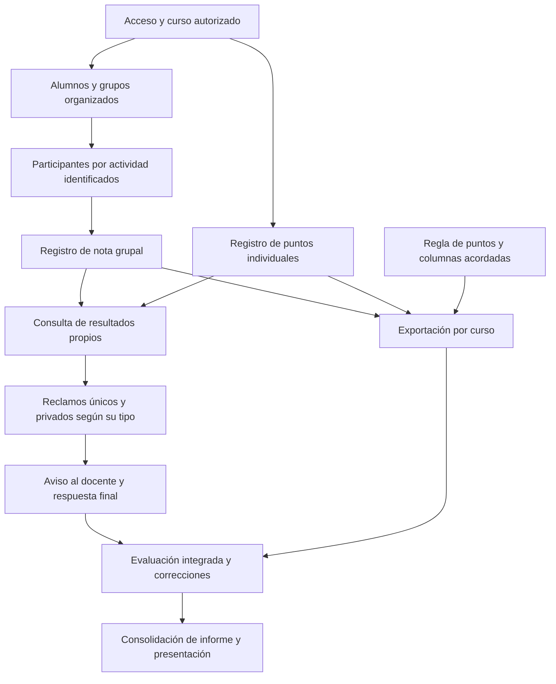

# Calendario, hitos y contingencia

> **Fuente única del calendario de ejecución.** Este documento establece periodos, puntos de control, dependencias y contingencia. Los criterios funcionales de cada hito están en [milestones](milestones.md); el [backlog provisional](backlog-y-responsabilidades.md) se reorganizará después conforme a esos hitos. No se han creado milestones ni Issues en GitHub desde estos documentos.
>
> Referencias: [caso vigente](../01-definicion/caso-evaluacion-grupal.md) · [acuerdos consolidados](../../development/PLAN-REFINAMIENTO-PARTE-I.md) · [equipo](equipo-y-flujo-de-trabajo.md) · [controles operativos](../03-calidad-y-operacion/controles-operativos.md) · [entregables del curso](../05-entregables/trabajo-final.md).

## 1. Bases del calendario

### 1.1 Acuerdos y límites

- Se dispone de **cuatro semanas para completar y evaluar el sistema**.
- **Cada semana incluye pruebas y documentación de lo avanzado**, además de una demostración del recorrido alcanzado.
- La preparación final del informe, el PowerPoint y la exposición se hará **después de las cuatro semanas**, aprovechando los registros semanales.
- La duración de esa fase posterior debe reservarse antes de la entrega real del curso. No es tiempo adicional concedido por la guía.
- No se dispone aún de fecha de inicio, fecha calendario de entrega, horas disponibles ni asignación nominal de responsables. Por eso se usan semanas relativas y no fechas inventadas.
- Las semanas 1–4 de este documento son **semanas de ejecución del proyecto**, no semanas 1–4 del ciclo académico. No se infiere su equivalencia con el calendario del curso.

La guía establece entrega de análisis, diseño y prototipo en semana 8 y de implementación, pruebas y evaluación en semana 16. Las fechas y el margen disponible entre el cierre del desarrollo y la entrega deberán comprobarse antes de fijar el inicio.

### 1.2 Calendario propuesto

| Periodo relativo | Foco | Punto de control al cierre | Registro documental |
| --- | --- | --- | --- |
| **Semana 1** | Curso, acceso, padrón, grupos y participación por actividad | **M1:** un curso preparado y destinatarios de evaluación identificados | Capacidades existentes verificadas, cambios, pruebas, decisiones y bloqueos |
| **Semana 2** | Registro de notas y puntos y consulta de resultados propios | **M2:** docente registra y alumno consulta, con atribución histórica y privacidad | Recorridos, correcciones, pruebas de acceso y pendientes |
| **Semana 3** | Reclamos, aviso por correo y exportación del curso | **M3:** seguimiento y XLSX integrados | Estados, destinatarios, pruebas de aviso y cálculo, errores y supuestos |
| **Semana 4** | Integración, evaluación y correcciones prioritarias | **M4:** sistema evaluado y cierre del desarrollo | Evidencia de recorridos completos, indicadores, limitaciones y pendientes finales |
| **Después de M4 — duración por acordar** | Consolidación del informe, PowerPoint y preparación de exposición | **Entrega preparada**, dentro del plazo del curso | Informe y presentación derivados de los avances y resultados documentados |

M3 reúne dos recorridos que pueden prepararse en paralelo: reclamos y exportación. Su concentración en una semana es un riesgo de capacidad, no una estimación de esfuerzo comprobada. Las pruebas de cada función empiezan en la semana en que se desarrolla; M4 no es la primera oportunidad de probar.

### 1.3 Datos que faltan para convertirlo en fechas

| Dato | Decisión requerida |
| --- | --- |
| Inicio | Día desde el que se cuentan las cuatro semanas |
| Entrega del curso | Fecha calendario confirmada del informe y exposición |
| Preparación posterior | Días disponibles y necesarios para maquetación, diapositivas, demostración y ensayo |
| Capacidad del equipo | Integrantes, horas disponibles, responsabilidades y revisión cruzada |
| Margen de contingencia | Holgura real, si existe; no se presuponen semanas libres del ciclo |

Si la fecha de entrega no permite cuatro semanas más preparación, se debe revisar el inicio o el plan con el equipo. No se resolverá omitiendo la documentación semanal ni declarando avances no comprobados.

## 2. Hitos y puntos de control

| Hito | Qué debe poder demostrarse | Condición principal de cierre |
| --- | --- | --- |
| **M1. Curso y participantes preparados** | Incorporar alumnos y organizar grupos con ventana/cupo, identificando participantes de actividades | La relación de una actividad con sus participantes se conserva aunque cambie el grupo actual |
| **M2. Registro y consulta** | Registrar y corregir notas y puntos; consultar resultados propios inmediatamente | Permisos correctos, nota pendiente distinta de cero y ausencia de exposición ajena |
| **M3. Seguimiento y exportación** | Presentar un reclamo, seguir su atención y obtener el XLSX del curso | Privacidad y unicidad, respuesta final docente, aviso por correo y cálculo conforme a reglas, sin alterar registros base |
| **M4. Evaluación y cierre** | Completar los recorridos con datos sintéticos y presentar sus resultados observados | No quedan fallos que impidan el recorrido esencial o expongan información ajena; las limitaciones restantes están documentadas |

El detalle de aceptación se mantiene en [milestones](milestones.md). Un hito incompleto se registra como tal y se revisa su impacto; el calendario no lo convierte en completado por llegar a la fecha.

### Control semanal

Al cerrar cada semana, el equipo debe revisar:

1. Qué recorrido se demuestra y qué resultado se esperaba.
2. Qué pruebas se ejecutaron y cuáles fallaron o no se pudieron ejecutar.
3. Qué decisiones, cambios y evidencias se documentaron.
4. Qué bloqueos afectan al siguiente hito y qué acción se acuerda.
5. Quién asume cada pendiente y quién revisará su cierre.

No se establece una metodología Scrum ni sprints quincenales por analogía con otro proyecto. Estos son puntos de control semanales; el equipo puede organizarlos dentro de su forma de trabajo.

## 3. Recorrido mínimo y dependencias críticas

### 3.1 Recorrido que debe integrar el sistema

**Curso autorizado → participantes de la actividad → registro de nota por grupo → consulta del resultado propio → reclamo → revisión y respuesta docente.**

La exportación utiliza esas notas históricamente correspondientes y los puntos individuales para obtener el resultado del curso. No recibe trabajos ni evalúa automáticamente su contenido. El docente define las calificaciones y decide la resolución de reclamos.

### 3.2 Cadena de dependencias funcionales

Esta es una cadena de dependencias candidata para planificar, no una ruta crítica calculada: aún faltan estimaciones y asignación de capacidad. La documentación y las pruebas acompañan todos los nodos.

### 3.3 Bloqueos previstos y prevención

| Dependencia o riesgo | Efecto posible | Acción preventiva y alternativa |
| --- | --- | --- |
| Participantes históricos antes de consulta, reclamos y XLSX | Atribuir resultados al grupo actual equivocado | Priorizar la regla en M1 y comprobarla en M2; si no puede establecerse una pertenencia, dejarla en revisión, no inventarla |
| Capacidad real de funciones heredadas | Subestimar correcciones o rehacer innecesariamente | Verificar lo existente al inicio y conservar lo que cumpla; revisar la carga restante antes de cerrar M1 |
| Reglas pendientes de puntos y archivo | Cálculo o formato inconsistente al integrar M3 | Cerrar la definición durante M1–M2; mantener explícito el supuesto del equipo y no improvisar reglas de saldo negativo |
| Dos recorridos concentrados en M3 | Reclamos o exportación llegan sin tiempo de integración | Preparar diseño, casos y configuración de ambos en paralelo desde M1–M2, con responsables por asignar |
| Configuración del correo | Avisos no entregados o exposición de información | Preparar acceso a un entorno autorizado antes de M3; verificar aviso sin contenido académico. Si falla, el caso permanece en la plataforma y se documenta el fallo |
| Fallos de privacidad o duplicados | Resultados ajenos visibles o solicitudes repetidas | Probar con distintos actores y envíos repetidos en cada recorrido, no solo al cierre |
| Preparación de entrega sin duración reservada | Sistema terminado pero informe o exposición incompletos | Fijar la fase posterior al convertir el calendario a fechas; usar los documentos semanales como insumo |

## 4. Documentación y evidencia por semana

No se crean documentos vacíos solo por cumplir un hito. Cada actualización debe reflejar avances o decisiones reales.

| Material | Qué se actualiza semanalmente | Ubicación |
| --- | --- | --- |
| Estado del trabajo | Avance, impedimentos, responsable y siguiente acción | [Backlog](backlog-y-responsabilidades.md) y, cuando se cree, su seguimiento en GitHub |
| Alcance y reglas | Decisiones nuevas, correcciones y supuestos vigentes | [Caso](../01-definicion/caso-evaluacion-grupal.md) y [glosario](../01-definicion/glosario.md) |
| Funcionamiento y diseño | Cambios necesarios para explicar lo construido y sus límites | [Diseño](../02-diseno/modelo-datos.md) y [estado actual](../03-calidad-y-operacion/estado-actual.md) |
| Pruebas y resultados | Fecha, versión, escenario, esperado, observado, discrepancias y evidencia sintética | [Registro de evaluación](../automatizaciones/gestion-evaluacion-grupal/evaluacion.md) |
| Insumos académicos | Proceso, prototipo y explicación del avance, consistentes con los resultados disponibles | [Material académico](../../development/README.md) y [entregables](../05-entregables/trabajo-final.md) |

El tiempo de registro se podrá contrastar con un procedimiento manual simulado equivalente. No existe una línea base histórica aportada por el docente. La consulta y los reclamos se evalúan contra criterios funcionales, sin inventar una tasa de mejora anterior.

## 5. Plan de contingencia propuesto

### 5.1 Cuándo activarlo

Se revisa el plan si un hito termina sin su recorrido esencial, si un bloqueo impide iniciar el siguiente, si los fallos pendientes amenazan M4 o si no cabe la preparación posterior antes de la entrega. No se fijan porcentajes de atraso sin estimaciones reales.

El equipo registra el bloqueo, el impacto, la acción y la persona responsable. Un cambio de alcance requiere acuerdo explícito del responsable del proyecto; esta sección no autoriza recortes automáticos.

### 5.2 Orden de actuación

| Orden | Medida propuesta | Qué preserva |
| --- | --- | --- |
| 1 | Detener mejoras no comprometidas: filtros avanzados, resúmenes visuales o pulido cosmético adicional, si se estaban considerando | Los recorridos funcionales, la legibilidad y la accesibilidad básica |
| 2 | Simplificar representación y presentación: pantallas esenciales y una salida XLSX clara, sin variantes o desgloses opcionales | Datos acordados, cálculo correcto, privacidad y uso docente |
| 3 | Reorganizar responsables y trabajo paralelo entre reclamos y exportación; mantener revisión distinta de la autoría | Criterios de aceptación y calidad, sin suponer capacidad adicional inexistente |
| 4 | Revisar fechas internas y usar solo la holgura que realmente se haya reservado | M4 para evaluación y correcciones, y preparación posterior de entrega |
| 5 | Si aún no cabe, proponer un cambio de alcance o plazo al responsable y documentar qué quedará pendiente | Transparencia sobre el producto y la evidencia; ninguna función acordada se declara terminada sin comprobarla |

### 5.3 Lo que no se elimina para ganar tiempo

Sin un nuevo acuerdo no se retiran funciones ya comprometidas como el aviso por correo, los reclamos o la exportación. Tampoco se suprimen:

- Acceso restringido a cursos y resultados correspondientes.
- Participación histórica para notas, consultas y reclamos.
- Privacidad y unicidad de los reclamos, con decisión final docente.
- Diferencia entre cero y pendiente; límites de notas y cálculo de puntos sin consumo.
- Pruebas de los recorridos esenciales, documentación semanal y registro honesto de limitaciones.

No se oculta un fallo del correo diciendo que se entregó; no se sustituye un resultado pendiente por cero para completar un promedio; no se concede acceso a notas ajenas como atajo. La regla de puntos continúa identificada como supuesto del equipo.

### 5.4 Contingencia de demostración

Preparar antes del cierre de M4 un conjunto sintético y un recorrido reproducible. Si un servicio externo impide la demostración, mostrar únicamente evidencia obtenida previamente e identificar qué no pudo ejecutarse en vivo. Una captura o simulación no se presenta como prueba de entrega de correo ni funcionamiento remoto. La forma concreta de demostración debe acordarse al preparar la exposición.

## 6. Relación con las entregas del curso

| Entrega de la guía | Material que debe existir | Relación con este calendario |
| --- | --- | --- |
| Semana 8: análisis, diseño y prototipo | Informe y PowerPoint del avance | El material académico describe el proyecto completo y el avance disponible; no se convierte en un objetivo distinto |
| Semana 16: implementación, pruebas y evaluación | Informe y PowerPoint final | Las cuatro semanas deben concluir con evidencia del sistema; luego se consolidan los entregables antes de la fecha oficial |

No se trasladan fechas, fases, tecnologías, número de Issues, versiones o exigencias del documento usado como referencia. El plazo aplicable es el de este curso y debe confirmarse al calendarizar.

## 7. Pasos para cerrar la planificación

1. Confirmar inicio, fecha de entrega y duración reservada para informe y presentación.
2. Revisar y aprobar la distribución M1–M4 según disponibilidad del equipo.
3. Reorganizar el backlog por esos hitos, estimar el trabajo restante y asignar responsables y revisores.
4. Preparar desde M1 los escenarios y requisitos externos de M3, sin posponer las pruebas.
5. Aplicar el control y la documentación semanales; registrar cualquier cambio de calendario aquí.

Las especificaciones históricas pueden consultarse como antecedente. Actualizarlas no constituye una dependencia obligatoria para ejecutar este calendario: las referencias del alcance vigente son los acuerdos y el caso documentado.
