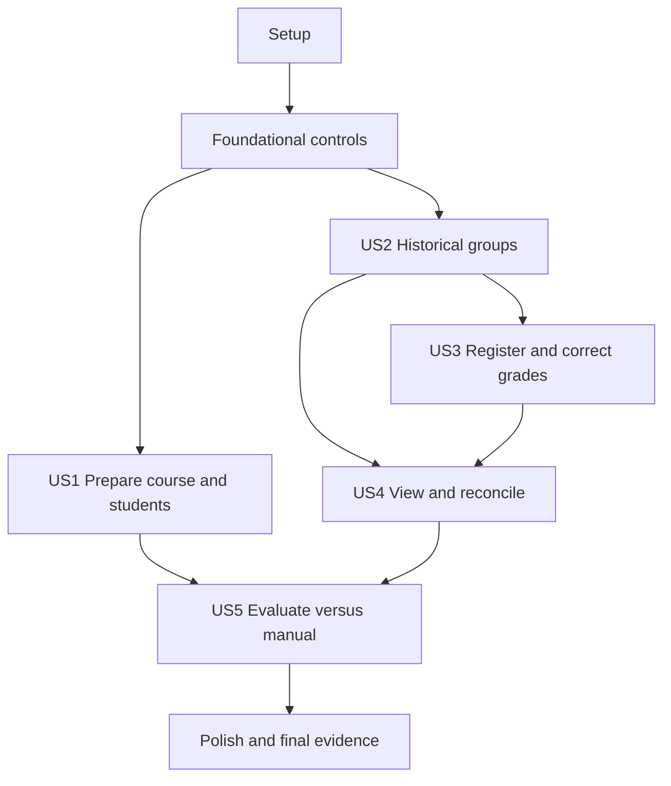

# Tasks: Gestión integral de evaluación grupal

**Input**: Design documents from `/specs/001-manage-group-evaluation/`

**Prerequisites**: `plan.md`, `spec.md`, `research.md`, `data-model.md`, `contracts/`, `quickstart.md`

**Tests**: Required by the specification and constitution. Write each listed test before the behavior it protects, verify that new regression tests fail for the expected reason, then implement the corresponding behavior.

**Existing capability rule**: A capability already present in code is not reimplemented automatically. Its task starts by verifying it against the acceptance criteria in an isolated environment. If it passes, preserve the evidence and close the task without a behavioral rewrite; if it fails, make only the smallest scoped correction and rerun the test.

**Evidence rule**: Every completed story records date, PR/version, isolated environment, synthetic fixture set, expected result, observed result and safe evidence references. Existing code or documentation alone is not completion evidence.

## Format: `[ID] [P?] [Story] Description`

- **[P]**: Can run in parallel because it targets different files and does not depend on an incomplete task.
- **[Story]**: User story from `spec.md`.
- All paths are relative to repository root.

## Phase 1: Setup — Verification and evidence foundation

**Purpose**: Establish repeatable tests and an evidence structure before changing behavior.

- [x] T001 Record the pre-implementation capability inventory as `verified`, `present-unverified`, `missing`, or `out-of-scope` for FR-001–FR-039 in `docs/automatizaciones/gestion-evaluacion-grupal/evaluacion.md`, citing concrete code/test evidence without claiming unexecuted controls
- [x] T002 Add test scripts and only the justified TypeScript/browser test dependencies from `plan.md` to `portfolio-coursse/package.json` and update `portfolio-coursse/pnpm-lock.yaml`
- [x] T003 [P] Create deterministic synthetic academic fixtures for two teachers, two courses, authorized/unauthorized students, groups and points in `portfolio-coursse/supabase/tests/fixtures/group_evaluation_fixtures.sql`, with no real personal data or secrets
- [x] T004 [P] Create shared browser-test configuration that refuses non-local Supabase targets in `portfolio-coursse/playwright.config.ts` and `portfolio-coursse/tests/e2e/support/environment.ts`
- [x] T005 [P] Create the TypeScript test configuration and common synthetic builders in `portfolio-coursse/vitest.config.ts` and `portfolio-coursse/tests/support/academic-builders.ts`
- [x] T006 Add lint, type-check, build, TypeScript-test, browser-test and local database-test commands plus evidence capture instructions to `portfolio-coursse/README.md`

**Checkpoint**: The team can run tests and collect evidence without touching production.

---

## Phase 2: Foundational — Trusted mutations, idempotency and safe signals

**Purpose**: Add shared primitives required by membership, grade and reconciliation stories.

**⚠️ CRITICAL**: Complete this phase before implementing story-specific mutations.

- [ ] T007 Add a failing SQL contract test for operation ownership, replay with the same fingerprint, rejection of UUID reuse with a different fingerprint, and statuses `pending`, `success`, `rejected`, `failed` in `portfolio-coursse/supabase/tests/academic_operations.sql`
- [ ] T008 Create the `academic_operations` ledger in `portfolio-coursse/supabase/migrations/0030_academic_operations.sql` with globally unique operation UUID, actor, nullable course, operation kind, payload fingerprint, safe result/error code, created/completed timestamps, and no personal data or grade values
- [ ] T009 Implement shared idempotency helpers and restricted RLS/grants for trusted operations in `portfolio-coursse/supabase/migrations/0031_academic_operation_helpers.sql`, returning a stable prior result for same actor/kind/fingerprint and rejecting mismatched reuse
- [ ] T010 [P] Define the typed `OperationResult<T>` statuses `success`, `rejected`, `failed`, `uncertain` and the contract error vocabulary in `portfolio-coursse/lib/academic/operation-result.ts`
- [ ] T011 [P] Implement privacy-safe structured server signals containing operation ID, non-personal course/evaluation references, event type, outcome, error category and timestamp—but no names, emails, secrets or grades—in `portfolio-coursse/lib/academic/operation-signal.ts`
- [ ] T012 Integrate operation result mapping and correlation into the shared server-side academic authorization boundary in `portfolio-coursse/lib/academic/authorize-current-user.ts` without weakening existing Google authentication or course authorization
- [ ] T013 Add SQL tests proving anonymous denial, student grade denial, teacher course isolation and same-course write enforcement to `portfolio-coursse/supabase/tests/group_evaluation_authorization.sql`, retaining the verified assertions from `portfolio-coursse/supabase/tests/group_grades_rls.sql`
- [ ] T014 Run local database reset and foundational SQL tests, then record actual command, date, environment and outcomes under the foundational evidence section in `docs/automatizaciones/gestion-evaluacion-grupal/evaluacion.md`

**Checkpoint**: Shared idempotency, error and evidence contracts are executable; server and RLS authorization have reproducible baseline evidence.

---

## Phase 3: User Story 1 — Preparar curso y alumnado (Priority: P1) 🎯 First MVP increment

**Goal**: Verify and, only where necessary, complete period/course preparation, idempotent student import, authorization and enrollment linkage.

**Independent Test**: With synthetic data, create or select a teacher-owned course, import valid/invalid/duplicate/existing rows twice, link one matching student, reject an unauthorized student and reject cross-course teacher access without duplicate authorizations or enrollments.

### Tests for User Story 1

- [ ] T015 [P] [US1] Add failing-or-baseline SQL tests for unique course/student enrollment, authorization/course consistency, equivalent import replay and teacher isolation in `portfolio-coursse/supabase/tests/course_preparation_and_import.sql`
- [ ] T016 [P] [US1] Add parsing tests for valid, malformed, duplicate and existing CSV/XLSX rows and per-row statuses `valid`, `invalid`, `duplicate`, `existing` in `portfolio-coursse/tests/unit/student-import.test.ts`
- [ ] T017 [P] [US1] Add a browser test for teacher import summary, authorized student linkage and unauthorized-student rejection in `portfolio-coursse/tests/e2e/course-preparation.spec.ts`

### Implementation and verification for User Story 1

- [ ] T018 [US1] Audit period and course ownership behavior in `portfolio-coursse/app/teacher/periods/actions.ts` and `portfolio-coursse/app/teacher/courses/actions.ts`; preserve passing behavior or minimally correct only failures demonstrated by T015/T017
- [ ] T019 [US1] Extract deterministic import validation and normalized row-status mapping from existing forms into `portfolio-coursse/lib/teacher/student-import.ts`, ensuring equivalent rows cannot create duplicate authorizations or enrollments
- [ ] T020 [US1] Route import confirmation through an operation ID and return inserted, updated, unchanged and rejected counts from `portfolio-coursse/app/teacher/students/actions.ts`, preserving existing import behavior that passes T015/T016
- [ ] T021 [US1] Update `portfolio-coursse/components/teacher/students/course-student-import-form.tsx` and `portfolio-coursse/components/teacher/students/student-list.tsx` to display per-row validation and final counts without exposing unnecessary personal data in evidence
- [ ] T022 [US1] Verify and minimally correct account-to-authorization synchronization in `portfolio-coursse/lib/academic/authorize-current-user.ts` and `portfolio-coursse/lib/student/get-dashboard.ts` so only a matching active authorization links one course/student enrollment
- [ ] T023 [US1] Run T015–T017 and record the preparation/import evidence, including which capabilities were already working versus changed, in `docs/automatizaciones/gestion-evaluacion-grupal/evaluacion.md`

**Checkpoint**: Course preparation and student incorporation are independently demonstrable and documented without unnecessary rewrites.

---

## Phase 4: User Story 2 — Organizar grupos con historia (Priority: P1)

**Goal**: Preserve effective-time group membership across student selection and teacher transfers, including capacity, closed-window and same-day cases.

**Independent Test**: Select a group inside the window, reject selection outside it, race for the final slot, transfer a student at a known instant and prove old/new activities resolve to non-overlapping historical memberships.

### Tests for User Story 2

- [ ] T024 [P] [US2] Add failing SQL tests for half-open membership intervals where `effective_from` is inclusive, `effective_to` is exclusive, `effective_to > effective_from`, intervals never overlap and at most one interval is open in `portfolio-coursse/supabase/tests/group_membership_history.sql`
- [ ] T025 [P] [US2] Add failing SQL tests for student ownership, same-course group, open window, concurrency-safe capacity, operation replay and teacher transfer in `portfolio-coursse/supabase/tests/group_membership_operations.sql`
- [ ] T026 [P] [US2] Add a browser test for student selection states and teacher transfer feedback in `portfolio-coursse/tests/e2e/group-membership.spec.ts`

### Implementation for User Story 2

- [ ] T027 [US2] Create `course_student_group_memberships` in `portfolio-coursse/supabase/migrations/0032_group_membership_history.sql` with enrollment/course/group, inclusive `effective_from`, exclusive nullable `effective_to`, change kind, actor, operation ID and constraints for same-course consistency, no overlap and one open interval
- [ ] T028 [US2] Add a conservative current-membership backfill and explicit unresolved-history marker in `portfolio-coursse/supabase/migrations/0033_backfill_current_group_memberships.sql`, never inferring earlier groups or unsupported effective instants
- [ ] T029 [US2] Replace direct current-group writes with transactional `select_course_group`, `transfer_course_student_group` and `resolve_enrollment_group_at` behavior in `portfolio-coursse/supabase/migrations/0034_group_membership_operations.sql`, atomically closing the prior interval and opening the next
- [ ] T030 [US2] Update authorization/enrollment synchronization in a new migration `portfolio-coursse/supabase/migrations/0035_history_aware_enrollment_sync.sql` so login/import synchronization cannot change `course_students.group_id` without preserving membership history
- [ ] T031 [US2] Add the teacher transfer action with explicit effective timestamp and stable domain errors in `portfolio-coursse/app/teacher/courses/group-actions.ts`
- [ ] T032 [US2] Update student selection to generate/reuse one operation ID and distinguish closed window, full group, membership conflict and uncertain result in `portfolio-coursse/app/student/actions.ts`
- [ ] T033 [P] [US2] Add teacher transfer and historical-membership presentation to `portfolio-coursse/components/teacher/groups/group-members-dialog.tsx`
- [ ] T034 [P] [US2] Update selection progress, duplicate-submit prevention and accessible errors in `portfolio-coursse/components/student-portal/group-selection.tsx`
- [ ] T035 [US2] Run T024–T026, including the same-day explicit-offset case, and record historical membership/capacity evidence in `docs/automatizaciones/gestion-evaluacion-grupal/evaluacion.md`

**Checkpoint**: Group changes preserve a deterministic history and current behavior remains usable.

---

## Phase 5: User Story 3 — Registrar y corregir notas grupales (Priority: P1) 🎯 Core automation MVP

**Goal**: Define dated evaluations and save/correct one same-course grade per group with range validation, idempotent retry, audit history and historical participant attribution.

**Independent Test**: Create a dated evaluation, accept 0 and 20, reject invalid/cross-course values, retry after a lost confirmation without duplication and correct an old-group grade after a transfer while retaining old/new values and original participants.

### Tests for User Story 3

- [ ] T036 [P] [US3] Add failing SQL tests for required timezone-aware activity instant, unique name within course and reviewed timestamp changes that affect attribution in `portfolio-coursse/supabase/tests/course_evaluation_activity_time.sql`
- [ ] T037 [P] [US3] Add failing SQL tests for grade range `[0, 20]`, unique group/evaluation pair, database-enforced same-course relationship, idempotent replay and cross-course rejection in `portfolio-coursse/supabase/tests/group_grade_operations.sql`
- [ ] T038 [P] [US3] Add failing SQL tests proving correction rows are append-only, retain previous/new grade and feedback, responsible teacher, operation and timestamp, and use historical participants in `portfolio-coursse/supabase/tests/group_grade_corrections.sql`
- [ ] T039 [P] [US3] Add server-action tests for `success`, `rejected`, `failed`, `uncertain`, safe retry and actionable error mapping in `portfolio-coursse/tests/unit/group-grade-actions.test.ts`
- [ ] T040 [P] [US3] Add a browser test for evaluation creation, range errors, save, uncertain-result retry and visible correction result in `portfolio-coursse/tests/e2e/group-grades.spec.ts`

### Implementation for User Story 3

- [ ] T041 [US3] Extend `course_evaluations` with timezone-aware `occurred_at` and lifecycle state `defined`, `partial`, `conciled` in `portfolio-coursse/supabase/migrations/0036_evaluation_activity_time.sql`, requiring review rather than fabricating timestamps for legacy evaluations
- [ ] T042 [US3] Implement read-only impact preview and token-bound confirmation for evaluation time changes in `portfolio-coursse/supabase/migrations/0037_evaluation_time_change_review.sql`, rejecting stale or mismatched review tokens
- [ ] T043 [US3] Add database-level same-course grade integrity and preserve the unique group/evaluation pair and numeric `[0, 20]` constraint in `portfolio-coursse/supabase/migrations/0038_group_grade_integrity.sql`
- [ ] T044 [US3] Create immutable `group_grade_corrections` with previous/new grade, previous/new feedback, teacher, operation and timestamp in `portfolio-coursse/supabase/migrations/0039_group_grade_corrections.sql`
- [ ] T045 [US3] Implement transactional `save_group_grade` with ownership, same-course validation, idempotent create/unchanged/corrected outcomes and historical participant count in `portfolio-coursse/supabase/migrations/0040_save_group_grade.sql`
- [ ] T046 [US3] Refactor evaluation creation/date-change and grade save actions to use the contracts in `portfolio-coursse/app/teacher/grades/actions.ts`, removing direct grade upsert and returning stable operation outcomes
- [ ] T047 [US3] Update evaluation management to require/display activity instant and show affected-attribution review before confirmation in `portfolio-coursse/components/teacher/grades/evaluation-manager-dialog.tsx`
- [ ] T048 [US3] Update the grade matrix for pending/saving/success/rejected/failed/uncertain states, duplicate-submit prevention and correction indication in `portfolio-coursse/components/teacher/grades/group-grades-table.tsx`
- [ ] T049 [US3] Update the teacher grade query/read model for activity time, historical participant counts and correction summaries in `portfolio-coursse/app/teacher/grades/page.tsx` and `portfolio-coursse/lib/teacher/group-evaluations.ts`
- [ ] T050 [US3] Run T036–T040, provoke one lost-confirmation retry and one cross-course attack, then record grade/correction evidence and existing-versus-new behavior in `docs/automatizaciones/gestion-evaluacion-grupal/evaluacion.md`

**Checkpoint**: The core automation can be demonstrated end to end with historical correctness, retry safety and correction traceability.

---

## Phase 6: User Story 4 — Consultar y conciliar resultados (Priority: P2)

**Goal**: Give the teacher a complete/missing/exception view and preserve student access only to own course, current group and points.

**Independent Test**: Prepare graded, missing and transferred groups; prevent reconciliation with unexplained missing groups; reconcile after grading or explicit group-level exception; prove students cannot read grades.

### Tests for User Story 4

- [ ] T051 [P] [US4] Add failing SQL tests for non-negative reconciliation counts, explained expected total, `missing_group_count = 0` for `conciled`, and staleness after relevant grade/membership/time changes in `portfolio-coursse/supabase/tests/evaluation_reconciliation.sql`
- [ ] T052 [P] [US4] Extend student-access SQL tests to prove students can read only own active enrollment/current group/non-voided points and cannot read evaluations' grades or corrections in `portfolio-coursse/supabase/tests/student_academic_visibility.sql`
- [ ] T053 [P] [US4] Add browser tests for teacher reconciliation and the student course/group/points-only view in `portfolio-coursse/tests/e2e/evaluation-reconciliation.spec.ts` and `portfolio-coursse/tests/e2e/student-visibility.spec.ts`

### Implementation for User Story 4

- [ ] T054 [US4] Create `evaluation_exceptions` and append-only `evaluation_reconciliations` in `portfolio-coursse/supabase/migrations/0041_evaluation_reconciliation.sql`, ensuring exceptions are group-level, never replace a grade and never implement individual overrides
- [ ] T055 [US4] Implement `reconcile_group_evaluation` and reconciliation invalidation on relevant changes in `portfolio-coursse/supabase/migrations/0042_reconcile_group_evaluation.sql`
- [ ] T056 [US4] Add the teacher reconciliation query/action and stable counts for expected, graded, missing and exception groups in `portfolio-coursse/app/teacher/grades/actions.ts` and `portfolio-coursse/lib/teacher/group-evaluations.ts`
- [ ] T057 [US4] Add accessible filtering and reconciliation status/confirmation UI to `portfolio-coursse/components/teacher/grades/group-grades-table.tsx`
- [ ] T058 [US4] Audit and minimally correct `portfolio-coursse/lib/student/get-dashboard.ts` and `portfolio-coursse/components/student-portal/student-dashboard.tsx` so they expose only authorized course, current group and non-voided point movements/balance, never group grades or correction history
- [ ] T059 [US4] Run T051–T053 and record reconciliation totals, student denial evidence and the explicit absence of individual grade correction in `docs/automatizaciones/gestion-evaluacion-grupal/evaluacion.md`

**Checkpoint**: A teacher can close an evaluation only with complete or explicitly exceptional group coverage, while student visibility remains restricted.

---

## Phase 7: User Story 5 — Evaluar frente al proceso manual (Priority: P2)

**Goal**: Produce reproducible, privacy-safe evidence comparing the completed platform workflow with the prior manual process without inventing results.

**Independent Test**: Execute the same synthetic activity and group volume at least three times manually and three times in the platform, then calculate every specified indicator from recorded raw observations.

### Validation and evidence for User Story 5

- [ ] T060 [P] [US5] Define the fixed synthetic comparison dataset, group volume, institutional timezone and invalid/exception case matrix in `docs/automatizaciones/gestion-evaluacion-grupal/protocolo.md`
- [ ] T061 [P] [US5] Add an evidence schema/template for date, PR/version, environment, fixture version, expected/observed result, operation IDs, safe signal references and limitations in `docs/automatizaciones/gestion-evaluacion-grupal/evidencia/README.md`
- [ ] T062 [US5] Execute and record at least three manual XLSX/group/point runs using the fixed dataset in `docs/automatizaciones/gestion-evaluacion-grupal/evidencia/linea-base-manual.md`
- [ ] T063 [US5] Execute and record at least three platform runs plus planned invalid, failure, retry and duplicate cases in `docs/automatizaciones/gestion-evaluacion-grupal/evidencia/ejecuciones-plataforma.md`
- [ ] T064 [US5] Calculate median total time, completeness, correction/duplicate rate, reconciliation time, retry-without-duplication rate and exception-detection rate from raw evidence in `docs/automatizaciones/gestion-evaluacion-grupal/evaluacion.md`
- [ ] T065 [US5] Compare measured results against SC-001–SC-012, label the 50% time reduction as met/not met rather than assumed, and document limitations and pending controls in `docs/automatizaciones/gestion-evaluacion-grupal/evaluacion.md`

**Checkpoint**: The final document can cite reproducible observations and clearly separates targets, implementation and measured results.

---

## Phase 8: Polish and cross-cutting validation

**Purpose**: Complete security, accessibility, performance, recovery, maintainability and final-document readiness across all stories.

- [ ] T066 [P] Add keyboard, focus, accessible-name and non-color status assertions for all Must browser flows in `portfolio-coursse/tests/e2e/accessibility.spec.ts`
- [ ] T067 [P] Add a local performance sample for the agreed synthetic volume and visible two-second confirmation target in `portfolio-coursse/tests/e2e/performance.spec.ts`, reporting observations rather than claiming production capacity
- [ ] T068 [P] Review all new server signals and evidence outputs for zero names, emails, secrets and grade values in `portfolio-coursse/tests/unit/operation-signal.test.ts`
- [ ] T069 Run `pnpm lint`, `pnpm exec tsc --noEmit`, `pnpm test`, `supabase test db`, `pnpm test:e2e` and `pnpm build` from `portfolio-coursse/`, recording exact passes/failures without fixing unrelated defects in `docs/automatizaciones/gestion-evaluacion-grupal/evaluacion.md`
- [ ] T070 Execute every applicable scenario in `specs/001-manage-group-evaluation/quickstart.md` in an isolated environment and annotate observed results in `docs/automatizaciones/gestion-evaluacion-grupal/evaluacion.md`
- [ ] T071 Reconcile FR-001–FR-039, NFR-001–NFR-010 and SC-001–SC-012 against executed evidence, marking each `verified`, `evaluated`, `failed`, `pending`, or `out-of-scope` in `docs/automatizaciones/gestion-evaluacion-grupal/evaluacion.md`
- [ ] T072 [P] Update `docs/01-definicion/caso-evaluacion-grupal.md`, `docs/02-diseno/modelo-datos.md` and `docs/03-calidad-y-operacion/estado-actual.md` to link the final evidence and distinguish implemented behavior from remaining proposals
- [ ] T073 Prepare the Parte II report/presentation input summary—problem, process, controls, architecture rationale, tests, metrics, results, limitations, conclusions and recommendations—in `docs/05-entregables/trabajo-final.md`, deriving every result from the evaluation record
- [ ] T074 Perform a final privacy and scope review proving no real personal data/secrets are committed and no export, notification, individual grade override, new grade type, backup automation or general LMS capability was introduced; record the review in `docs/automatizaciones/gestion-evaluacion-grupal/evaluacion.md`

---

## Dependencies and execution order

### Phase dependencies

- **Phase 1 — Setup**: no dependency; start immediately.
- **Phase 2 — Foundational**: depends on Phase 1 and blocks trusted story mutations.
- **US1 — Preparation/import**: depends on Phase 2; can be delivered as the first independently demonstrated increment.
- **US2 — Group history**: depends on Phase 2; its history contract is required by US3 historical attribution.
- **US3 — Group grades**: depends on Phase 2 and the US2 membership resolution contract.
- **US4 — Reconciliation/views**: depends on US2 and US3 read models and mutations.
- **US5 — Evaluation**: protocol/template tasks T060–T061 may start after Phase 1; execution tasks T062–T065 depend on the desired stories and evidence being complete.
- **Phase 8 — Polish**: depends on all stories included in the Parte II delivery.

### User story dependency graph



### Existing-capability decision path

1. Run the relevant baseline test first.
2. If behavior passes, capture evidence and avoid rewriting it.
3. If behavior fails, identify the smallest root-cause correction.
4. Rerun the focused test and then the affected story suite.
5. Record whether the task verified existing behavior or introduced a change.

## Parallel opportunities

- T003–T005 can run in parallel after T002 dependency choices are agreed.
- T010 and T011 can run in parallel with the database operation-ledger work.
- Within US1, T015–T017 can be authored in parallel; T018 and T019 touch separate boundaries.
- Within US2, T024–T026 can be authored in parallel; T033 and T034 can run in parallel after action contracts stabilize.
- Within US3, T036–T040 can be authored in parallel; T047 and T049 target separate files after database contracts land.
- Within US4, T051–T053 can be authored in parallel.
- T060 and T061 can be prepared early in parallel with implementation so measurement conditions are fixed before results exist.
- T066–T068 and T072 target different files and can run in parallel after feature behavior stabilizes.

## Parallel execution examples

### User Story 1

```text
Task T015: SQL baseline for import/enrollment integrity
Task T016: Unit tests for import parsing/statuses
Task T017: Browser test for preparation and authorization
```

### User Story 2

```text
Task T024: Membership interval invariant tests
Task T025: Selection/transfer/concurrency tests
Task T026: Student/teacher browser flow
```

### User Story 3

```text
Task T036: Evaluation-time tests
Task T037: Grade integrity/idempotency tests
Task T038: Correction-history tests
Task T039: Server-action result tests
Task T040: Browser grade lifecycle test
```

### User Story 4

```text
Task T051: Reconciliation database tests
Task T052: Student visibility database tests
Task T053: Teacher/student browser flows
```

### User Story 5

```text
Task T060: Fix comparison protocol and data volume
Task T061: Create evidence schema/template
```

## Implementation strategy

### First MVP increment — verify existing preparation flow

1. Complete Setup and Foundational phases.
2. Complete US1 by testing before modifying.
3. Stop and demonstrate course preparation, mixed import, idempotent replay and authorization evidence.
4. Use the inventory to show which requirements were inherited and verified versus changed.

### Core automation MVP — recommended Parte II demonstration

1. Complete US2 historical membership.
2. Complete US3 dated evaluation, grade retry and correction history.
3. Complete US4 reconciliation and restricted student view.
4. Demonstrate one end-to-end valid flow plus cross-course rejection, failed save/retry, duplicate operation, transfer and late correction.
5. Complete US5 measurements and final evidence only after the behavior is stable.

### Five-person parallel ownership

- **Integrante 1 — Domain/preparation**: T001, US1 and requirements reconciliation.
- **Integrante 2 — Experience**: story UI/browser-flow tasks and accessibility.
- **Integrante 3 — Data/security**: foundational SQL, US2/US3 migrations and RLS.
- **Integrante 4 — Quality**: test harness, SQL/unit/E2E suites and fixtures.
- **Integrante 5 — Operation/evidence**: safe signals, protocol, measurements and final documentation.

Assignments do not create silos: each PR requires a different reviewer, and database contracts must land before dependent application PRs.

## Task completion rules

- A task is complete only when its acceptance behavior is run in an isolated environment and evidence is recorded.
- A passing existing capability should be preserved rather than rewritten for appearance of work.
- A new regression test must fail for the expected reason before implementation and pass afterward.
- Do not mark monitoring, alerts, backups, production deployment or metrics as available without direct verification.
- Do not include production secrets, real student data or destructive production commands.
- Keep PRs scoped to one observable result whenever possible and use the contracts in `specs/001-manage-group-evaluation/contracts/` as integration seams.
